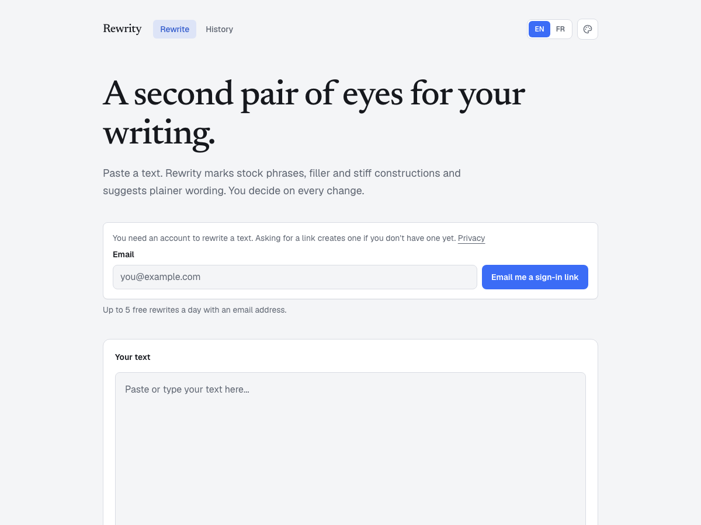
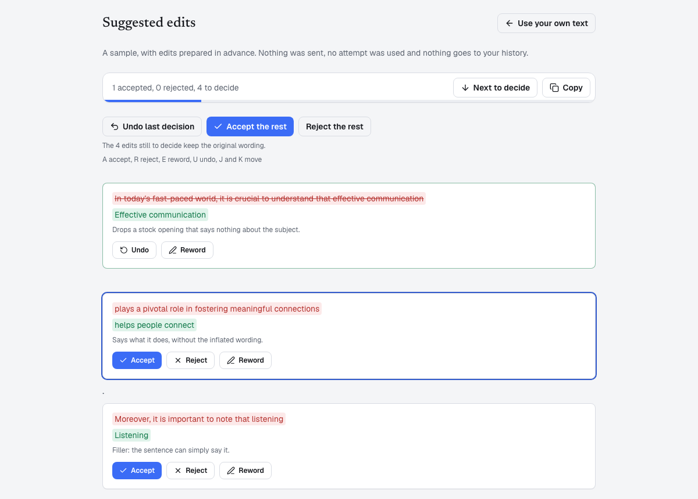
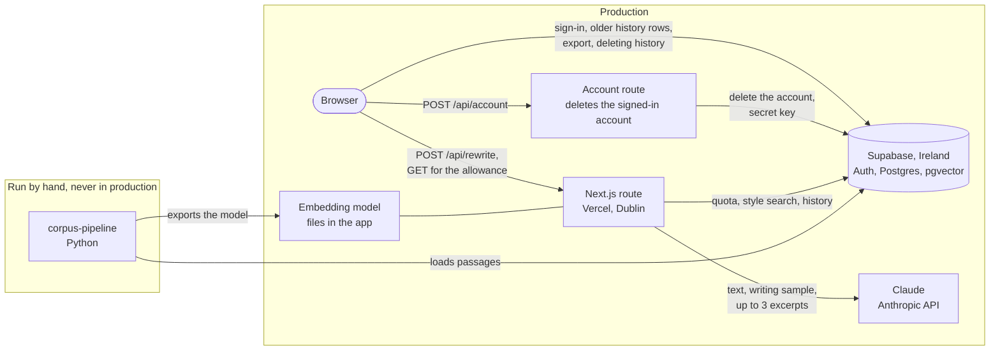

# Rewrity

A bilingual (English and French) writing editor. You paste a text of up to 5,000 characters, Claude
proposes targeted edits with a reason for each, and you accept or reject them one by one before
copying the result. It is for people who draft with AI tools, or write in a stiff register, and want
plainer wording without giving up the final say.

Demo: <https://rewrity.vercel.app> (sign-in by email link, a few attempts per day, as the line above the
editor says)





Screens from a local build. The edits in the second one are a sample written by hand, not model output.

## What it does

- Returns edits, never a rewritten text. Each edit quotes the original, proposes a replacement and
  says why.
- Lets you choose how much to change (light, standard, thorough) and paste a sample of your own
  writing, so the edits stay close to how you write. A rewrite can also be left out of your history:
  the text still goes to Anthropic and the attempt still counts.
- Says above the editor how many attempts you have left today and when they reset, or that rewriting
  is paused. That line is a hint: only the request itself decides.
- Shows edits as the model writes them. Once the first one is on screen you can stop and keep what has
  arrived.
- Reviews by mouse or keyboard (A accept, R reject, E reword, U undo, J and K move). The words that
  change are marked inside each edit, you can put your own wording before accepting, and a row at the
  top of the screen holds what is left to decide, Next to decide and Copy.
- Shows the result's length against the original. The result can be copied or downloaded, along with a
  list of the accepted edits (before, after, why). It is a list of edits and says nothing about who
  wrote a text.
- Keeps a finished review while you go back to your text, switch language or visit the history, and
  gives it back, decisions included, when the next rewrite is refused or fails before any edit.
- Offers "Try an example": a real review of a sample text, with edits written in advance, in the
  language of the page, with no account, request, attempt or history row. Leaving it empties the box.
- Has a free check, a second button in the editor. It runs a short list of stock phrases and paste
  clean-ups in the browser, on up to 50,000 characters, with no account, model, request, attempt or
  history row. It never scores a text or says who wrote it, and finding nothing says little.
- Keeps a history you can search, reopen, delete and download. You can also delete your account
  yourself, and your history goes with it. The sign-in service's own log, which names your address
  when the account is created, at each sign-in link asked for, at each sign-in and sign-out, at each
  automatic renewal of the session while you use the site and at the deletion, stays after the
  account is deleted.
- Works in English and French, in day, night or system mode.

It is an editor, not a detector. It does not tell who wrote a text and makes no promise about
passing any AI-text detector. [The research note](docs/research/detector-evaluation.md) explains how
the project moved away from detection.

## Architecture



There is one deployed app and no server to operate. The Python folder builds the corpus on a laptop;
no request ever reaches it. Every step of a request, the main tools and the reason each was chosen are in
[docs/ARCHITECTURE.md](docs/ARCHITECTURE.md).

## Run it locally

You need Node 24, Docker and the Supabase CLI.

```bash
supabase start                 # local Postgres, Auth and a mailbox, with every migration applied
supabase status -o env         # shows API_URL, PUBLISHABLE_KEY and SECRET_KEY for the next step
cd frontend
cp .env.example .env.local     # fill in the three local Supabase values, and a model as below
npm ci
npm run dev                    # http://localhost:3000
```

For the model, choose one:

- **Free and simulated.** Add `ANTHROPIC_API_KEY=not-real` and `ANTHROPIC_BASE_URL=http://127.0.0.1:4310`
  to `.env.local`, and run `npm run stand-in` in a second terminal. This is a local stand-in, not Claude:
  it shortens every other sentence to its last words, which shows the path of a request and the review, and
  says nothing about the quality of real edits. A variable already exported in your shell wins over
  `.env.local`, so unset any `ANTHROPIC_BASE_URL` or `ANTHROPIC_API_KEY` first.
- **The real model.** Set `ANTHROPIC_API_KEY` to your own key. An attempt on ordinary prose costs about
  $0.09 at most ([costs](#costs-security-privacy-and-limits)).

Sign-in emails arrive in the local mailbox at <http://127.0.0.1:54324>. The local database starts
without a corpus, so rewrites run without style excerpts until you load one
([docs/STYLE_CORPUS.md](docs/STYLE_CORPUS.md)). To see the vector index without a corpus, see
[the `EXPLAIN` example](docs/ARCHITECTURE.md#the-index-at-work).

## Tests

None of these calls the real model, and none needs a secret.

| Layer                                                | Command (from `frontend/`, unless stated)                                                                 | Needs                      |
| ---------------------------------------------------- | --------------------------------------------------------------------------------------------------------- | -------------------------- |
| Format, lint, types, unit tests                      | `npx prettier --check . && npm run lint && npm run typecheck && npm test`                                 | Nothing                    |
| Browser tests on the production build, API mocked    | `npm run e2e`                                                                                             | Chromium for Playwright    |
| Database policy: limits, races, tickets, RLS, grants | `npm run test:db`                                                                                         | `supabase start`           |
| Whole site in a real browser, stand-in for the model | `npm run audit` (writes `audit/report.md`)                                                                | `supabase start`, Chromium |
| Corpus pipeline (from `corpus-pipeline/`)            | `uv sync --group dev --locked && uv run ruff check . && uv run ruff format --check . && uv run pytest -q` | `uv`                       |

`test:db` and `audit` change limits and counters while they run and put them back afterwards. They
refuse to run against anything but a local stack. To use a stack started from another folder, set
`SUPABASE_WORKDIR` to that folder. A production build fetches its fonts from Google, so `e2e` and
`audit` need network access the first time. The audit picks its own port for the stand-in, so it can
run beside `npm run stand-in`.

GitHub Actions runs the first two rows, the corpus row, `test:db` and `npm run audit -- limits concurrency`.
Nothing measures the quality of the edits.
[A blind comparison with and without excerpts](docs/research/style-references-comparison.md) is written down
and has not been run, because it needs real model calls.

## Costs, security, privacy and limits

**Costs.** Each attempt is one call to Claude, with no automatic retry and at most 8,000 output
tokens: about $0.09 at most on ordinary prose, an estimate from the bounds in the code and today's prices,
[worked out here](docs/ARCHITECTURE.md#what-one-attempt-costs). The database allows 5 attempts per account
per UTC day, 2 at once per account, and for all accounts together 15 started attempts per day and 300 per
month. These limits cap the number of calls, not the money: the actual spending cap is the one you set in a
workspace of its own at Anthropic ([docs/DEPLOY.md](docs/DEPLOY.md#two-separate-ceilings)). Once an attempt
has started it stays counted, even if it ends in an error, a refusal or a cancelled stream.

**Security.** Nothing paid runs without a signed-in user and a ticket granted by the database. If the
quota check fails, the model is not called. The route calls the quota functions and the corpus search and
writes to the history with a secret key that never reaches a browser and the account taken from the verified
session: a user's token is refused on those functions. Row-level security limits each history to its owner,
who can read and delete it. Deleting an account goes through a second route, which uses that key for nothing
else and only on the account of the verified session.

Until `20261107000000_close_direct_access.sql` (pull request #9, on hold) is applied, signed-in users can still
call the six older quota and search functions, under the same limits, and insert rows into their own history
([the rollout](docs/DEPLOY.md#moving-a-running-site-to-server-only-operations)).

**Privacy.**

| Data                | Reaches the browser   | Stored in Supabase                                                                              | Sent to Anthropic |
| ------------------- | --------------------- | ----------------------------------------------------------------------------------------------- | ----------------- |
| Your text           | Yes                   | Yes, in your history until you delete it, unless you tick "Do not keep this text in my history" | Yes, even then    |
| Suggested edits     | Yes                   | Yes, in your history, unless you tick that box                                                  | Written by it     |
| Your writing sample | Typed there           | No                                                                                              | Yes               |
| Style excerpts      | Only author and title | Yes, as the corpus                                                                              | Up to 3 per call  |
| Email address       | Yes, your own         | Yes, by Supabase Auth                                                                           | No                |
| Attempts per day    | Your own count        | Yes, a counter, and a ticket for each one                                                       | No                |

A rewrite left out of the history adds no row, but its text still goes to Anthropic and the attempt still
counts. The example and the free check run in the browser and send nothing. Asking for a sign-in link keeps a
copy of the text, never the writing sample, in that browser until you are back in the editor or sign out, and
that copy is ignored after an hour. From the history page you can download your history and delete your account,
and the rows tied to the account go with it.

The browser only ever gets an excerpt's author and title. With `STYLE_REFERENCES=off`, no excerpt is
read or sent. Stored text is not encrypted against the project's owner, who can read it. Tickets are kept
at least two days and removed at a later accepted attempt. Supabase Auth can record an IP address and
browser each time a reader's browser calls it, to ask for a link, sign in, sign out or renew a session.
Logs carry one line per attempt, with the model, durations, the state it ended in and token counts, along
with error codes and counts of dropped edits, and never a text. Anthropic handles what it receives under
its own terms.

**Limits you should know about.**

- Nobody has measured whether the edits are good, or whether the style excerpts improve them.
- The automatic checks on an edit compare numbers, units, figures attributed to a name, denials, the
  bound next to a figure (at least, under), length and markup. They read words and figures, not
  meaning: "rose" becoming "fell", or a denial that moves within a sentence, gets through. That is why
  every edit is shown for review
  ([what they cannot see](docs/ARCHITECTURE.md#checks-on-the-models-output)).
- The ceilings protect the budget, not availability: three accounts can use up a day's allowance
  for everyone. The code creates an account for any email address; whether sign-ups are open is a
  console setting.
- Web excerpts are not proven human. Only a date cut-off and a list of sites lower that risk. Many
  are copyrighted by their publishers ([details](docs/STYLE_CORPUS.md#licences-and-credits)).
- A sign-in link works once, in the browser that asked for it.
- A review lasts as long as the tab. A reload or a closed tab loses it and any unsent text. History >
  Reopen brings a kept rewrite back with every decision pending and the model's suggestions, not your
  wordings. A rewrite left out of the history has no such way back.
- The free check is a short list. What it misses says nothing about a text. On pasted Markdown it can
  propose removing heading or bold marks. It leaves alone table padding, code between backticks on one
  line, and blocks fenced with three backticks that start a line and are closed again; an indented or
  unclosed fence is checked like prose. Lines of `#` right next to a line that starts like a command
  (in lower case from a to z, or with `$`, `.`, `/` or `~/`) are not taken for headings, but what
  follows the `#` is still checked, and a stock phrase that fills such a line can be removed with its
  `#`; any other shell comment, such as one above a blank line, can be taken for a heading.
- The history page lists the 50 most recent rewrites, Load more reaches older ones, and search covers
  the loaded rows only. The sign-in email comes from one Supabase template, so it has one language.

## Documentation

- [docs/ARCHITECTURE.md](docs/ARCHITECTURE.md): the request path, every table and function, the quota
  policy, the vector index, the tools and their trade-offs, known limits.
- [docs/DEPLOY.md](docs/DEPLOY.md): deploying and upgrading, the spending ceilings, pausing, and what is set
  in which console.
- [docs/STYLE_CORPUS.md](docs/STYLE_CORPUS.md): the corpus, its sources and their provenance, how to rebuild
  it, licences.
- [docs/research/style-references-comparison.md](docs/research/style-references-comparison.md): the protocol
  for comparing suggestions with and without excerpts, not yet run.
- [docs/research/detector-evaluation.md](docs/research/detector-evaluation.md): the detector research
  that came first, and why the project moved on.
- [THIRD_PARTY_NOTICES.md](THIRD_PARTY_NOTICES.md): the notices of the embedded model and the prompt's
  sources.

## Licence

No licence file has been added, so all rights are reserved by default. The owner has yet to decide
whether to publish the code under a licence.

The editing prompt follows the method of [blader/humanizer](https://github.com/blader/humanizer) (MIT)
and reuses some of its wording, and credits Wikipedia's "Signs of AI writing". The embedded model is under
Apache-2.0, with its licence and a notice of the changes in `frontend/data/embedder`. Both are set out in
[THIRD_PARTY_NOTICES.md](THIRD_PARTY_NOTICES.md), and credits for the corpus are in
[docs/STYLE_CORPUS.md](docs/STYLE_CORPUS.md#licences-and-credits).
