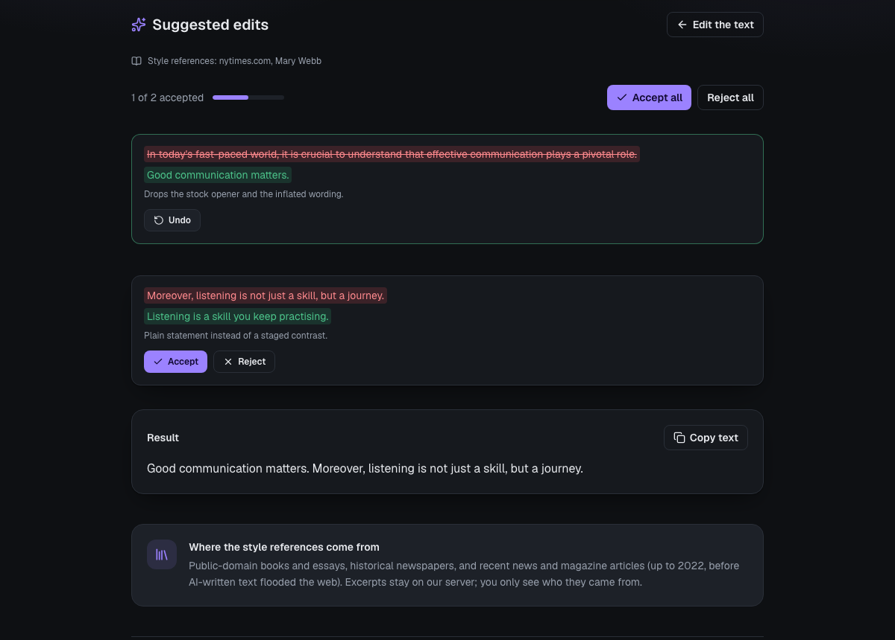
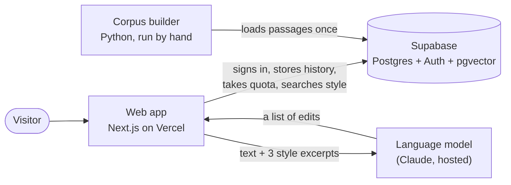

# Rewrity

A bilingual (English / French) writing editor that makes a text read like a person wrote it.
Paste a text, get a short list of targeted edits, accept or reject each one, copy the result.

Live: <https://rewrity.vercel.app>




## Contents

1. [What it is, and what it is not](#1-what-it-is-and-what-it-is-not)
2. [How a rewrite works](#2-how-a-rewrite-works)
   - [Architecture at a glance](#architecture-at-a-glance)
3. [How it was designed, step by step](#3-how-it-was-designed-step-by-step)
4. [The style corpus](#4-the-style-corpus)
5. [Backend and safety](#5-backend-and-safety)
6. [Speed](#6-speed)
7. [Testing](#7-testing)
8. [The detector research](#8-the-detector-research)
9. [Repository layout](#9-repository-layout)
10. [Run it locally](#10-run-it-locally)
11. [Deploy](#11-deploy)
12. [Limits and honest caveats](#12-limits-and-honest-caveats)
13. [Credits and licences](#13-credits-and-licences)

## 1. What it is, and what it is not

Text that sounds generated has recognisable habits: stock openers ("In today's fast-paced
world"), staged contrasts ("not just X, but Y"), lists of three applied everywhere, inflated
vocabulary, a closing line that repeats the point. Rewrity finds those habits and proposes plainer
wording, in the language of the text.

Three rules shape the whole product:

- **Edits, never a full rewrite.** The model returns a list of `{original, replacement, reason}`.
  You see each change next to its reason and decide. Your meaning and your voice stay yours.
- **Facts are protected.** A change that alters a number, adds markup or balloons in size is
  discarded by code before you see it, whatever the model said.
- **It is an editor, not a detector.** It does not claim to tell who wrote a text, and it makes no
  promise about passing any AI-text detector. Section 8 explains why, with measurements.

## 2. How a rewrite works

```
 browser                      Next.js route  POST /api/rewrite                       Supabase
 -------                      -----------------------------------                    --------
 text ---------------------> validate (size, schema, locale)
                              signed in? ------------------------------------------> Auth (JWT, checked locally)
                              +-- reserve_quota()  ------------------------------->  usage, reservations
                              +-- embed text (in process, 0.4 ms) -> match_style_passages() -> pgvector
                                  (these two run at the same time)
                              build prompt = rules + <text> + 3 style excerpts
                              Claude -> structured JSON edits
                              guard  (numbers, markup, size, count)
                              locate (find each quote, compute offsets)
 edits <---------------------  respond
                              after the response: save history, free the in-flight slot
```

1. **Auth.** A magic link (Supabase Auth). The route reads the session cookie and verifies the
   token locally against the project public key.
2. **Quota.** `reserve_quota()` takes one of the 20 daily rewrites and returns a reservation id.
   A user can also have at most 2 rewrites running at once.
3. **Style excerpts.** The text is embedded in the server process with a small static model, and
   the three closest passages from the corpus (section 4) are fetched with pgvector.
4. **Claude.** The system prompt holds the editing rules; the user message holds the text between
   `<text>` tags, which the prompt declares to be data, never instructions. The answer is
   constrained to a JSON schema.
5. **Guard and locate.** Models count characters badly, so Claude never gives offsets. The server
   finds each quoted passage itself (tolerating curly quotes and non-breaking spaces) and drops
   any it cannot find.
6. **Review.** The browser shows each edit as a before/after card. The result text updates as you
   accept or reject.

If the model fails, the reservation is released so the request is not lost. If the style search
fails, the rewrite still runs, without excerpts.

### Architecture at a glance



There is no server of our own to run: a web app, a database and one hosted model. The database
holds the access rules, the daily limit and the style search, in four small functions. The model
is a dependency, never trusted for facts. The Python side only builds the corpus and never runs in
production.

The full picture, with the request sequence, the tables, the four database functions, what the
vector database contains and why, the safety layers, and a table of every decision against the
alternative left aside, is in **[`docs/ARCHITECTURE.md`](docs/ARCHITECTURE.md)**.

## 3. How it was designed, step by step

The project began as research on detecting machine-written text (section 8). The measurements
showed that detection is a weak foundation for a product, so the goal moved to the other side of
the problem: helping people write text that does not carry those habits in the first place.

| Step | Decision                                                                    | Why                                                                                      |
| ---- | --------------------------------------------------------------------------- | ---------------------------------------------------------------------------------------- |
| 1    | Next.js on Vercel, Supabase for data                                        | One deployable unit per side, free tiers, nothing to operate                             |
| 2    | English and French from the start, UI text only in `messages/{en,fr}.json`  | Retrofitting translation later touches every component; a test enforces identical keys   |
| 3    | The model returns **edits**, not a rewritten text                           | Reviewable, reversible, and it keeps the author's voice                                  |
| 4    | Offsets are computed by the server, not the model                           | Language models miscount characters; a located quote is checked, a guessed offset is not |
| 5    | A diff review with accept / reject / undo                                   | The user is the editor; the tool only proposes                                           |
| 6    | Sign-in, history and a daily quota, all in Postgres with row-level security | A public endpoint that spends money must be closed to anonymous callers                  |
| 7    | Style excerpts retrieved by vector search and added to the prompt           | See below                                                                                |
| 8    | A guard layer between the model and the user                                | The model is trusted for wording only, never for facts                                   |
| 9    | Tests, CI, and a measured performance pass                                  | Every claim in this file is backed by a command in section 7 or 6                        |

**Why retrieval, not training.** The edits come from a hosted model whose weights do not change.
To steer it toward concrete, varied prose, the server looks up three passages of real published
writing close in meaning to the user's text and puts them in the prompt as a reference for
rhythm. The model is told to use them only as a guide, never to copy words or imitate a period
style. Nothing is learned; the corpus is read per request.

**Why the prompt is structured the way it is.** It follows the shape of the open-source
[humanizer](https://github.com/blader/humanizer) skill (MIT), itself built on Wikipedia's
"Signs of AI writing": a short explanation of why generated text sounds generic, a four-step
method (mark, draft, check against the original, check again), structural tells first and
vocabulary tells second (word habits change with every model release, structure persists), and an
explicit list of things to leave alone (typos, informal style, quotations, names). It was then
adapted to return edits and to work in French.

## 4. The style corpus

45,527 passages of 45 to 150 words (median 118), cleaned and embedded, stored in one Postgres table.

| Source                 | Passages | What                                             | Period              |
| ---------------------- | -------: | ------------------------------------------------ | ------------------- |
| Project Gutenberg      |    4,920 | 123 hand-picked books and essays, EN and FR      | up to 1950          |
| Common Corpus (Pleias) |   24,607 | public-domain books and newspapers, EN and FR    | 1531 to 1950        |
| C4 `realnewslike`      |    9,000 | English news and magazine articles from 40 sites | crawled 2019        |
| FineWeb-2              |    7,000 | French news and magazine pages from 50 sites     | crawls 2013 to 2022 |

Old sources give clean, varied prose but not today's register. Recent journalism fixes that, with
two rules. First, only pages from a reviewed list of press, magazine and public-broadcaster sites
are kept (`backend/src/aiwd/style/web.py`), and no site may exceed 12 % of its language. Second,
crawls stop at 2022: from late 2022 a growing share of web text is written by language models,
which would defeat the point of a human reference. That is a date cut-off, not a detector, so it
lowers the risk without removing it.

Every passage goes through the same pipeline:

1. **Clean.** Repair mojibake and Windows-1252 control characters, rejoin hyphenated line breaks,
   cut at sentence boundaries, drop page furniture (menus, "read also", cookie notices).
2. **Filter noise.** Reject OCR garbage, lists and tables, and passages with too many words
   missing from a vocabulary built from the corpus itself. On held-out Gutenberg prose the filter
   keeps about 96 % of English and 90 % of French.
3. **Deduplicate** by normalised text, so syndicated articles count once.
4. **Embed** with a static multilingual model (`static-similarity-mrl-multilingual-v1`, Apache-2.0):
   the first 256 of 1,024 dimensions, quantised to int8. The 29 MB result is committed under
   `frontend/data/embedder`, and the same maths runs in Python (build) and TypeScript (serve), with
   a test that checks both give the same vectors.
5. **Store** in Postgres with a pgvector HNSW index. The table is unreachable by browsers; signed-in
   users only reach it through `match_style_passages()`, which returns at most 10 rows.

The full recipe, including how to rebuild everything from scratch, is in
[`docs/STYLE_CORPUS.md`](docs/STYLE_CORPUS.md).

## 5. Backend and safety

There is no separate server. The backend is one route handler plus Postgres functions.

**Access.** The route refuses to run without a signed-in user and a working quota check, so an
anonymous visitor can never spend the model key. Row-level security limits every table to its
owner, and `supabase/tests/rls_check.sql` checks it against a real database.

**Quota.** 20 rewrites per user per UTC day, at most 2 at the same time.
`reserve_quota()` increments the counter atomically and returns a reservation id; `release_quota()`
gives a request back only for a reservation that belongs to the caller and only once. An earlier
version let any signed-in user call a refund function directly and reset their own quota. That was
found in an audit, reproduced against the hosted database, and replaced by the reservation scheme.
A crashed request frees its slot by itself after 90 seconds.

**Guard.** Whatever the model returns, the server drops an edit that changes nothing, quotes more
than 600 characters, grows to more than three times its size, adds HTML or Markdown, or changes
any number. At most 40 edits are kept.

**Prompt injection.** The user's text sits between tags that the prompt declares to be data, a
closing tag inside the text is neutralised, and every edit is re-checked against the original, so
an instruction hidden in the text can change at most the wording of a located span.

**Hardening.** Request bodies are capped, the redirect after sign-in only accepts same-site paths,
security headers are set on every route, secrets never reach git or the browser, and database
grants are the minimum each role needs (hosted Supabase grants everything by default, so this was
tightened explicitly in a migration).

## 6. Speed

The wait is dominated by the model call, which takes seconds and cannot be shortened from this
code. Everything around it was reduced, and measured:

- **Quota and style search run at the same time** instead of one after the other.
- **History save and slot release run after the response** (`after()`), so the user does not wait
  for them.
- **The embedder loads once per server instance** (about 130 ms cold, 0.4 ms per text afterwards).
- **The function is pinned to Dublin** (`frontend/vercel.json`), next to the database. Response
  headers showed the production function running in the US east region, which adds a transatlantic
  round trip to every database call. After the next deploy, check that `x-vercel-id` no longer
  contains `iad1`.
- **Vector search fills its page.** The language filter ran after the index, so a few French
  queries in a hundred returned fewer than ten rows. Iterative index scans fix that: 0 short results in 300
  random queries.

On a local database, the database work the user waits for dropped from a median of 32 ms to 10 ms;
over the network the saving is larger because each avoided round trip costs 25 to 150 ms. I did
not measure the model call itself.

Prompt caching was tried and removed: the system prompt is only about 1,000 tokens by my
estimate, around the minimum size at which caching applies, and I could not confirm it would
activate, so it is not claimed.

## 7. Testing

| Layer                                         | Command                          | What it covers                                          |
| --------------------------------------------- | -------------------------------- | ------------------------------------------------------- |
| Frontend unit and component tests             | `cd frontend && npm test`        | Prompt, guard, locate, retrieval, route, components     |
| Browser tests on the production build         | `cd frontend && npm run e2e`     | Main journeys with a canned API                         |
| Backend tests                                 | `cd backend && uv run pytest -q` | Corpus cleaning, filters, embedder, detector evaluation |
| Row-level security and quota against Postgres | see section 10                   | Who can read and change what                            |
| **Site audit**                                | `cd frontend && npm run audit`   | The whole site, driven like a visitor (below)           |

CI (`.github/workflows`) runs lint, format check, type check, tests, build and the browser tests
for the frontend, and lint, format check and tests for the backend. The browser tests need no
secret.

### The site audit

`npm run audit` builds the production site, starts it against the local Supabase stack, and
drives it with a real browser. Only the language model is replaced, by a small local stand-in that
answers like the real API, so the audit costs nothing and uses no key. Everything else is real:
the route, the database, the auth service, and the mailbox that receives the magic link.

It checks, in order:

- **Pages**: every page loads in both languages, with the right headers, a translated 404, a
  sitemap, and no secret in the page.
- **Accessibility and layout**: automated checks in day and night mode and in all five accent
  colours, no sideways scrolling on a phone, a tablet or a desktop, and a focus ring on every control.
- **Every button**: navigation, language switch, the appearance panel (day, night, auto, each
  accent, kept after a reload), the editor, accept, reject, undo, accept all, copy, delete.
- **Signing in**: the real magic-link round trip, an invalid link, a refused redirect to another
  site, sign out, a forged session.
- **Limits**: bad input, a failing model, a changed number, a made-up quote, the daily limit, two
  rewrites at once, and one user trying to read or delete another user's history.
- **Speed**: page load, layout shift, a slow phone, frame times while the review opens, and how
  long the route itself takes once the model answers instantly.

A written report lands in `frontend/audit/report.md`. The route also sends a `Server-Timing`
header, so the browser's network panel shows where each rewrite spent its time.

The first run found real problems, all fixed: the accent colours failed contrast checks in day
mode (text and a few buttons), the text fields hid their focus ring, and a link in the footer was
too small to tap comfortably. What the audit cannot tell is how good the edits are: the stand-in
model always gives the same kind of answer, so quality is still judged by reading edits from the
real model. It also runs on a local database and a fast machine, so its speed figures show the
site adds little of its own, not what a visitor on the other side of the world will see.

## 8. The detector research

`backend/` also holds the first phase of the project: an evaluation harness for AI-text detectors,
built before any product code because a detector is only as credible as its evaluation.

- **Data.** A frozen, versioned dataset built from [RAID](https://github.com/liamdugan/raid):
  each human text is grouped with every machine text generated from it, and a group never
  straddles two splits, so no machine text leaks across a boundary. The same parameters always
  produce the same rows (content hash).
- **Protocol.** The threshold is chosen on the human texts of a calibration split with a
  split-conformal rule, frozen, then applied to the test split (422 human texts, thousands of
  machine texts). Results are reported as true-positive rate at a fixed false-positive rate, with
  confidence intervals, split by domain and by generator.
- **Detectors tried**, all with the small open model Qwen2.5-1.5B (observer and instruct pair):
  log-likelihood, log-rank, Fast-DetectGPT and Binoculars, against two sanity baselines.

| Detector       | AUROC | TPR at 1 % FPR | TPR at 5 % FPR |
| -------------- | ----: | -------------: | -------------: |
| random score   | 0.500 |          0.5 % |          3.3 % |
| text length    | 0.465 |          0.0 % |          0.0 % |
| log-likelihood | 0.770 |         28.5 % |         50.6 % |
| log-rank       | 0.784 |         28.4 % |         50.2 % |
| Fast-DetectGPT | 0.782 |         50.8 % |         61.3 % |
| Binoculars     | 0.781 |         42.4 % |         62.6 % |

The reports are in `backend/reports/`. Two lessons came out of them. First, even the best of these
misses roughly half of machine texts when it is held to a 1 % false-alarm rate, and its quality
varies a lot by generator (Binoculars: AUROC 0.985 on GPT-3 outputs, 0.757 on GPT-4's) and by
domain (0.662 on recipes). Second, a detector that accuses a human writer is costly, and the only
way to make false accusations rare is to accept missing many real cases. A product that promised
"100 % human" output on top of that would be promising something nobody can measure.

So the product does not try to beat detectors, and was not tuned against any. It removes the
habits that make text feel generic to a human reader, and leaves the decision to the author. The
full research plan (in French) is kept in
[`docs/research/detector-plan.fr.md`](docs/research/detector-plan.fr.md); the product never used
most of it.

## 9. Repository layout

```
frontend/            Next.js app (App Router, TypeScript, Tailwind), deployed on Vercel
  app/                 pages, /api/rewrite, auth callback, sitemap, share image
  components/          editor, diff review, history, theme controls
  lib/rewrite/         prompt, model call, guard, locate, apply, client
  lib/style/           in-process embedder, language guess, retrieval
  data/embedder/       the quantised embedding model (29 MB, checksummed)
  messages/            en.json, fr.json (every user-facing string)
  tests/  e2e/         unit, component and browser tests
  audit/               the site audit: a stand-in model and the checks it runs
supabase/            migrations (schema, RLS, quota, vector search) and a SQL check script
backend/             Python: corpus pipeline (aiwd.style) and detector evaluation (aiwd.*)
docs/                ARCHITECTURE.md, DEPLOY.md, STYLE_CORPUS.md, images, research plan
.github/workflows/   CI for both sides
```

## 10. Run it locally

You need Node 24, Docker (for local Supabase) and an Anthropic API key.

```bash
supabase start                       # local Postgres, Auth, mail catcher
cd frontend
cp .env.example .env.local           # add ANTHROPIC_API_KEY and the local Supabase keys
npm install
npm run dev                          # http://localhost:3000
```

The local database starts empty, so rewrites work but without style excerpts until you load a
corpus (`docs/STYLE_CORPUS.md`). Magic-link emails arrive in Mailpit at <http://127.0.0.1:54324>.
Set `STYLE_REFERENCES=off` to switch the excerpts off and compare.

```bash
# Frontend checks
npm run lint && npm run typecheck && npm test && npm run build && npm run e2e

# Backend checks (Python 3.11+, uv)
cd backend && uv sync --group dev && uv run ruff check . && uv run pytest -q

# Row-level security and quota functions against the local database
docker exec -i supabase_db_IA_Writing psql -U postgres -d postgres < supabase/tests/rls_check.sql
```

## 11. Deploy

Step by step in [`docs/DEPLOY.md`](docs/DEPLOY.md): Supabase project and migrations, Vercel project
with root directory `frontend`, four environment variables. Do not run `supabase config push`: the
local `config.toml` would overwrite your hosted auth settings.

## 12. Limits and honest caveats

- **Edit quality is not measured.** No test calls the real model. Whether the style excerpts make
  rewrites better has not been evaluated; compare with and without them on texts you know.
- **Web excerpts are not verified human.** The 2022 cut-off and the site list lower the risk of
  machine-written references; they cannot remove it. English news comes from a single 2019 crawl.
- **Retrieval is loose on some inputs.** Corporate jargon matches at about 0.35 cosine similarity
  and code or gibberish at 0.2 to 0.33, so no threshold separates related from unrelated. The
  excerpts guide rhythm, not subject, which is why this is tolerable.
- **Residual noise.** A few OCR errors survive the filter in the older sources.
- **The model is a dependency.** Edits come from a hosted model that can be wrong, can decline, and
  is billed per call; the daily quota and the monthly spend limit in the provider console are the
  guard rails.
- **No guarantee about detectors.** See section 8.

## 13. Credits and licences

- Passages are quoted from public-domain books ([Project Gutenberg](https://www.gutenberg.org),
  [Common Corpus](https://huggingface.co/datasets/PleIAs/common_corpus)) and, for recent news, from
  the open datasets [C4](https://huggingface.co/datasets/allenai/c4) (ODC-By) and
  [FineWeb-2](https://huggingface.co/datasets/HuggingFaceFW/fineweb-2) (ODC-By). The site shows
  which author or outlet inspired a rewrite but never the excerpt itself. The news excerpts are
  copyrighted by their publishers and are used here only as private, server-side style references
  in a personal project.
- Embeddings: `sentence-transformers/static-similarity-mrl-multilingual-v1` (Apache-2.0).
- Prompt structure: [blader/humanizer](https://github.com/blader/humanizer) (MIT) and Wikipedia's
  "Signs of AI writing".
- Detector research: RAID (Dugan et al.), Binoculars (Hans et al.), Fast-DetectGPT (Bao et al.).
- Source code: no licence file has been added yet, so all rights are reserved by default.
