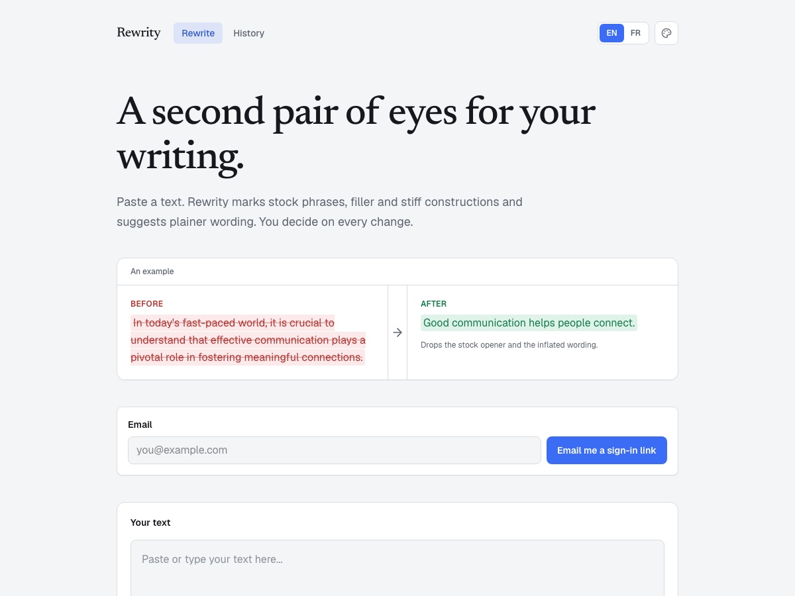
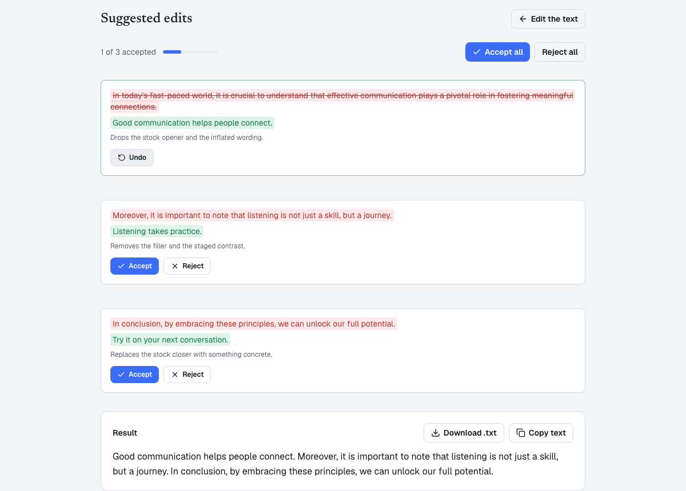
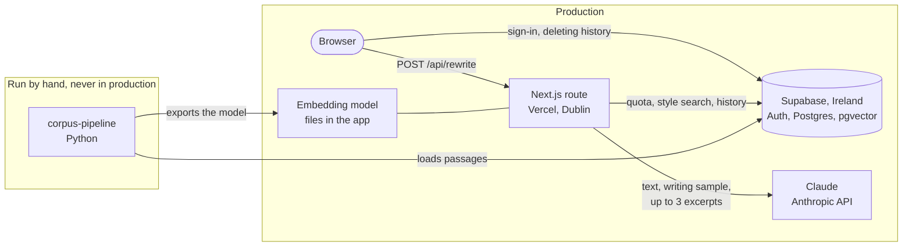

# Rewrity

A bilingual (English and French) writing editor. You paste a text of up to 5,000 characters, Claude
proposes targeted edits with a reason for each, and you accept or reject them one by one before
copying the result. It is for people who draft with AI tools, or write in a stiff register, and want
plainer wording without giving up the final say.

Demo: <https://rewrity.vercel.app> (sign-in by email link, a few attempts per day)





Screens from a local build. The edits in the second one are a sample written by hand, not model output.

## What it does

- Returns edits, never a rewritten text. Each edit quotes the original, proposes a replacement and
  says why.
- Lets you choose how much to change (light, standard, thorough) and paste a sample of your own
  writing, so the edits stay close to how you write.
- Shows edits as the model writes them. Once the first one is on screen you can stop and keep what has
  arrived.
- Reviews by mouse or keyboard (A accept, R reject, J and K move). The result can be copied or
  downloaded.
- Keeps a history you can search, reopen and delete.
- Works in English and French, in day, night or system mode.

It is an editor, not a detector. It does not tell who wrote a text and makes no promise about
passing any AI-text detector. [The research note](docs/research/detector-evaluation.md) explains how
the project moved away from detection.

## Architecture



There is one deployed app and no server to operate. The Python folder builds the corpus on a laptop;
no request ever reaches it. Every step of a request, each tool and the reason it was chosen are in
[docs/ARCHITECTURE.md](docs/ARCHITECTURE.md).

## Run it locally

You need Node 24, Docker, the Supabase CLI and an Anthropic API key.

```bash
supabase start                 # local Postgres, Auth and a mailbox, with every migration applied
supabase status -o env         # shows API_URL and PUBLISHABLE_KEY for the next step
cd frontend
cp .env.example .env.local     # fill in the Anthropic key and the two local Supabase values
npm ci
npm run dev                    # http://localhost:3000
```

Sign-in emails arrive in the local mailbox at <http://127.0.0.1:54324>. The local database starts
without a corpus, so rewrites run without style excerpts until you load one
([docs/STYLE_CORPUS.md](docs/STYLE_CORPUS.md)).

## Tests

None of these calls the real model, and none needs a secret.

| Layer                                                | Command (from `frontend/`, unless stated)                                                                 | Needs                      |
| ---------------------------------------------------- | --------------------------------------------------------------------------------------------------------- | -------------------------- |
| Format, lint, types, unit tests                      | `npx prettier --check . && npm run lint && npm run typecheck && npm test`                                 | Nothing                    |
| Browser tests on the production build, API mocked    | `npm run e2e`                                                                                             | Chromium for Playwright    |
| Database policy: limits, races, tickets, RLS, grants | `npm run test:db`                                                                                         | `supabase start`           |
| Whole site in a real browser, stand-in for the model | `npm run audit` (writes `audit/report.md`)                                                                | `supabase start`, Chromium |
| Corpus pipeline (from `corpus-pipeline/`)            | `uv sync --group dev --locked && uv run ruff check . && uv run ruff format --check . && uv run pytest -q` | `uv`                       |

`test:db` and `audit` change limits and counters while they run and put them back afterwards. They
refuse to run against anything but a local stack. To use a stack started from another folder, set
`SUPABASE_WORKDIR` to that folder. A production build fetches its fonts from Google, so `e2e` and
`audit` need network access the first time.

GitHub Actions runs the first two rows, the corpus row and `test:db`. Nothing measures the quality of
the edits: that would take a separate protocol with real model calls and a cost of its own.

## Costs, security, privacy and limits

**Costs.** Each attempt is one call to Claude, with no automatic retry and at most 8,000 output
tokens. The database allows 5 attempts per account per UTC day, 2 at once per account, and for all
accounts together 15 started attempts per day and 300 per month. These limits cap the number of
calls, not the money: the actual spending cap is the one you set in the Anthropic console. Once an
attempt has started it stays counted, even if it ends in an error, a refusal or a cancelled stream.

**Security.** Nothing paid runs without a signed-in user and a ticket granted by the database. If the
quota check fails, the model is not called. The limits live in the database, so calling its API
directly cannot change them. Row-level security limits each history to its owner.

**Privacy.**

| Data                | Reaches the browser   | Stored in Supabase                        | Sent to Anthropic |
| ------------------- | --------------------- | ----------------------------------------- | ----------------- |
| Your text           | Yes                   | Yes, in your history, until you delete it | Yes               |
| Suggested edits     | Yes                   | Yes, in your history                      | Written by it     |
| Your writing sample | Typed there           | No                                        | Yes               |
| Style excerpts      | Only author and title | Yes, as the corpus                        | Up to 3 per call  |
| Email address       | Yes, your own         | Yes, by Supabase Auth                     | No                |
| Attempts per day    | No                    | Yes, a counter, and a ticket for each one | No                |

The app sends the browser an excerpt's author and title only; a signed-in user calling the database API
directly can read up to ten full excerpts per counted attempt. Stored text is not encrypted against the
project's owner, who can read it. Tickets are kept at least two days and removed at a later accepted
attempt. Supabase Auth can record an IP address and browser for sign-ins. Logs carry error codes and
counts, never the text. Anthropic handles what it receives under its own terms.

**Limits you should know about.**

- Nobody has measured whether the edits are good, or whether the style excerpts improve them.
- The automatic checks on an edit compare numbers, length and markup. They cannot see a change of
  meaning such as a dropped "not"; that is why every edit is shown for review.
- The ceilings protect the budget, not availability: three accounts can use up a day's allowance
  for everyone. The code creates an account for any email address; whether sign-ups are open is a
  console setting.
- Web excerpts are not proven human. Only a date cut-off and a list of sites lower that risk. Many
  are copyrighted by their publishers ([details](docs/STYLE_CORPUS.md#licences-and-credits)).
- A sign-in link works once, in the browser that asked for it.
- The history page lists and searches the 50 most recent rewrites, and there is no self-service account
  deletion. The sign-in email comes from one Supabase template, so it has one language.

## Documentation

- [docs/ARCHITECTURE.md](docs/ARCHITECTURE.md): the request path, every table and function, the quota
  policy, the tools and their trade-offs, known limits.
- [docs/DEPLOY.md](docs/DEPLOY.md): deploying and upgrading, and what is set in which console.
- [docs/STYLE_CORPUS.md](docs/STYLE_CORPUS.md): the corpus, its sources, how to rebuild it, licences.
- [docs/research/detector-evaluation.md](docs/research/detector-evaluation.md): the detector research
  that came first, and why the project moved on.

## Licence

No licence file has been added, so all rights are reserved by default. The owner has yet to decide
whether to publish the code under a licence.

Prompt structure adapted from [blader/humanizer](https://github.com/blader/humanizer) (MIT) and
Wikipedia's "Signs of AI writing". Credits for the corpus and the embedding model are in
[docs/STYLE_CORPUS.md](docs/STYLE_CORPUS.md#licences-and-credits).
