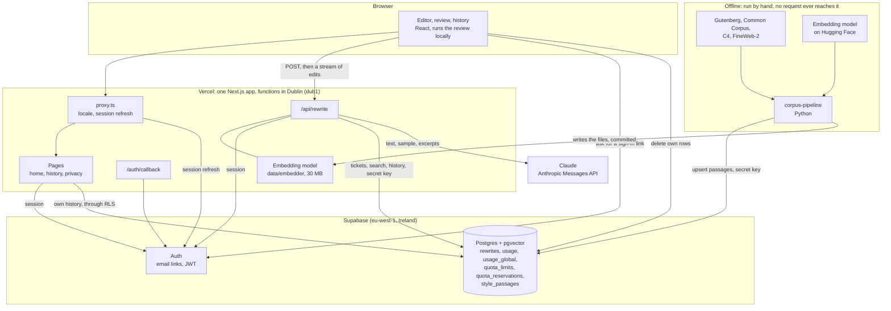
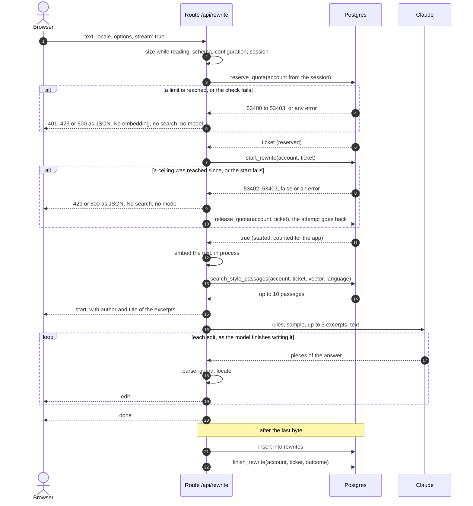
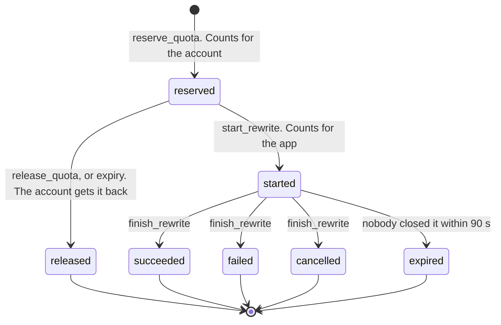

# Architecture

How Rewrity works today, written so you can follow a request without reading every source file.
Figures say how they were obtained. Limits are named where they apply and listed at the end.

## Components



The function region (`frontend/vercel.json`) and the database region were checked on 2 November 2026:
a request to production answered with `x-vercel-id: cdg1::dub1::…` and the Supabase project is in
`eu-west-1`. The route makes several database calls per request, so the two should stay close.

## One rewrite, step by step



The order follows one rule: nothing that costs anything runs before the quota has answered. Starting
the ticket comes before the search because the database only lets a started ticket read the corpus
([the quota policy](#the-quota-policy)). This costs more database round trips than running quota and search
side by side, as the earlier design did, but that also embedded the text and searched for requests the quota
then refused. In the audit, on a local stack with a simulated model answering at once, the route's own time
was a median of 33 ms, of which 29 ms before the model: body, session, reserve, start and
search (`npm run audit`, 4 November 2026). This is not a production figure. The history and ticket writes at
the end still run in parallel.

## The browser

**Pages.** Next.js App Router under `app/[locale]`, in English and French. `proxy.ts` picks the locale
(URL, `NEXT_LOCALE` cookie, then `Accept-Language`) and refreshes the session cookies. All user-facing
text lives in `messages/en.json` and `messages/fr.json`; message keys are type-checked against English
and a test requires the same keys and placeholders in both.

**Sign-in.** An email link only, with no password. `components/auth-panel.tsx` calls
`signInWithOtp` from the browser, which also creates the account on first use. The link lands on
`app/auth/callback/route.ts`, which exchanges the code for a session cookie and only redirects to
same-site paths. The exchange needs a proof kept in a cookie of the browser that asked (PKCE, which
`@supabase/ssr` turns on), so a link opened anywhere else fails, and that attempt uses the link up. The
page says so when it sends the link and when a link fails. Signing out reloads the page, so nothing of
the session stays on the screen or in memory.

**Streaming.** `lib/rewrite/client.ts` posts with `stream: true` and reads one JSON event per line
(`lib/rewrite/protocol.ts`): `start`, `edit`, `done` or `error`. A refusal before the stream starts
comes back as plain JSON with an HTTP error; once the stream has started, the status is already 200
and failures travel as an `error` event. A `done` with `partial` says the model stopped early. A stream
that ends without `done` is reported as a network error.

**Review.** `components/use-rewrite.ts` holds the request state and keeps the edits in reading order as
they arrive, since the model can write a later edit first. Decisions stay in the browser and never go
back to the server: `lib/rewrite/apply.ts` rebuilds the result from the accepted edits, so rejecting or
undoing costs nothing. `components/result-panel.tsx` copies the result with the clipboard API or
downloads it as a text file, in the browser only. Stop appears once the first edit is on screen; it
aborts the request and keeps what has arrived. When the answer stops short, the page says so above the
edits it has. A refusal that follows some edits withdraws them and shows the message, because the
server keeps nothing of that answer. A rewrite reopened from the history travels through
`sessionStorage`, and its offsets are checked against the text before being trusted
(`lib/rewrite/reopen.ts`). It is read during the render and removed only once React has kept that
render, because React can throw a render away and start again. What the reader has typed stays in
memory while they move between pages and languages (`lib/rewrite/draft.ts`), and a reopened rewrite does
not replace it; a reload loses it. Boxes work before the scripts arrive, and what was typed by then is
taken in when they do, as is the text a browser puts back on Back (`components/use-typed-early.ts`).

## The route

`app/api/rewrite/route.ts` is the only entry point that can spend money. In order:

1. **Size and shape.** `lib/rewrite/body.ts` counts the bytes as they arrive and stops reading past 40,000,
   so multibyte characters and a missing or false `Content-Length` change nothing: a 413, before the
   session, the quota or the model. A body that fails the zod schema (`lib/rewrite/schema.ts`) gets a 400.
   The text is limited to 5,000 characters and the sample to 1,500.
2. **Configuration.** Without `ANTHROPIC_API_KEY`, `SUPABASE_SECRET_KEY` or the other Supabase variables, a 503.
   That is what a preview answers, since it has neither secret.
3. **Session.** `supabase.auth.getClaims()`, then a 401 without a user. If the auth server cannot be
   reached the answer is a 500 instead, since that does not mean the reader signed out.
4. **Reservation, start, search, model.** As in the diagram above.
5. **Bookkeeping,** with `after()`, so the reader does not wait for it and the platform keeps the
   function alive until it is done.

`maxDuration` is 60 s. The model call must end within 50 s of the request's arrival, whatever the
session, quota and search took, which leaves time to save what arrived and close the ticket. The SDK's
own `timeout` is not enough for that: it stops once the response headers arrive, so it cannot end a
stream that stalls or runs long.

| Error code              | HTTP     | When                                               | Counted                  |
| ----------------------- | -------- | -------------------------------------------------- | ------------------------ |
| `invalid_request`       | 400, 413 | Bad body                                           | No                       |
| `not_configured`        | 503      | Missing key or Supabase settings                   | No                       |
| `unauthorized`          | 401      | No session, a rejected token, an account deleted   | No                       |
| `too_many_requests`     | 429      | Two attempts already open (53400)                  | No                       |
| `quota_exceeded`        | 429      | The account's daily limit (53401)                  | No                       |
| `global_quota_exceeded` | 429      | The app's daily or monthly ceiling (53402, 53403)  | No                       |
| `server_error`          | 500      | Auth or the quota check is down, the start failed  | No, the model not called |
| `busy`                  | 503      | Rate limit or overload, as a status or in a stream | Yes                      |
| `upstream_error`        | 502      | Any other failure of the call (below)              | Yes                      |
| `refused`               | 422      | The model declined                                 | Yes                      |

`upstream_error` covers a rejected key, another API error, a lost connection, the 50 s deadline, an
answer that is cut off or does not follow the schema, and an answer whose every edit fails a check.
Anything unforeseen after the start answers `server_error` and stays counted.

**The server's access to Supabase.** The route has two clients. `lib/supabase/server.ts` builds one from the
publishable key and the visitor's session cookie, and it only says who is asking.
`lib/supabase/service.ts` builds the other from `SUPABASE_SECRET_KEY`, with no session of its own, and it
runs the quota, the search and the history insert. The account each call passes comes from the verified
session, never from the request, and each function checks that the ticket belongs to that account.

**Why a secret key.** It acts as `service_role`, which is broader than the route needs and bypasses RLS. A
Postgres role of its own would be narrower, but it takes a direct connection from serverless functions, so a
driver, a pooler and a password that Supabase's key rotation does not cover. A custom JWT role depends on how
the project signs its tokens, which is a console setting. So the key is what this stack makes practical, and
it is narrowed where it can be: a key for the route alone, in Vercel Production only, with no `NEXT_PUBLIC_`
prefix, in a module that fails the build when client code imports it (`import "server-only"`). The audit
looks for the key in the bundles. The table grants of `service_role` stay as they are, because the corpus
pipeline and the tests use them. A leak would reach the whole database, so
[replacing the key](DEPLOY.md#what-is-set-where) is part of the deployment guide.

`getClaims()` verifies the token locally only when the project signs its tokens with asymmetric keys;
with the legacy shared secret it calls Supabase Auth on each request. That is a console setting, not
visible from this repository.

## The database

| Table                | Holds                                                                                | Who can reach it                                               |
| -------------------- | ------------------------------------------------------------------------------------ | -------------------------------------------------------------- |
| `rewrites`           | History: user, original text, edits, edit count, language, date                      | Its owner reads and deletes, through RLS. Only the server adds |
| `usage`              | Attempts per account per UTC day. Never purged; goes with the account                | Its owner reads. Only the functions write                      |
| `usage_global`       | Started attempts per UTC day, all accounts. Stays when an account is deleted         | Owner and secret key                                           |
| `quota_limits`       | One row: the limits                                                                  | Owner and secret key                                           |
| `quota_reservations` | One ticket per attempt: user, day, state, timestamps                                 | Owner and secret key; the functions change it                  |
| `style_passages`     | The corpus: passage, vector, author, title, language, kind, source, collection, year | Owner and secret key; the route reads it through the search    |

"Owner" is the database owner, in the SQL editor. The secret key (`service_role`) reaches the same
tables over HTTP: one on Vercel for the route, another on the operator's machine for the corpus.

Row-level security is on for every table. Hosted Supabase may grant new tables and functions to `anon` and
`authenticated` by default, so migrations revoke them explicitly. `npm run test:db` asks the catalog what
each browser role can do, a grant to `PUBLIC` or on a single column included, and fails on any privilege
beyond the list it expects: `SELECT` and `DELETE` on `rewrites`, `SELECT` on `usage`, and `EXECUTE` on no
function. It also checks that the functions run as their owner with an empty search path, and that the
limits are the ones shipped. The `SELECT` on `usage` dates from the first migration: nothing on the site
reads it, and it only shows a user their own daily count.

### The quota policy

The limits live in one row of `public.quota_limits`:

| Limit                | Value | Why it exists                                                          |
| -------------------- | ----: | ---------------------------------------------------------------------- |
| `user_daily`         |     5 | One account cannot use the whole demo                                  |
| `global_daily`       |    15 | Creating accounts does not create budget                               |
| `global_monthly`     |   300 | Bounds a month of a public demo, and binds before 15 per day does      |
| `max_in_flight`      |     2 | Each attempt holds a function for up to a minute and a paid call       |
| `ticket_ttl_seconds` |    90 | Above the route's 60 s limit, so a live request never loses its ticket |

These are cautious starting values, changed with one `update` in the SQL editor and no deploy. Setting
`global_daily` to 0 [pauses the site](DEPLOY.md#pausing-the-site). They count calls, not money, and the real
spending cap is the one set on the app's workspace at Anthropic. Days and months are UTC.

#### What one attempt costs

An estimate from the bounds in the code, with Claude Sonnet 5.5 at $2 per million input tokens and $10 per
million output tokens (read on 4 November 2026). No real call has been measured. The route uses no prompt
caching and makes no retry, so one attempt is one call at those rates.

| Part                                    | Bound                                                                                                         | Cost at most |
| --------------------------------------- | ------------------------------------------------------------------------------------------------------------- | -----------: |
| Output, thinking included               | `max_tokens`, 8,000                                                                                           |        $0.08 |
| Input, ordinary prose                   | About 15,000 characters: system prompt 4,666, schema, text 5,000, sample 1,500, three excerpts of 150 words   |  About $0.01 |
| Input, a text written to tokenise badly | About 22,000 tokens: the fixed part, and text and sample taken as one token per byte, which is 19,500 at most | About $0.044 |

So an attempt costs **about $0.09 at most on ordinary prose and about $0.125 at worst**. The output bound is
most of that, and an answer rarely uses all of it. The ceilings then bound the bill: 15 attempts a day come
to $1.35 to $1.90, and 300 a month to $27 to $38. The line `Rewrite attempt` in the logs gives each call's
real tokens ([below](#history-and-bookkeeping)), except the output of an answer cut short: the API gives that
count in its last event, so the line leaves it out. A price or model change makes these numbers wrong without
anything failing, which is one reason for the spending limit.

**A ticket for each attempt.** Every change of state is a guarded update (`where state = ...`) under
one transaction-level advisory lock, so a ticket moves forward once, however many calls race.



A request refused by `reserve_quota` never gets a ticket: the function raises an error, the
transaction rolls back and nothing changes.

| What happened                                  | Browser receives        | History              | Ticket      | Counted |
| ---------------------------------------------- | ----------------------- | -------------------- | ----------- | ------- |
| Complete answer, with or without edits         | edits, `done`           | Saved                | `succeeded` | Yes     |
| Complete answer, every edit failed a check     | `error`                 | No                   | `failed`    | Yes     |
| Cut off, error or 50 s deadline, after an edit | edits, `done` (partial) | Delivered edits only | `failed`    | Yes     |
| Cut off, error or 50 s deadline, before any    | `error`                 | No                   | `failed`    | Yes     |
| Refusal, even after some edits                 | `error`                 | No                   | `failed`    | Yes     |
| Reader left or pressed Stop, some edits sent   | -                       | Delivered edits only | `cancelled` | Yes     |
| Reader left before any edit, after the start   | -                       | No                   | `cancelled` | Yes     |
| Reader left before the start                   | -                       | No                   | `released`  | No      |
| Function killed before closing the ticket      | -                       | No                   | `expired`   | Yes     |
| Start failed; the model was not called         | JSON error              | No                   | `released`  | No      |
| Function killed before the start               | -                       | No                   | `released`  | No      |

Nothing is refunded once a ticket has started, because the code cannot establish that a call was free.
Some of those attempts probably were: an overload answer, or a reader who left during the search, in
which case the aborted call never reaches the service. Nothing here relies on how Anthropic bills them.
A misconfigured key therefore uses up attempts, which is why the deployment guide runs one real rewrite
first. `refused`, `busy` and `upstream_error` tell the reader that the attempt counted, and
`server_error` before the start means it did not. Three cases cannot say so: the browser's network
message, which does not know, a `server_error` after the start, whose message is the one used before it,
and a failure after some edits, which shows the edits and says the answer was cut short.

**The reader leaving.** On a streamed answer, the only kind the page asks for, it aborts the model call,
so nobody pays for more of an answer nobody reads. A direct caller of `stream: false` is only heard
leaving before the start: after that the call runs to its end, and the attempt counts either way. The
server hears of it through the request's signal or through the response stream being cancelled, and
listens to both (`lib/rewrite/stream-response.ts`). Vercel only fires the signal for routes that opt in,
so `frontend/vercel.json` sets `supportsCancellation`. Vercel then ends the function, except for work
handed to `after()`, so the route holds the function open with `after()` as soon as a ticket exists,
until the ticket's own bookkeeping is handed over. This was tested on `next start` and with
the real SDK over a local socket, and a local `vercel build` shows the setting in the function's
configuration, but it has not run on a Vercel deployment, so
[the deployment guide](DEPLOY.md#after-a-deployment) includes the check.

**The functions.** All are `security definer` with an empty `search_path`, and only `service_role` can run
them: execution is revoked from `PUBLIC`, `anon` and `authenticated`. They take the account as an argument,
because `auth.uid()` is empty under the secret key, and every step checks that the ticket belongs to it.

| Function                                                       | What it does                                                                                          |
| -------------------------------------------------------------- | ----------------------------------------------------------------------------------------------------- |
| `reserve_quota(account)`                                       | Closes expired tickets, checks the four limits, counts the attempt for the account, returns a ticket  |
| `start_rewrite(account, reservation)`                          | Moves a live reserved ticket to started and counts it for the app. Re-checks the ceilings, atomically |
| `finish_rewrite(account, reservation, outcome)`                | Closes a started ticket, once, and frees its slot                                                     |
| `release_quota(account, reservation)`                          | Gives back a ticket that never started, once                                                          |
| `search_style_passages(account, reservation, vector, lang, n)` | Returns up to 10 passages, once per started ticket                                                    |

**What a browser can no longer do.** These functions used to be open to signed-in users, with the same limits
but no route in front. Three accounts could take all 15 of the day's places through the API without any model
call, a user could add any number of rows to their own history, and a started ticket read ten full passages.
Now a user's token is refused on every one of those, `supabase/tests/access.test.mjs` checks each through the
API, and `supabase/tests/rls.test.mjs` reads every privilege the browser roles hold from the catalog.

**Why the search is one call now.** It used to take two. The API runs a function and its outer query in one
transaction, and a browser could make that outer query fail: `select=body::int` raises an error that quotes
the value and undoes what the function recorded, so one attempt could have read the corpus through error
messages. So one call recorded the passages and another read them. Only the server calls the search now, and
its outer query is fixed, so one call keeps the same guarantees, which the tests confirm: once per started
ticket, for the account that owns it, ten rows at most, and nothing once the ticket is closed. A search that
fails rolls back and can be repeated.

Holding reservations does not block others: the app-wide ceilings count started tickets only, and only the
route starts a ticket, right before it calls the model.

**Failure.** If the database cannot be reached, or the limits row is missing, `reserve_quota` gives no
ticket and the model is not called. If closing a ticket fails, the next accepted reservation closes it
once it is over 90 seconds old; the attempt stays counted. A refused call rolls that closing back, so on
a quiet app, or once a ceiling refuses everyone, a stale ticket stays until the next accepted attempt.
The counts stay right, because each call does that work again first. An accepted reservation also
deletes the 200 oldest tickets past two days, after its checks: more than it adds, so the table cannot
grow for long, and never so many that a backlog holds up everyone waiting on the lock. No scheduled job
does it, which would be new infrastructure for a small table.

**The choice of one lock.** A single advisory lock serialises reservations for the whole app, which is
the simplest way to make "check, then count" atomic across three counters. The calls take milliseconds
and this app allows 15 started attempts a day. At a much larger volume, conditional updates on counter
rows would avoid the queue. This relies on one function per request, which is how the route calls them. No
browser can call them by any path, `pg_graphql` included, which is off on the hosted project (read-only
check, 3 November 2026) and has no reason to be on.

**No limit per IP address.** Nothing here reads a client address. An account is needed before anything
is spent, and the ceilings hold however many addresses there are. Supabase Auth limits sign-ups per
address, and Vercel offers firewall rules; both are console settings.

## Vector search

Each passage has a 256-dimension vector in `style_passages.embedding`, compared by cosine distance
through an HNSW index (`extensions.vector_cosine_ops`). pgvector was preferred to a separate vector
service because the data, the access rules and the search then live in one database, with nothing else
to run or pay for. HNSW is approximate: it can miss the exact nearest passage, which matters little
here. Because the language filter applies after the index, the function sets
`hnsw.iterative_scan = strict_order` so a search keeps walking the index until it has enough rows
(available from pgvector 0.8; the hosted project ran 0.8.2 on 2 November 2026).

`lib/style/retrieve.ts` chooses what reaches the prompt:

1. Embeds the text, and takes its language from a word count (`lib/style/language.ts`), falling back
   on the interface language.
2. Asks for 10 candidates in that language.
3. Drops those under a similarity of 0.2, keeps one per author, and stops at 3.

A search that fails, or takes more than 5 seconds, is logged and the rewrite goes on without excerpts,
so a stalled search cannot eat the model's time. Setting `STYLE_REFERENCES=off` switches them off, along
with the sources note on the home page and the mention on the privacy page
([why the public site should run that way](STYLE_CORPUS.md#changing-the-corpus)).

The search matches meaning, not style, and it always returns something. Top and tenth similarity on
the hosted corpus, measured on 2 November 2026 with one input of each kind:

| Input                      |  Best | Tenth |
| -------------------------- | ----: | ----: |
| Plain English prose        | 0.512 | 0.457 |
| Plain French prose         | 0.474 | 0.406 |
| Generated-sounding English | 0.414 | 0.316 |
| Corporate jargon           | 0.399 | 0.359 |
| Code                       | 0.316 | 0.221 |
| Random letters             | 0.331 | 0.254 |

All of them clear the 0.2 floor, so the floor does not separate related from unrelated text, and
meaningless input still gets excerpts. Whether the excerpts improve the edits has not been measured;
[a protocol](research/style-references-comparison.md) is written and has not been run.

### The index at work

`supabase/examples/vector_search_explain.sql` shows the plan without any corpus. In one transaction, which it
rolls back, it adds passages with random vectors, half in each language, then runs the search's query under
`EXPLAIN ANALYZE`, with the index and without it. It needs a local stack, and takes a few seconds with its
default 5,000 rows. From the repository root:

```bash
docker exec -i supabase_db_IA_Writing psql -U postgres -d postgres < supabase/examples/vector_search_explain.sql
```

With `-v rows=45000` after `psql`, about the size of the hosted corpus, it took about two and a half minutes on a
laptop and gave the following, cut down to the lines that matter. **Synthetic vectors on a local stack
(4 November 2026), not a measurement of the hosted database,** and the times move from one run to the next.

```text
Limit  (actual rows=10 loops=1)
  ->  Index Scan using style_passages_embedding_idx on style_passages p
        Order By: (embedding <=> (InitPlan 2).col1)
        Filter: (lang = 'en'::text)
        Rows Removed by Filter: 13
Execution Time: 6.294 ms

Limit  (actual rows=10 loops=1)
  ->  Sort
        Sort Key: ((p.embedding <=> (InitPlan 2).col1))
        Sort Method: top-N heapsort
        ->  Seq Scan on style_passages p  (actual rows=22500 loops=1)
              Filter: (lang = 'en'::text)
              Rows Removed by Filter: 22500
Execution Time: 35.721 ms
```

The first plan walks the HNSW graph in distance order and stops once ten rows have passed the language filter,
having read and rejected only a few of the other language. The second compares the query with all 22,500
passages of that language and sorts them. Random vectors have no clusters, which is a hard case for the index
rather than a typical one.

## The embedding model

`sentence-transformers/static-similarity-mrl-multilingual-v1` (Apache-2.0) is a static model: a table
with one vector per token, with no neural network to run. To embed a text, `lib/style/embedder.ts`
tokenises it, averages the rows of its tokens and normalises the result.

| File (`frontend/data/embedder/`) | Content                                                                          | Size    |
| -------------------------------- | -------------------------------------------------------------------------------- | ------- |
| `weights.i8`                     | 105,879 tokens x 256 dimensions, as int8                                         | 27.1 MB |
| `scales.f32`                     | One scale per token, to undo the quantisation                                    | 0.4 MB  |
| `tokenizer.json`                 | The tokenizer, read by `@huggingface/tokenizers`                                 | 2.6 MB  |
| `meta.json`                      | Dimension, vocabulary size, upstream revision and the SHA-256 of the three files | 448 B   |
| `LICENSE`, `NOTICE`              | The Apache-2.0 text, and what was changed from which revision                    | 13 KB   |

`corpus-pipeline/scripts/export_embedder.py` keeps the first 256 of the model's 1,024 dimensions and writes these
files, from a pinned upstream revision. They are committed, read at the first rewrite of each server instance and
verified against their checksums, because a wrong table would return plausible but meaningless matches. Only the
route's function carries them: the file tracer finds them, and `next.config.ts` lists them in
`outputFileTracingIncludes` as well, because without them rewrites would go on with no excerpts and only a log line
would say so. `frontend/tests/embedder.test.ts` compares the TypeScript vectors with a committed fixture of what
the Python code produces, which holds them in one space for as long as the fixture is current: after any change to
the maths in `embed.py`, regenerate it by hand (`corpus-pipeline/scripts/export_parity_fixture.py`). No check does
that for you.

The trade-off: no request to an embedding service, so no bill, no network hop and one less point of
failure. In exchange, about 30 MB of assets in the repository and in the route's bundle, a model to
maintain by hand, and a pause in the first rewrite of each instance. On a laptop, loading took about
200 ms and embedding a 5,000-character text about 1 ms (one informal measurement, November 2026). It
matches loosely, as the table above shows, which is acceptable for excerpts meant to guide rhythm rather
than subject.

## Claude

`lib/rewrite/claude.ts` is the only file that talks to the model. The default model is
`claude-sonnet-5-5` (override with `ANTHROPIC_MODEL`), with `max_tokens` 8,000, effort `medium`, a 50 s
deadline over the whole call and no retries: a retry could not finish within the route's limit and would
be another paid call. The SDK's own logger is off, because it prints the raw chunk of a corrupt event,
which can quote the user's text.

**The prompt** (`lib/rewrite/prompt.ts`). The system prompt holds the editing method and the tells to
look for. The user message holds, in order: the intensity if not standard, the author's sample, the
excerpts, and the text. The last three sit in tags that the system prompt declares to be data, never
instructions, and a closing tag inside the data is neutralised; the intensity comes from a fixed list.
That lowers the risk of prompt injection without removing it, which is why every edit is then checked
and reviewed.

**Structured output.** The request carries a JSON schema (`{ edits: [{ original, replacement, reason }] }`,
`lib/rewrite/schema.ts`). Only the schema is passed, not the SDK helper's parse step: with it, the SDK
itself throws at the end of a refusal or a cut-off answer, before the code can read why the model
stopped.

**Reading the stream.** `lib/rewrite/edit-stream.ts` tracks braces and strings as characters arrive, and
hands over each edit at its closing brace, so the first edit can be on screen while the fifth is being
written. A piece that does not parse is skipped. When the answer ends, the whole of it must follow the
schema and must not have hit the token limit; otherwise the call fails, and the edits already handed
over are kept as an answer cut short. So `{"edits":[]}` means "nothing to change" while `{}` is an
error. An answer whose every edit fails the checks below is an error too, unless each one merely
changed nothing.

The non-streaming path (`stream: false`) is the same call read at once. The page never uses it; the
audit does.

## Checks on the model's output

Every edit goes through `lib/rewrite/guard.ts` and `lib/rewrite/locate.ts` before reaching the reader, one at
a time when streaming (`lib/rewrite/collect.ts`). `numbers.ts`, `units.ts`, `attribution.ts` and `negation.ts`
beside them each read one thing. A check that fires by mistake costs a suggestion, or an attempt when that was
the only edit, and never a fact.

| Check              | An edit is dropped when                                                                                                    |
| ------------------ | -------------------------------------------------------------------------------------------------------------------------- |
| `unchanged`        | Replacement equals the quote, ignoring case, spacing and typography                                                        |
| `span_too_long`    | The quote exceeds 600 characters                                                                                           |
| `too_long`         | The replacement exceeds both 200 characters and three times the quote                                                      |
| `markup`           | The replacement holds an HTML tag, a Markdown link, or starts with a heading                                               |
| `numbers_changed`  | The written numbers differ (below)                                                                                         |
| `units_changed`    | A figure's scale changed, or its currency or unit became another (below)                                                   |
| `figures_swapped`  | Two named entities traded their figures (below)                                                                            |
| `negation_changed` | A denial appeared or disappeared (below)                                                                                   |
| `too_many`         | 40 edits were already kept, or, while streaming, 40 were already refused as `not_found`                                    |
| `not_found`        | The quote is absent, cuts a word or a figure, would change a figure or its unit next to it, or another edit took its place |

**Numbers.** The guard compares each number as written, in any order: 3.5 and 35, -5 and 5, 12/03 and
03/12, 12% and 12, .5 and 5 all differ. Thousands separators are ignored when they are unambiguous (1 200
with any kind of space, 1,234,567). A last comma or period that differs from the marks before it is the
decimal mark, so 1,234.567 is not 1,234,567. A lone comma or period before three digits only equals
itself, since "1,200" reads 1200 in English and 1.2 in French. A hyphen or dash after a digit, a letter,
a closing bracket or a unit that follows a digit separates, so a range can be reworded ("2019-2021" to
"2019 to 2021", "5%-10%" to "5% to 10%"), except in a date with its year first or last, which is one number
(2024-03-12 and 2024-12-03 differ); anywhere else it is a minus sign, also ahead of a currency symbol (-$5, -₹5).

Since each number is compared as written, an edit that re-punctuates a figure is dropped even when a
person reads the same figure: "5-10%" to "5% and 10%", "2019/2020" to "2019-2020", "10h30" to "10:30". That
fails safe, at the cost of a suggestion, or of an attempt when it was the only edit. So does reading "May 15
300 people" as one number. A percent word reads as the sign, so "12 percent", "12-per-cent", "12 pct" and "12
pour cent" equal "12%".

That comparison only sees the quote. So locating refuses a quote that stops inside a figure and leaves its
digits out ("fell by -" before "5%", "cost 1," before "200", "%" after "12"), and then compares the figures
of the whole text with and without it. That covers what the first rule leaves: "of -" before "$5", "% en" after
"12 ", a minus brought by the replacement, a deleted word that joins "5 or 300" into one number. The `too_many`
cap bounds that comparison at 80 per answer, on a text of at most 5,000 characters. On the development machine, an
answer with 79 comparisons took about 100 ms on a French report of 5,000 characters and about 0.9 s on a
text written as the worst case, with 2,500 figures. No shorter window gave the same verdicts, so the text stays
whole.

**Units.** `units.ts` reads what stands next to each figure, in English and French: a currency symbol or code, a
scale (thousand, million, milliard, `bn`), and units of length, area, weight, volume, time, temperature, energy,
power, speed and data. For one number, the scale must stay, so "3 million" is neither "3 billion" nor "3". One
scale can cover two figures ("between 3 and 5 million", "3–5 million", "de 40 à 3 millions"). After "and", "or" or
a spaced dash, it does when the first figure is at most twice the second, and not when it is more than ten times
the second, so "It employs 400 and 5 million more depend on it." reads 400 alone. In between ("30 and 10 million"),
beside "1,200", which reads 1200 or 1.2, or beside a negative figure ("-120 and -8 million"), it can be either, so
an edit has to hold on every reading. A percent shares no scale ("rose 12% to $3 million"), a spaced long dash
opens a new clause ("400 — 3 million more depend on it"), and a figure that reads like a year keeps to itself:
"between 1500 and 2000 million" to "between 1500 million and 2000 million" costs a suggestion. A unit may go or be
added, but not become another: "5 km" can become "5", not "5 miles", and "5 lb" not "5 pounds", which reads as
money. The same goes for the period of a rate, when it is a unit written after "/", "per", "par", "a" or "an": "500
€/mois" can become "500 € par mois", not "500 €/an", and "$40 an hour" not "$40 a day". A letter is a scale next to
money ("3 M€", "$5B", "3 G$", "5 M d'euros", "3M USD"). A figure from 1500 to 2099 right after a date word (in, by,
since, until, after, before, during, en, depuis, dès, après, avant, vers) is a year when a plural or a name follows
it ("In 2020 millions lost their jobs", "In 2018 Md Ali led the team"): what follows can leave with its clause, and
cannot become another size. Anywhere else it is an amount ("by 2000 million", "une dette de 2000 milliards"), as it
is when a currency, written as a code or a word, follows the scale ("by 2000 million USD"), even in a title: "In
2020 Million Dollar Baby aired again." to "Million Dollar Baby aired again in 2020." costs a suggestion. A month is
no date word, so "In May 2020 millions lost their jobs" to "In May 2020 many lost their jobs" costs a suggestion. A
spaced dash or a paragraph break ends the reading of the word after a figure ("400 — thousands more depend on it").
What is ambiguous is left out on purpose: a bare `m` with no currency, `s`, `t` or `in`, and the French `livre`.
The French `cent` is not read as a hundred, only as the coin.

**Attributed figures.** `attribution.ts` only judges a quote and a replacement of the same plain shape, with two
or more names that both share, each next to its own figures. "Acme rose 12% and Zenith rose 40%" cannot become
"Acme rose 40% and Zenith rose 12%", and a scale or a unit cannot move between names either ("Alpha a 50 k€ et
Beta 50 Md€"). A word that opens sentences ("Moreover", "Cependant") or a unit next to a figure ("5 GB") is no
name, and "Sterling" away from any figure is one. Anything else gets no verdict, such as names holding unequal
numbers of figures: in "Apple rose 12% and Google 40% in 2019" the date goes with both.

**Denials.** `negation.ts` looks for a closed list of words on each side (not, never, no, without, pas, jamais,
aucun, sans, nul, nullement, ne ... plus, ne ... point and others, and "ne peut", "ne sait" or "n'ose" written
alone), after removing set phrases such as "not least", "no doubt" or "sans doute". A flip is a denial on one side
only. A set phrase has to stay whole: "no more than 40" can become "at most 40", not "more than 40". It also has to
be the phrase: "no doubt remains", "no surprise fees" and "paid late or not at all" are denials. Four phrases are
set phrases in some forms only: "ne manque pas de rappeler" is one, "ne manque pas un vote" may be one, and "not
without", "never been" and "jamais été" have forms of both kinds too. A form that may be one is read both ways, as
a set phrase and as a denial, so an edit there has to hold on both readings: "Le député ne manque pas un vote." can
become neither "Le député rate un vote." nor "Le député ne vote pas." The list of set phrases is closed, so a
phrase it lacks, or a denial reworded in words it does not hold ("did not change" to "stayed flat"), counts as a
flip and costs a suggestion. Four cases are let through, because the meaning can survive them:

- A denial that the same quote answers, when the word before the answer goes with it ("not a bug but a feature" to
  "a feature", "This isn't about speed. It's about trust." to "This is about trust."). If that word stays, it is a
  flip: "The drug is not approved. It is safe." to "The drug is approved. It is safe." So it is when the answer
  stays and so does the word the denial stood on, or the one past its determiner: "The drug is not approved in
  France. It is safe." to "The drug is approved. It is safe.", "It wasn't a bug in France. It was a feature." to
  "It was a bug. It was a feature." A pronoun answers only from a clause of its own ("Le soin n'est pas remboursé
  quand il est prescrit." states a condition), and when what is denied holds a pronoun, nothing further on answers
  it: "Le médicament n'est pas remboursé quand il est prescrit en France, mais il est vendu." cannot become "Le
  médicament est remboursé quand il est prescrit." A denial after the answer states a fact of its own. What follows
  "rather than" or "plutôt que" is set aside up to the end of its clause ("The goal is not growth but survival." to
  "The goal is survival rather than growth."), and an answer after "because" answers nothing ("Not because it's
  cheap." to "Because it's cheap."). The same goes for a denial in the past answered directly ("The launch wasn't a
  failure. It was a lesson." to "The launch was a lesson.") and for a cleft ("It's not the price that matters, it's
  the timing." to "The timing matters."), which has to keep what it says instead: "It's not him who paid, it's
  Smith." cannot become "He paid.", "It is not true that prices fell." denies its clause, and a denial ahead of a
  cleft stands on its own: "Ce n'est pas vrai que Reyes a payé, mais ce n'est pas lui qui a signé, c'est Smith."
  cannot become "C'est vrai que Reyes a payé, mais Smith a signé."
- A contrast in two halves that loses the one that denies: after the same pronoun ("We don't sell software, we sell
  trust." to "We sell trust."), after a bare "Not X." or one answered in its own terms ("Not for the money. For the
  love." to "For the love."), in "Not a X, a Y" ("Not a sprint: a marathon." to "A marathon."), in the same with
  one word on each side of a full stop, when that is the whole quote, stop included ("Not a product. An
  experience." to "An experience.", "Pas de promesses. Des preuves." to "Des preuves.", but not "Not a cent. The
  firm" to "The firm" or "Not one paid. Not a cent. The fine." to "The fine."), down a list to its "just" ("No
  fluff, no jargon, just 40 pages of facts." to "40 pages of facts."), and with the answer first when what goes
  names one thing ("It's a marathon, not a sprint." to "It's a marathon.", but not "It's a new drug, not yet
  approved." to "It's a new drug."). In the present, a name with its pronoun counts too ("People don't buy
  products. They buy stories." to "People buy stories."). Any other sentence that denies states a fact: "The drug
  is not approved. The drug is safe.", "Not a cent was paid. The firm closed." and "The firm did not pay. It sold
  the plant." cannot lose their first half. The contrast has to open the quote: "For Acme, it's not about speed,
  it's about trust." to "For Acme, it's about trust." costs a suggestion, and "It's not about speed, it's about
  trust." to "It's about trust." passes.
- A staged contrast that loses its adverb ("not just a tool" to "a tool", "ne se résume pas aux notes", "The
  question isn't whether AI will change work, but how." to "The question is how AI will change work."), when no
  other denial stands beside it. If the adverb stays, it is a flip: "n'est pas juste une idée" to "est juste une
  idée". Its look-alikes are denials: "did not so much as apologize", "pas tant que ça", "ne s'arrête pas à Lyon".
  What "so much X as Y" denies has to go too: "The issue isn't so much the price as the timing." cannot become "The
  issue is the price." "Suffit" has to go itself, whatever other form of it comes later: "Il ne suffit pas de payer
  40 €, il faut payer une somme suffisante." cannot become "Il suffit de payer 40 €."
- A plain side that says no in other words, ahead of the word the denial stood on ("did not go" to "failed to go",
  "n'a pas assez de temps" to "manque de temps", "not available" to "unavailable", "do not often" to "rarely").
  Said after that word, it says something else: "The drug is not approved." to "The drug is approved and helps
  patients stop smoking." is a flip.

A denial the replacement adds can answer something only when it opens the quote: "a feature" to "not a bug but a
feature" passes, and "The drug is safe." to "The drug is not approved. It is safe." does not.

**What this cannot see.** The checks are deterministic: they read figures and listed words, not meaning.
`frontend/tests/guard.test.ts` lists what passes on purpose, in the group `whyDrop: what it cannot see`, and
`locate.test.ts` holds the last item:

- A denial that moves or goes where another stays, one lost next to an answer when the word before the answer
  changes too, an irregular verb or a synonym ("We did not pay. It is late." to "We paid. It is late.", "The drug
  is not approved. It is safe." to "The drug is authorized. It is safe.") or when that first sentence goes ("It is
  safe."), a sentence dropped after the same pronoun ("We did not pay. We sold it." to "We sold it."), after a name
  in the present ("The drug does not work. It costs $40." to "The drug costs $40.", "Le médicament n'est pas
  autorisé. Il est sûr." to "Le médicament est sûr.", "Le médicament n'est pas autorisé en France. Il est sûr." to
  "Le médicament est autorisé."), a short sentence or a clause that denies one word ("Not approved. Sold in
  France." to "Sold in France.", "It's legal, not safe." to "It's legal."), a bare "Not a X. A Y." whose first half
  states a fact ("Not a cent. The fine." to "The fine."), one lost beside a word that says no about something else,
  when the verb is irregular ("The bank did not pay the fine." to "The bank paid the fine to avoid a trial."), and
  a clause denied by a word it does not list ("It is not alleged that the firm paid 40 staff, but it is possible."
  to "The firm paid 40 staff, but it is possible.").
- A set phrase at the very start of a quote or of a clause ("sans compter les frais" to "en comptant les frais"), a
  set phrase turned around in other words ("The result is not surprising." to "The result is a surprise.", "Les
  fonds ne manquent pas." to "Les fonds sont rares."), a staged contrast that says the opposite in other words ("La
  tablette ne fait pas que remplacer le manuel." to "La tablette remplace seulement le manuel."), and "pas juste"
  followed by more words, when "juste" goes too ("n'est pas juste pour tous" to "est équitable pour tous").
- A word turned into its opposite (safe to dangerous), a reversed direction (rose to fell, augmenté à baissé)
  and a change of scope (some to all).
- A scale or unit it cannot place (5 m to 5 km, 5 s to 5 min, 5 t to 5 kg, 5 in to 5 cm, 5 livres to 5 euros, and 5
  Mg to 5 mg once another word changes too, since a change of case alone is dropped as `unchanged`), a unit a word
  away from its figure (5 long km to 5 long miles), a scale that leaves with what
  follows a year ("Après 2000 milliards de pertes" to "Après 2000 de pertes"), a scale added to a figure in another
  clause ("Each costs $5 and 6 million shares were sold." to "Each costs $5 million and 6 million shares were
  sold."), a period that is no unit ($40 a person to $40 a seat) or in a form it does not read (20 € de l'heure to
  20 € par jour), a month (5 May to 5 June), a dollar of another country (C$ to US$), and a currency that goes once
  it has made an amount of what reads like a year ("By 2000 Million Dollars were lost." to "By 2000 million people
  were lost.").
- Figures that trade places with no name to hold them, or in a sentence it will not judge, such as one with a
  date or a total that goes with both names.
- A range reversed, unless a lone percent sign tells its ends apart ("5-10%" to "10-5%" is seen, "10-20" to "20-10"
  and "5%-10%" to "10%-5%" are not), a number written in words, figures that are not plain digits (½, 10², XIXe,
  fullwidth digits), a sign written in words or brackets, a sign that is not a minus (±5, <5%, T-5), a minus ahead
  of a currency in letters (-CHF 5) or set apart by a space (- 5 %), and two edits that change a figure only
  together.

Most of this list needs meaning: a reversed direction, a word turned into its opposite, a denial said in other
words. A few items are forms that no rule reads yet, and each would need its own rule, with its false refusals
weighed first: a month ("May" and "mars" are also ordinary words), a dollar written with its country (C$5 to US$5,
while "$" alone can be any dollar), a number written in words and figures that are not plain digits.

The group `whyDrop: what it refuses, at the cost of a suggestion` lists the other side: honest edits that the same
rules drop, such as "The firm is not hiring now, but it is growing." to "The firm has paused hiring, but it is
growing.", "Il fait un pas, puis d'autres pas." to "Il avance.", "It's not a bug but a feature, not a flaw." to
"It's a feature." and "3 — 5 million" to "3 million to 5 million". Others are refused because the same shape can
change a fact, and `guard-rules.test.ts` keeps both sides in `honest edits it refuses, because the same shape can
change a fact`: "The firm did not hire many people." to "The firm hired few people." goes with "The report does not
say how much Acme paid." to "The report says how little Acme paid.", "It's a tool, not a toy or a gadget." to "It's
a tool." with "It's approved, not a single patient was harmed." to "It's approved.", "Le groupe n'hésite pas à
investir 40 millions d'euros." to "Le groupe investit 40 millions d'euros." with "Il n'hésite pas à payer." to "Il
rechigne à payer.", "L'aide ne peut être versée que si le dossier est complet." to "L'aide est versée uniquement si
le dossier est complet." with "Le tribunal ne peut accepter qu'une société paie 40 millions d'euros." to "Le
tribunal peut accepter qu'une société paie 40 millions d'euros.", "For Acme, it's not about speed, it's about
trust." to "For Acme, it's about trust." with "The patient has no cancer, but her sister has cancer." to "The
patient has cancer.", "Le député ne manque pas un vote." to "Le député assiste à tous les votes." with "Le député
ne manque pas un vote." to "Le député rate un vote.", "between 800 and 1,200 million" to "between 800 million and
1,200 million" with "It employs 40 and 5 million more depend on it." to "It employs 40 million and 5 million more
depend on it.", and "gains of 5 and -3 million" to "gains of 5 million and -3 million" with "Net cash flow was -120
and -8 million in 2019 and 2020." to "Net cash flow was -120 in 2019 and -8 million in 2020." Rules that let
several of these honest edits through were tried and taken back, on those pairs.

Equal numbers do not mean equal meaning, and the prompt's instruction to keep facts is a request, not a check.
These are limits of the validation, and this is why each edit is shown with its reason and takes effect only
when accepted.

**Locating.** The model never gives offsets; the server finds each quote. Exact match first, then a
match that ignores curly quotes, no-break spaces, no-break hyphens and runs of whitespace, mapping the
position back to the real text. Other differences (an ellipsis typed as three dots, a dash typed as a
hyphen) drop the edit rather than guess. A match must be whole words, so "key" never lands inside
"monkey"; a quote found only inside a longer word is dropped, and an accent stored as a separate
character counts as part of its letter. The page also sends the text in one Unicode form (NFC), so the
model's quote and the offsets refer to the same characters. Overlapping edits are dropped. A quote that
occurs several times takes the first free occurrence, so an edit meant for the second one can land on
the first. Two rules protect the spacing of the accepted text. A deleted quote comes down to the whitespace
of one side, the one with more line breaks, so paragraphs stay apart and no double space stays behind. A
line it had to itself goes with it, and the next line keeps its indent. Next to a closing mark after it or
an opening mark before it, a dash or a bold marker included, the space goes; a hyphen or a slash does not
count. Before a French mark, the space in front of the mark is the one that stays, so a no-break space
survives. Spaces written in place of a quote count as a deletion, unless nothing else keeps two words
apart ("—" to " " in "works—and", or in "12%—a"). An outer space or line break that a quote has and its
replacement lost stays in the text, so what it separated does not join, unless the replacement decides
the spacing itself ("de " to "d'") or no space belongs there ("yes ,"). When another edit holds the space
to take, the other side's goes instead, and accepting several neighbouring deletions can still leave a
stray space, or join two words when one of them is a tight dash with nothing in its place.

**Identifiers.** When streaming, ids follow arrival order and never change, so a decision made while
the model writes stays attached to the right edit. The list is kept in position order for display.

## History and bookkeeping

Once the answer is out, the route writes the history row and closes the ticket, side by side, with the
server's key and the account from the verified session (`settle` in `route.ts`). The writing sample is never
part of that row: it goes to Anthropic in the prompt and nowhere else. A failed history write is logged and
does not affect the answer or the ticket.

The history page reads through RLS on the server, lists the 50 newest rows and shows the total. A read
that fails says so, rather than looking like an empty history. Its search covers the listed rows only,
and it says so when older ones exist. Deleting goes straight from the browser to Supabase, also through
RLS. "Delete all" removes every row of the account, listed or not, and its question says so on a line of
its own, where a double click cannot reach the answer. Each delete asks the server for the list again, so
older rows move up and the browser's copy of the page cannot bring a deleted row back. Dates are printed
in one fixed zone (Paris), which is shown, so the server and the browser agree on them.

On the request path, logs hold error codes, HTTP statuses, class names and counts of dropped edits, and one
line per attempt that reached the quota (`lib/rewrite/diagnostics.ts`):

```text
Rewrite attempt {"state":"succeeded","model":"claude-sonnet-5-5","stop_reason":"end_turn","input_tokens":10,"output_tokens":10,"prep_ms":39,"model_ms":1461,"first_edit_ms":758,"references":1,"edits":2,"dropped":0}
```

(A line from `npm run audit`: the token counts are the stand-in's, and `model` is the name the route asked for, the
default or `ANTHROPIC_MODEL`.) `state` says how a started attempt ended, `released` when it was given back before
it started, or the code it was refused with, and `stop_reason` why the model stopped, from the API's own list or
`other`. Apart from that configured name, only numbers and closed lists of words go in, so a text, an excerpt, a
raw answer or a key has no way into that line. Logs never print an error's message either, because a message can
quote the text it failed on (a JSON parse error does). One place does print a message: the page's error boundary,
which writes to the reader's own console.

## The corpus pipeline

`corpus-pipeline/` is a Python project run by hand, once in a while. It samples passages from four
sources, cleans them, embeds them with the same files the app uses and upserts them into Postgres with
a secret key that stays on the operator's machine. Sources, periods, cleaning, stored metadata and
limits are in [STYLE_CORPUS.md](STYLE_CORPUS.md). The Python package keeps its historical name, `aiwd`.

## Tests and CI

| Layer              | Where                             | Real                                                                               | Replaced                                                 |
| ------------------ | --------------------------------- | ---------------------------------------------------------------------------------- | -------------------------------------------------------- |
| Unit and component | `frontend/tests`, Vitest          | Guard, locate, parser, prompt, components, the Anthropic SDK over a local socket   | Supabase, Anthropic's service                            |
| Browser            | `frontend/e2e`, Playwright        | Production build, pages, client code. Fails on a console error or a broken request | `/api/rewrite`, mocked in the browser                    |
| Database           | `supabase/tests`, `node:test`     | Migrations, functions, RLS, grants, Auth, the HTTP API, real races                 | Nothing, but the stack is local and no route is involved |
| Site audit         | `frontend/audit`, `npm run audit` | Production build, route, database, Auth, mailbox. Fails on a browser error too     | The model, by `audit/mock-anthropic.mjs`                 |
| Corpus             | `corpus-pipeline/tests`, pytest   | Cleaning, filters, embedder, ingest rows                                           | Network and datasets                                     |

**The stand-in model.** `audit/mock-anthropic.mjs` answers on the Messages API's own paths, in JSON and
as a server-sent event stream, and the audit points the SDK at it with `ANTHROPIC_BASE_URL`. Words in
the text steer it: `SLOW`, `FAILAPI`, `REFUSE`, `TRUNCATE`, `TOOLONG`, `CUTOFF`, `MISSING`, `ALLBAD`,
`REVERSE` and `12%`.
The audit then checks each ticket's final state, the counters and the history against the database.

The audit found what stand-in clients could not. The SDK's parse step made every streamed refusal
surface as a server error; the unit tests had passed, because their fake client never parsed anything.
`tests/claude.test.ts` now also runs the real SDK over canned HTTP answers, and
`tests/stream-flow.test.ts` runs the real stream handler and SDK against a local server, which is how a
stream's deadline, a dying connection and a reader leaving get tested.

GitHub Actions has one workflow per area (`frontend.yml`, `database.yml`, `corpus-pipeline.yml`),
triggered by the paths they cover. No workflow calls the real model and none needs a secret. The site
audit is not in CI: it is slow and its timing checks depend on the machine. Nothing tests the quality
of the edits, which needs real model calls and a budget of its own. A protocol for comparing them with and
without excerpts is [written down](research/style-references-comparison.md): `npm run compare` runs it, on the
stand-in unless asked otherwise, and it has only been run that way.

## Tools and why they are here

| Tool                               | What it does here                               | Why                                                                    | Simplest alternative left aside                             | Trade-off accepted                                                  |
| ---------------------------------- | ----------------------------------------------- | ---------------------------------------------------------------------- | ----------------------------------------------------------- | ------------------------------------------------------------------- |
| Next.js on Vercel                  | Pages and the API route in one deployable app   | No server to run; streaming route handlers; pages and route share code | A separate API server                                       | Function time limits, cold starts, tied to one platform's model     |
| next-intl                          | Locale routes and messages                      | Two languages from the start, with typed keys                          | One language, or hand-written lookups                       | Every text goes through a message file                              |
| Tailwind CSS                       | Styling, with colours as CSS variables          | Utility classes, no style sheet to name and keep in step               | Plain CSS                                                   | Long class lists in the markup                                      |
| Supabase Auth                      | Email-link sign-in, sessions                    | Comes with the database, and RLS reads its users                       | Writing auth by hand                                        | Sign-up is open, with email limits set in a console                 |
| `@supabase/ssr`                    | Keeps the session in cookies                    | Pages, proxy and route read the same session on the server             | Sending the token by hand with each request                 | The cookie is readable by the page's scripts                        |
| Postgres with RLS                  | History, counters, tickets, access rules        | Rules sit next to the data and also hold for direct API calls          | Checks in the route only                                    | Logic spread over SQL migrations, tested separately                 |
| Tickets and an advisory lock       | Limits, ceilings, unstarted attempts returned   | Atomic, holds across instances, needs no other service                 | A counter in memory (does not work on serverless), or Redis | One lock, enough at this volume                                     |
| A Supabase secret key, server only | The route's identity for quota, search, history | No direct connection or pooler on serverless; rotated in the console   | A Postgres role of its own over a direct connection         | Acts as `service_role`, broader than the route needs                |
| pgvector (HNSW)                    | Nearest passages                                | No second service; rules and data in one place                         | A hosted vector database                                    | Approximate results, and the corpus counts against database storage |
| Static embedding model, in process | Text to vector, per request                     | No per-request API call, bill or network hop                           | A hosted embedding API                                      | 30 MB of assets, manual upkeep, cold-start cost, loose matching     |
| `@huggingface/tokenizers`          | Cuts the text into the model's tokens           | The same tokens as the Python side, with no native module              | Writing a tokenizer by hand                                 | A dependency, and a 2.6 MB tokenizer file                           |
| Claude (Anthropic SDK)             | Writes the edits                                | Hosted, structured output, streaming                                   | Self-hosting a model                                        | A paid external dependency that sees the text                       |
| zod                                | Validates requests, and edits from the stream   | One schema for the type, the check and the JSON sent to the model      | Hand-written checks                                         | A dependency                                                        |
| Vitest, Testing Library            | Unit and component tests                        | Fast, and works with the TypeScript setup                              | `node:test`                                                 | jsdom is not a real browser, which is why Playwright runs too       |
| Playwright, axe                    | Browser tests and accessibility in the audit    | A real browser; the same tool for e2e and audit                        | Unit tests only                                             | Slower, needs Chromium                                              |
| `node:test`                        | Database tests over HTTP                        | No dependency, and it uses the same API an attacker would              | pgTAP, which cannot race two connections                    | Needs a running local stack                                         |
| Python, uv, Ruff, pytest           | The offline corpus pipeline                     | Data tooling (pandas, pyarrow, Hugging Face), locked and reproducible  | Writing it in TypeScript                                    | A second language to maintain                                       |
| GitHub Actions                     | CI                                              | Lives with the repository                                              | Running checks by hand                                      | Only the checks listed above                                        |

## Known limits

- **Edit quality is not measured**, nor the effect of the style excerpts:
  [the protocol](research/style-references-comparison.md) has not been run.
- **The output checks do not see meaning** (see above).
- **The ceilings protect the budget, not availability.** With 5 attempts per account and 15 per day, three accounts
  can use up a day for everyone, through the app. Done every day, that also uses up the month's ceiling in about 20
  days. The code creates an account on first use; whether sign-ups are open is a console setting, like raising the
  numbers. A captcha would also need a change here: the form sends no captcha token, so turning it on in the
  console stops every sign-in.
- **Attempts count even when the failure is on the provider's side**, and a wrong key or model name
  uses up the day's allowance quickly.
- **Cancelling is not verified on Vercel.** Stop and closing a tab were tested locally; on a deployment,
  they rely on the `supportsCancellation` setting doing what Vercel documents.
- **Stop comes with the first edit.** Before that, only leaving the page ends the wait, and the attempt
  stays counted.
- **The route's key is broader than the route.** It acts as `service_role`
  ([why](#the-route)), so a leak or a bug in the route reaches every table, not only the quota.
- **Corpus excerpts leave the database** for Anthropic, up to three per attempt, unless
  `STYLE_REFERENCES=off`.
- **A sign-in link works once, in the browser that asked for it.** Asking on a laptop and opening the
  link on a phone fails, and the page can only say so afterwards. A link based on `token_hash` would
  lift this; it needs a change to the email template in the console and to the callback.
- **Leaving the review is final for its decisions.** "Edit the text" goes back to the original text. The
  edits come back through History > Reopen, every decision pending again. A reload loses unsent text. A
  reopened rewrite does not replace the typed draft: coming back to the editor after leaving it shows that
  draft. So does switching language while it is on screen, or the editor is empty if no draft waits: the
  rewrite stays in the history. A Reopen abandoned on the way can still open that rewrite for 60 seconds,
  unasked.
- **The browser's copy of a page can be stale.** Coming back to the history with Back can leave out a
  rewrite saved since, or show a failed read after the service has recovered, until a reload.
- **During an Auth outage, pages wait and then ask to sign in.** With a token due for refresh, the proxy
  and the page each wait out the client's retries (about 25 s each here), and the page then looks signed
  out. The route answers `server_error` instead, and the session is fine once Auth returns. Sign out waits
  for Auth with no time limit, so while Auth stalls the button seems to do nothing.
- **An account deleted by the owner looks signed in until its token expires** (an hour at most), when the
  project signs tokens with asymmetric keys: the chip stays above "Sign in to rewrite your text".
- **A full load with a Reopen on its way logs a hydration error.** Reloading in the instant after Reopen,
  or a navigation that falls back to a full load, logs React's error #418 once and rebuilds the page on the
  client. The review shows and works.
- **The sign-in button does nothing useful before the scripts arrive.** The browser submits the form
  itself, the page reloads and the address is gone. On a fast line there is no time to do this.
- **The language guess can be wrong on one short sentence.** It counts function words, so names and titles
  can tip a sentence of about ten words: "Le Monde, Le Figaro and Les Echos all ran it on Monday." reads
  as French, and a short French sentence can read as undecided, which falls back on the interface
  language. It only chooses which excerpts are searched, and a longer text settles it.
- **Accessibility has gaps axe cannot see.** Focus falls to the page after "Edit the text", after a
  delete and after Cancel in the Delete all question, Escape in the appearance panel does not return focus, the radio groups ignore arrow keys, and
  forced-colours mode hides the selected mode, language and accent.
- **Sessions and accounts.** There is no self-service account deletion, and the history page only lists
  and searches the newest 50 rows.
- **The sign-in email has one language.** It comes from one project-wide Supabase template, set in the
  console, so a French reader gets whatever language that template is written in.
