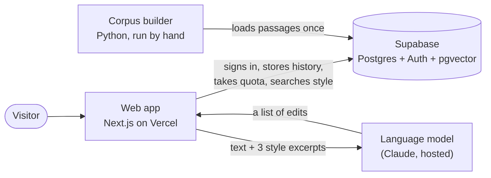
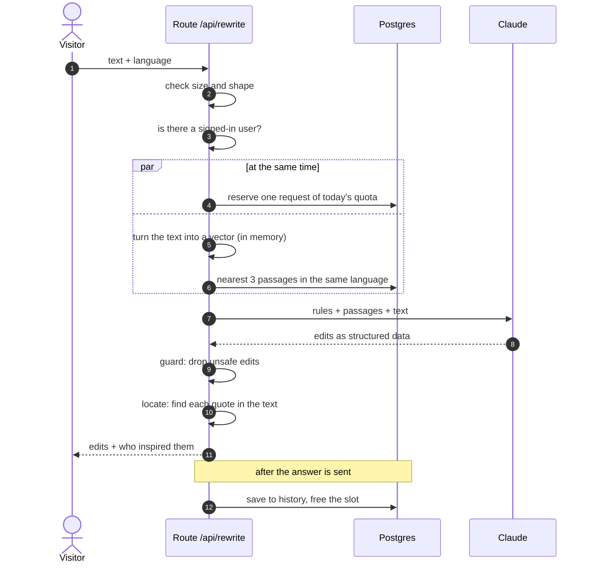
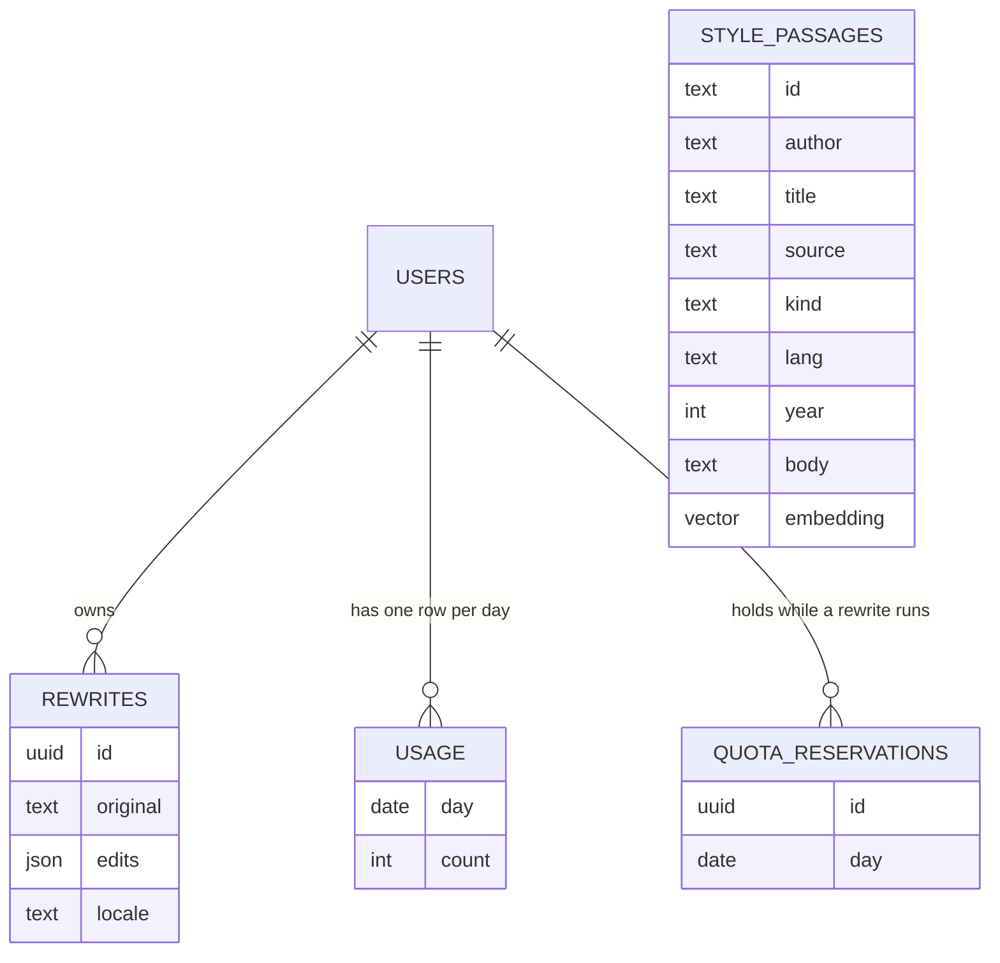
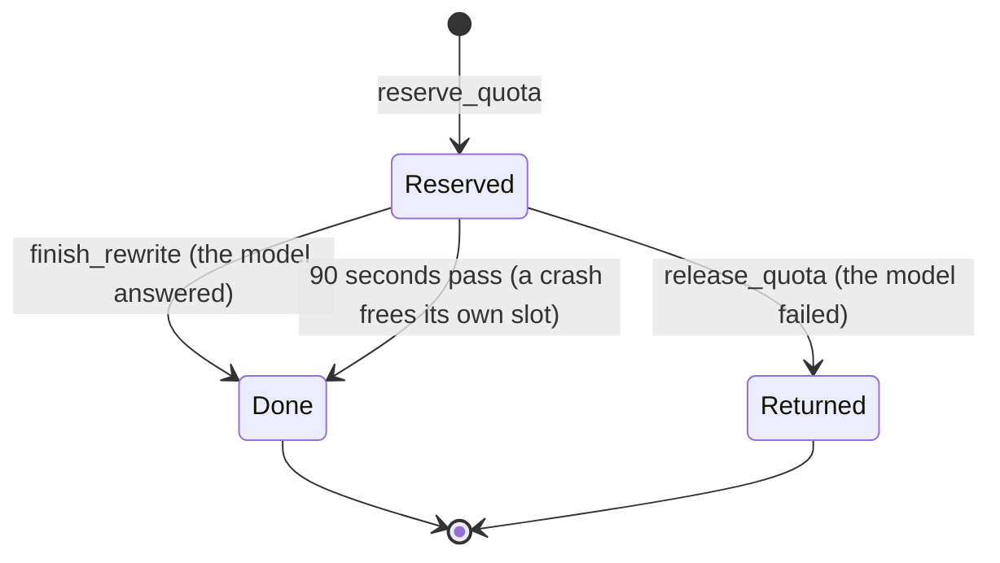
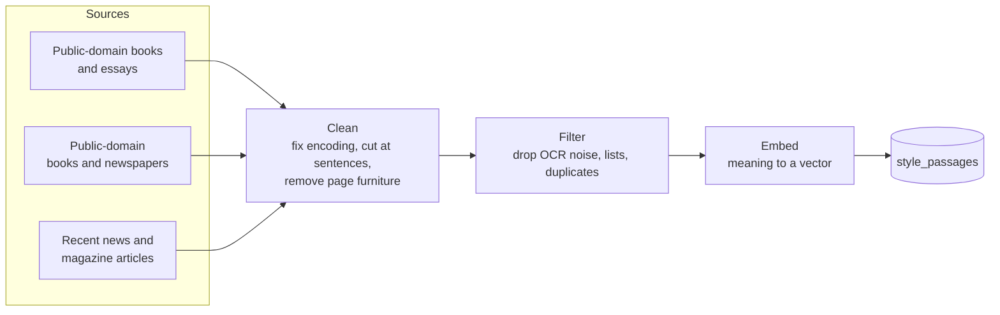
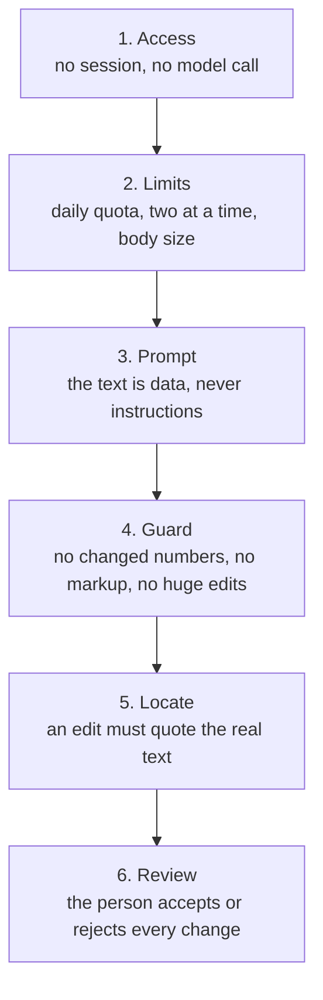

# Architecture

How Rewrity is built, and why each piece is there. Short on numbers on purpose: the choices matter
more than the measurements. For the measurements see the README and `docs/STYLE_CORPUS.md`.

## The idea in one picture

There is no server of our own to run. A web app, a database, and one hosted language model. Each
part does the one thing it is good at, and the app is the only place where they meet.

Why this shape:

- **One deployable app.** The page, the API route and the embedding code live in the same
  project. Nothing to keep in sync, nothing to operate.
- **The database does the heavy lifting.** Authentication, access rules, the daily limit and the
  vector search all happen in Postgres, close to the data, in a few small functions.
- **The model is a dependency, not a component.** It is called from one file, its answer is
  treated as a suggestion, and the app still works (with fewer references) if the search fails.
- **The Python side never runs in production.** It builds the corpus on a laptop and loads it
  into the database. The live site does not need it.

## One rewrite, step by step

The order is deliberate:

1. **Cheap refusals first.** A malformed or anonymous request is turned away before it costs
   anything. The model is never reached without a signed-in user and a reserved request.
2. **Quota and search side by side.** They do not depend on each other, so the visitor waits for
   the slower of the two, not for both.
3. **The model last.** It is the slow and paid step, so everything that can fail early does.
4. **Bookkeeping after the answer.** Saving history and freeing the slot do not change what the
   visitor sees, so they happen once the response is on its way.

## Why each piece exists

### The web app (Next.js on Vercel)

| Piece                        | Job                                  | Why this way                                                                                  |
| ---------------------------- | ------------------------------------ | --------------------------------------------------------------------------------------------- |
| Pages, in English and French | Editor, review, history, privacy     | All text lives in two message files, so a missing translation is a failing test               |
| Route `/api/rewrite`         | The whole rewrite pipeline           | One entry point to guard: it checks, reserves, calls the model, cleans the answer             |
| In-process embedder          | Turns the text into a vector         | A small static model loaded once per server instance: no second service, no extra network hop |
| Guard                        | Drops unsafe edits                   | The model is trusted for wording only, never for facts                                        |
| Locate                       | Finds each quote in the text         | Models miscount characters, so the server finds the positions itself                          |
| Proxy                        | Language routing and session refresh | Keeps the visitor's session fresh without a call from every page                              |

### The database (Supabase: Postgres, Auth, pgvector)

| Table                | Holds                                                             | Who can touch it                                                 |
| -------------------- | ----------------------------------------------------------------- | ---------------------------------------------------------------- |
| `rewrites`           | One row per successful rewrite: the text, the edits, the language | Its owner only: read, add, delete                                |
| `usage`              | How many rewrites a user has used today                           | Its owner can read it; only the functions below change it        |
| `quota_reservations` | A ticket for each rewrite in progress                             | Nobody directly; only the functions                              |
| `style_passages`     | The style corpus (see below)                                      | Nobody directly; only the search function and the loading script |

Every table has row-level security switched on. Hosted Supabase hands new tables to every role by
default, so the permissions are narrowed explicitly in a migration, and a SQL script checks them
against a real database.

### The four database functions

The browser can never write to the quota. Four small functions, run with the rights of the
database rather than the caller, are the only way to change it.

| Function               | What it does                                                                                                                                | Why it exists                                                                                   |
| ---------------------- | ------------------------------------------------------------------------------------------------------------------------------------------- | ----------------------------------------------------------------------------------------------- |
| `reserve_quota`        | Takes one of today's requests and hands back a ticket. Refuses when the daily limit is reached or the user already has two rewrites running | Takes the request _before_ the model is called, so parallel requests cannot slip past the limit |
| `finish_rewrite`       | Marks the ticket finished: the slot is free, the request stays spent                                                                        | A rewrite that worked costs a request, but should not block the next one                        |
| `release_quota`        | Gives the request back, once, for a ticket the caller owns                                                                                  | A rewrite that failed should not cost the user anything                                         |
| `match_style_passages` | Returns the passages closest in meaning to a vector, in one language                                                                        | The only door into the corpus; returns at most ten rows                                         |

**Why tickets instead of a simple refund.** An earlier version had a plain "refund" function that
any signed-in user could call directly, resetting their own quota. A refund now needs the ticket's
unguessable identifier, which only the route holds, and each ticket works once. A forged
identifier gives nothing back.

## What the vector database contains

Not a copy of the internet and not training data. A library of short passages of real published
writing, each stored with a numeric fingerprint of its meaning.

Each row is one passage with:

| Field                               | What it is                                                                         |
| ----------------------------------- | ---------------------------------------------------------------------------------- |
| `body`                              | The passage itself, 45 to 150 words, cut on a sentence boundary                    |
| `embedding`                         | A vector that places the passage by meaning, so similar topics sit close together  |
| `lang`, `kind`                      | English or French; fiction, essay, book or news                                    |
| `author`, `title`, `year`, `source` | Where it came from, shown to the user as credit; the passage itself is never shown |

**Why these sources.** Old books are clean and varied but not today's register. Recent journalism
fixes that, but only from a reviewed list of outlets and only from before late 2022, when a growing
share of web text began to be written by language models. Both kinds are kept: the old ones for
clean rhythm, the recent ones for the way people write now.

**What the passages are for.** Not to copy. The model is shown three of them as a reference for
rhythm and concreteness, and told never to reuse their words. The lookup is by the _meaning of the
text_, not by style, so what comes back is loosely related prose. That is acceptable because the
job is to show how plain, varied writing sounds, not to match the subject.

**Why the embedder runs inside the app.** The same small static model that built the corpus ships
with the web app, so a visitor's text becomes a vector in memory, in well under a millisecond. The
alternative, calling an embedding service per request, would add a network trip, a bill and a
point of failure to every rewrite. A test checks that the Python and TypeScript sides produce the
same vectors.

**Why a vector index in the database.** The search has to find the closest few of tens of
thousands of passages instantly. An approximate-nearest-neighbour index does that, with a small
trade: it may very rarely miss the exact closest passage, which does not matter here. One extra
setting makes the search keep looking until it has filled its page, because the language filter is
applied after the index.

## Safety, in layers

Each layer assumes the one before it can fail. The model's answer is never applied to the text on
its own: it becomes a list of proposals, and the last word is always the author's.

## Decisions and the alternatives left aside

| Decision                            | Instead of                                    | Because                                                                                 |
| ----------------------------------- | --------------------------------------------- | --------------------------------------------------------------------------------------- |
| Edits, not a rewritten text         | Returning a full rewrite                      | Reviewable, reversible, keeps the author's voice, and safe to check automatically       |
| Retrieval of style excerpts         | Fine-tuning a model                           | Nothing to train, the corpus can change in an afternoon, and the source is always known |
| Static in-process embedder          | A hosted embedding API                        | No network trip, no bill, no extra failure; good enough for loose topical matching      |
| Quota inside Postgres               | A counter in the app, or a rate-limit service | One atomic place; cannot be bypassed by parallel requests                               |
| Tickets for refunds                 | A plain refund function                       | A plain refund could be called by anyone to reset their own quota                       |
| Function placed beside the database | The default region                            | Several database calls per request, so distance is paid several times                   |
| Bookkeeping after the response      | Waiting for every write                       | The visitor does not need to wait for history to be saved                               |
| No detector in the product          | Promising "undetectable" text                 | Detectors are unreliable both ways; the research is kept, the promise is not made       |
| Corpus built offline in Python      | Building it on request                        | A slow, heavy, once-in-a-while job that has no place in a request                       |

## What would change at larger scale

Honest limits of this design, so a personal project is not mistaken for a platform:

- **The model call dominates** the wait. Streaming the answer edit by edit would feel faster; it
  would also make the guard harder.
- **The free database tier** holds this corpus comfortably, but not many times more.
- **Quota is per user, not per address.** A determined person can make many accounts; a captcha or
  an email allow-list would be the next step.
- **Edit quality is not measured.** There is no automatic score; judging it means reading edits.
