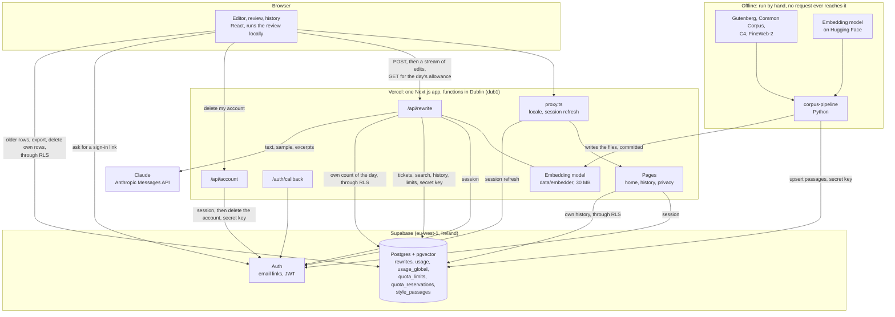
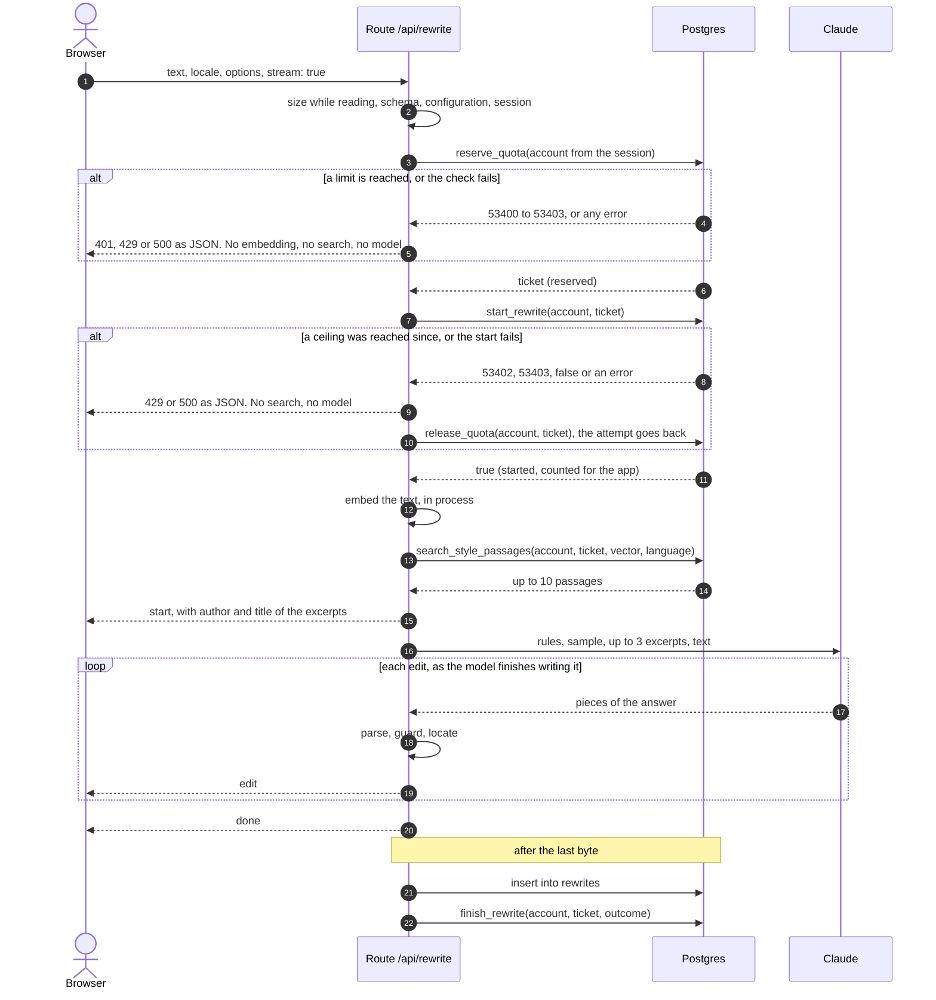
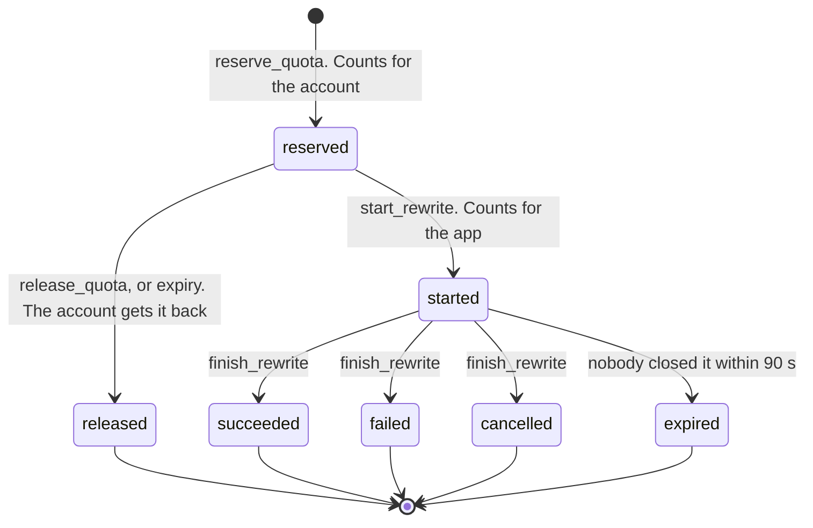

# Architecture

How Rewrity works today, written so you can follow a request without reading every source file.
Figures say how they were obtained. Limits are named where they apply and listed at the end.

**Rollout state.** Until `20261107000000_close_direct_access.sql` (pull request #9, on hold) is applied, signed-in
users can still call the six older quota and search functions, under the same limits, and insert directly into
their own history. The app uses neither. The steps are in
[the deployment guide](DEPLOY.md#moving-a-running-site-to-server-only-operations).

## Components



The function region (`frontend/vercel.json`) and the database region were checked on 2 November 2026:
a request to production answered with `x-vercel-id: cdg1::dub1::…` and the Supabase project is in
`eu-west-1`. The route makes several database calls per request, so the two should stay close.

## One rewrite, step by step



The order follows one rule: nothing that costs anything runs before the quota has answered. Starting
the ticket comes before the search because the database only lets a started ticket read the corpus
([the quota policy](#the-quota-policy)). This costs more database round trips than running quota and search
side by side, as the earlier design did, but that also embedded the text and searched for requests the quota
then refused. In the audit, on a local stack with a simulated model answering at once, the route's own time
was a median of 33 ms, of which 29 ms before the model: body, session, reserve, start and
search (`npm run audit`, 4 November 2026). This is not a production figure. The history and ticket writes at
the end still run in parallel.

## The browser

**Pages.** Next.js App Router under `app/[locale]`, in English and French. `proxy.ts` picks the locale
(URL, `NEXT_LOCALE` cookie, then `Accept-Language`) and refreshes the session cookies. All user-facing
text lives in `messages/en.json` and `messages/fr.json`; message keys are type-checked against English
and a test requires the same keys and placeholders in both. `fr.json` puts a no-break space (U+00A0) before `:`,
`;`, `?` and `!` and inside guillemets, and `tests/messages.test.ts` refuses a breakable space before those four
marks. The editor's character counter and its 5,000 limit, and the writing sample's counter and its 1,500 limit, group
their digits by language, as the free check's limit does: "5,000" in English, "5 000" with a narrow no-break space in
French.

The page shell (header, main, footer, skip link) lives in `app/[locale]/layout.tsx`, inside the intl provider, and
stays on screen through navigation and loading. Pages, `loading.tsx`, `error.tsx` and `not-found.tsx` render inside
that main and have no main of their own. An unknown path under a locale reaches `not-found.tsx` through
`app/[locale]/[...rest]/page.tsx`. Next serves that page as an empty shell, which the scripts then draw: the
`generateMetadata` of `not-found.tsx` puts the title in the shell, and the catch-all re-exports it for the page the
scripts draw, so the tab says "Page not found · Rewrity" or "Page introuvable · Rewrity" from the start. One
`HistorySkeleton` serves both `loading.tsx` and the history page's Suspense fallback. It holds the list's own words
unseen, so the toolbar and the first line of each row wrap where the list's do: the toolbar's count for a full page
and Delete all, in the page's language, and on each row a sample date in the list's format (`ROW_DATE` in
`lib/history.ts`), an edit count, Reopen and Delete. The toolbar keeps its place when the list arrives. Each row holds
three lines of text, the most a row shows, so a row whose text is shorter closes up when the list arrives, and the
rows below it move up. The note above the list of a history longer than one page (`History.olderHidden`) moves every
row down. `AccountSkeleton` holds the account chip's place on the home page.

**What loads when.** The Supabase browser client is loaded on use in the sign-in form, the history list and the
account actions, and prefetched when the email box gets focus. `STRENGTHS`, `Strength` and `MAX_VOICE_CHARS` live in
`lib/text.ts`, so that browser code does not pull in zod through `schema.ts`.

**Sign-in.** An email link only, with no password. `components/auth-panel.tsx` calls
`signInWithOtp` from the browser, which also creates the account on first use. The form says that an account is
needed and that asking for a link creates one, with a link to the privacy page. The link lands on
`app/auth/callback/route.ts`, which exchanges the code for a session cookie and returns to the page the link was
asked from (`next` is `window.location.pathname` at submit), and `safePath` keeps that to same-site paths. The
exchange needs a proof kept in a cookie of the browser that asked (PKCE, which `@supabase/ssr` turns on), so a link
opened anywhere else fails, and that attempt uses the link up. The page says so when it sends the link and when a
link fails.

After sending, the panel names the address and offers "Use another address", which brings the form back with the
value and the focus and sends nothing. While the link is on its way, the panel calls `router.refresh()` on window
focus, and on `visibilitychange` when the page is not hidden, since focus may not fire when coming back from another
app on iOS, and only while `navigator.onLine`: offline, the refresh would fall back to a full load and the browser's
error page would replace the page. So the tab that asked follows the session. When a session reaches the panel it
announces it (`lib/signed-in.ts`), and `useRewrite` drops the `unauthorized` error. When the client script cannot be
fetched for a sign-in, the form says to reload the page (`Auth.sendNeedsReload`), not to check the address, and keeps
the text in the editor as for a link on its way (below), since the reload empties the editor. Offline it says to check
the connection instead (`Auth.sendOffline`), whether the script or the request for the link failed: a reload would
bring the browser's error page, and the next press fetches the script again. It says the same when auth-js gives the
request status 0, which it does when it can read no answer: none came, or what came is not the API's, such as a page
served in its place. A network that is up but reaches nothing, such as a Wi-Fi that asks to sign in first, leaves the
browser online. An error that Auth itself sends, such as a refused address or a busy mailer, keeps `Auth.sendFailed`.
A held Enter asks for one link: the panel cancels the repeats, which would otherwise press "Use another address" and
then send from the box it gives back.

Signing out uses the `local` scope, so other devices stay signed in. It first removes the kept copy of unsent text
(below) and a Reopen on its way, whatever happens next. If the client script cannot be fetched, `signOut` throws, or
`signOut` returns an error and `getSession` then still finds a session or fails, the panel says "Could not sign out,
so this browser is still signed in. Reload the page, then try again." (`Auth.signOutFailed`) and the page stays:
auth-js keeps a session it could not renew first, and removes one the server could not be told about. Otherwise the
page tells the browser's other tabs and does a full load of `/{locale}`, so nothing of the session stays on the screen
or in memory. Meanwhile the button says "Signing out..." and takes no second press, until the page goes or the
failure gives it back.

After a sign-out that worked, and after the account is deleted, the page tells the browser's other tabs through the
`BroadcastChannel` `rewrity:session` (`lib/signed-out.ts`). A tab that shows a session, with a signed-in account panel
on the home page or the history's account section, does the same full load to `/{locale}` and forgets its kept text
and Reopen stash. So does a tab that has shown one since it was loaded, whatever page it is on by then: a client
navigation keeps the editor's text and the router's copies of earlier pages, so the privacy page, a missing page, the
error page or a history that could not be read still hold them. The layout listens for those pages
(`components/leave-on-sign-out.tsx`), and stands aside while a part that shows the session is there to do it. A tab
that has shown no session since it was loaded ignores the news, and the tab that spoke ignores its own. A browser
that has no `BroadcastChannel`, or refuses one, tells and hears nothing.

**Streaming.** `lib/rewrite/client.ts` posts with `stream: true` and reads one JSON event per line
(`lib/rewrite/protocol.ts`): `start`, `edit`, `done` or `error`. A refusal before the stream starts
comes back as plain JSON with an HTTP error; once the stream has started, the status is already 200
and failures travel as an `error` event. A `done` with `partial` says the model stopped early. A stream
that ends without `done` is reported as a network error.

**Review.** `components/use-rewrite.ts` holds the request state and keeps the edits in reading order as
they arrive, since the model can write a later edit first. Decisions stay in the browser and never go
back to the server: `lib/rewrite/apply.ts` rebuilds the result from the accepted edits, so rejecting or
undoing costs nothing. Until the first edit is on screen, the box is read-only and dimmed and the Rewrite
button shows the wait; nothing is drawn over the box. Stop appears once the first edit is on screen; it
aborts the request and keeps what has arrived. When the answer stops short, the page says so above the
edits it has. A refusal that follows some edits withdraws them and shows the message, because the
server keeps nothing of that answer. Boxes work before the scripts arrive, and what was typed by then is
taken in when they do, as is the text a browser puts back on Back (`components/use-typed-early.ts`). When a text of
30 words or more is guessed to be in the other language than the page, the review's text, quotes and wordings carry
`lang`, and so do the model's reasons; the free check's and the sample's reasons stay in the page's language and
carry none.

**Decisions and undo.** `lib/rewrite/decisions.ts` holds the decisions as a pure undo log: `ReviewLog` is the current
`ReviewState { decisions, overrides }` plus the earlier snapshots. A decision, a card's Undo, a bulk decision and a
saved wording are one step each, and a change that changes nothing leaves no step. U and "Undo last decision" take
one step back and restore the whole state. While some edits are decided and others are pending, the bulk buttons
read "Accept the rest" and "Reject the rest" and reach the pending edits only. While all are pending or none is,
they read "Accept all" and "Reject all" and reach every edit.

**Your own wording.** The Reword field puts the writer's words in place of a suggestion, and `applyEdits` takes the
overrides. A wording exists only on an accepted edit, leaving accepted drops it, and a blank one is refused. Written
in place of a suggested removal, a wording gets back the blank the removal took on one side of its words, a space or a
paragraph break, without doubling one the writer typed on that side (`accepted` in `lib/rewrite/apply.ts`). It
changes the review only: nothing is sent and the history keeps the model's suggestion, so a rewrite reopened from
History shows the suggestions, not the writer's wordings. The field's soft warning uses `factChange` from
`lib/rewrite/guard.ts`, the five fact checks `whyDrop` also runs. It warns and does not block. It is fetched on
first use, and until it arrives, or if it cannot be fetched, there is no warning. The hint for a blank wording is tied
to the field with `aria-describedby`. A wording accepted with Ctrl or Cmd+Enter in the field has its warning, if any,
said on the status line with the decision, since that way never passes the button that carries it.

**Word marks.** `lib/rewrite/word-diff.ts` marks the words that change inside each edit. It is fetched with the
first rewrite, and when an edit appears without it (a reopened rewrite, the example, the free check). Marks fall
back to whole lines when under a third of the letters and digits are shared, above 1.5 million comparison cells, or
if the script cannot be fetched.

**The review bar and the result.** `components/review-bar.tsx` renders a sticky row and a block in the normal flow.
The row must stay one row inside the 96 px scroll margin that cards and the review's buttons and textareas carry.
`components/result-panel.tsx` shows the result's length against the original, and copies the result with the
clipboard API or downloads it as a text file, in the browser only. A failed copy shows an alert and selects the
text. A copy that works, of the result from the panel or the sticky row, or of the list, is said on the workspace's
status line (`Review.status.copied` or `Review.status.listCopied`), since screen readers do not announce the button's
new label. The line is empty for one frame first, so that a second copy in a row is said again. The sticky Copy goes
through `ResultPanelHandle`, so that its failure shows in the panel too.
`lib/rewrite/change-list.ts` builds the list of accepted edits (before, after, why), and it is static rather than
fetched because the clipboard write must stay in the user's gesture. A button that takes the place of another one
ignores the second click of a double click (`lib/first-click.ts`), which covers Reject, the sticky Copy, Download
.txt and Copy text among others.

**Keyboard and focus.** The shortcuts (`lib/rewrite/keys.ts`) are bound to the review section (`tabIndex` -1) and
dead outside it, for WCAG 2.1.4, and never fire with Ctrl, Cmd, Alt or Shift; a capital typed with Caps Lock still
counts. They act on the card that holds the focus while it waits for a decision, and on the marked edit otherwise.
Held A, R, E and U count once; J and K repeat. The field a held E opens, or gives the focus back to, takes none of its
repeats until a first key is pressed in it. A held Enter on a control counts once, through a capture listener on the
document that remembers where the press began, unless it began in a field (`components/use-enter-once.ts`, also on the
history page, where a delete or a load takes the keyboard to a row's Reopen); a held Ctrl or Cmd+Enter in the box
sends one request. The first pending edit is marked once the answer is complete, and the mark moves to the next
pending edit after a decision, or nowhere when none is left; a card's Undo keeps it on that edit. "Next to decide"
first brings the marked card into view when it is out of sight, then goes on from the card it last brought, which a
new review forgets. The hint sits in `ReviewBar` and is hidden where nothing can hover (`hover: none`).

The heading takes focus on open with `preventScroll`, the marked card takes focus after a shortcut, the pressed button
keeps focus as it becomes Undo, and the box takes focus coming back from a review. The review is scrolled into view on
the frame after it opens: on Back or Forward it opens before the browser puts back the page's scroll. The editor and the
review take each other's place inside one box, which the browser's scroll anchoring then holds, rather than the example
below, which the much longer review would push down. When the answer ends with the focus on Stop, which turns into "Back
to the original text", the focus goes to the heading. While the review is open, a click on nothing that leaves the focus
on the page gives it back to the review section, so the letters keep working, and Tab then goes on from the top of the
review; a click on a control keeps its focus. After a failed rewrite or free check, the focus goes back to the button
that was pressed if it had fallen to the page, and after a sign-in link that could not be sent, to the email box; that
element is described by the failure message while it shows. Enter on "Do not keep this text in my history" does not send
the form, and Escape in the Appearance panel puts the focus back on its button. One always-mounted `role="status"` per
workspace is the only live region for the review's counts; `AuthPanel`, the history list and the account actions have
their own. The main box is described by its word and character counts, the writing sample's box by its hint and its
counter, and each intensity segment by the hint for that intensity, through the segment's `describedBy` in
`SegmentedControl`, so that a segment reached without being chosen is described too. Those hints are hidden elements,
and the visible hint is the chosen intensity's.

**Colours.** The day and night themes and the five accents are CSS variables in `app/globals.css`. `--accent` fills
buttons and marks. `--accent-text` colours text and small icons, and also the focus outline and the active edit's
ring. `--accent-hover` shades accent-filled buttons under the pointer, with no filter. `tests/accent-contrast.test.ts`
measures, for each accent and theme, the rings at 3:1 and the label at 4.5:1 at rest and under the pointer; the
audit's look suite measures the hovered Accept for each accent and theme, and has a forced-colours check. The chosen
segment of a control has a muted ring as well as its fill. In forced-colours mode, an accepted edit's changed words
keep their strike-through, accent-filled buttons and links get a 1px `ButtonBorder` border, except the current
language, and the marked edit gets a 2px `Highlight` outline.

**Leaving and coming back.** "Back to the original text" leaves the review without ending it. "Back to the review"
is offered in the editor only while the box holds exactly the reviewed text, because offsets are valid only against
that string, and not while the free check's code is on its way, since the check would replace that review. "Edit this
result" puts the applied text in the box and ends the review; it is hidden while the result equals the text and while
the model writes. `Draft.review` in `lib/rewrite/draft.ts` keeps a finished review in module memory across a language
switch or a trip to History, including decisions, undo steps, the marked edit and which screen was open. A reopened
rewrite takes priority, an answer being written is not kept, and a new answer or "Edit this result" ends it.

A rewrite that brings nothing in its place gives the earlier review back with its decisions and undo steps, and with no
wording field open. That covers an error before any edit and a refusal, which also withdraws the edits it followed.
"Back to the review" is offered next to the error while the box holds that text, and the error goes once the reader
moves to the review, except a request to sign in, which stays until a session arrives. To give it back,
`useRewrite().start` keeps the edits, credits and flags, and `submit` keeps the decisions, the marked edit and the
reviewed text. Edits already shown when an answer fails stay, cut short, and a stopped answer stays. After a first
rewrite that fails there is only the error.

**From the history.** A rewrite reopened from the history travels through `sessionStorage`, and its offsets are
checked against the text before being trusted (`lib/rewrite/reopen.ts`). On a client-side navigation it is read as
the workspace is first created. On a full load the page from the server holds the editor, so `RewriteWorkspace` reads
it once React has taken that page over (a hydration flag from `useSyncExternalStore`) and starts the workspace again
with it, keyed on what was read, with no hydration error. Either way it is removed only once React has kept a render
that read it, because React can throw a render away and start again. `stashReopen` returns false when storage is
blocked, and History then stays put with a message.

**Unsent text.** What the reader has typed stays in memory while they move between pages and languages
(`lib/rewrite/draft.ts`), and a reopened rewrite does not replace it; a reload loses it. There is one exception.
Once a sign-in link is on its way, or the form asks for a reload to send one, one copy of the text, the strength and
the choice to leave it out of the history, never the writing sample, goes to `localStorage` under
`rewrity:sign-in-draft`, and `keepDraftForSignIn` removes an earlier copy when the editor is empty. `TextEditor` calls
`onReady` from an effect, so nothing is read in a first render on a full load, and the workspace applies the copy only
if the box holds nothing and no reopened rewrite is waiting to take the editor's place. The copy is removed when
applied, when older than an hour (`otp_expiry`) or malformed, at sign-out and when the account is deleted; reading it
does not consume it. The editor also has a line saying where the text goes, with a link to the privacy page.

**The example.** `useRewrite().show(edits, source, notShown)` opens a review without a request; `source` is `sample`
or `check`, and it resets as a submit does. "Try an example" is offered while the box is empty. `Editor.exampleText`
and `Editor.exampleEdits` are in the message files, and `lib/rewrite/sample.ts` places them with `indexOf` at run
time, so that locate and the guard stay out of the page's script; `tests/sample.test.ts` checks them with the real
locate and guard. `KeptReview` carries `source` and `more`. A kept sample is rebuilt from the page's messages on a
language switch and never enters the box or the copy kept for a sign-in link. On a sample, "Use your own text"
replaces the back button and empties the box, and "Edit this result" is hidden.

**The free check.** A second button in the editor runs a short list of stock phrases and paste clean-ups in the
browser, up to `MAX_CHECK_CHARS` (50,000, in `lib/text.ts`), and opens the result through `show`. It is not offered
while a review by the model waits behind the editor for the very text in the box, since it would replace a review that
cost an attempt; it comes back as soon as the box differs. `lib/check/scan.ts`, `rules-en.ts` and `rules-fr.ts` load
by dynamic import when the button is pressed. The language is `guessLanguage`, then the interface language.
`edit.reason` holds a category, and the page words it from `Review.checkReason`. Every edit passes the real `whyDrop`
at run time; a clean-up the guard calls `unchanged`, as it does a change of spacing, has to pass `factChange` instead.
Nothing inside quotation marks is touched, apart from the no-break space a French guillemet takes at its edge. A
straight single quotation still counts as one when it holds an apostrophe between letters ('I can't stay,'). Code
counts as quoted too, and a guillemet in it takes no space: a span between backticks on one line, and a block fenced
with three backticks that start a line and are closed again; an indented fence (as in a list item) or one never closed
is read as prose; lines of `~~~` do not count, since prose uses them to break scenes. French spacing is proposed only
in a paragraph that shows no sign of another language: `guessLanguage` saying English, English function words and no
French one (`soundsEnglish` in `lib/style/language.ts`), or a ¿ or ¡. Short French that shows nothing either way still
gets it on a French page. Phrases come before clean-up under `MAX_EDITS`, with a note for the rest
(`Review.checkMore`). `Review.checkNoEdits` exists because a short list cannot say that a text reads naturally. The
privacy page and the editor's notice say that the check runs in the browser and sends nothing.

The phrases leave a sentence whole. A swap or an opener is left alone when dropping its last word would strand the
same word repeated later in the sentence ("that A and that B", "que A et que B", "in A and in B", the same with "to"
and "of", and "de A et de B" before an infinitive); in a chain of openers, only the stranding one stays. A full stop
after one to three letters, counted back to the nearest character that is not a letter, does not end that sentence,
since it may close an abbreviation ("M. Durand", "Mr. Lee", "the U.S. economy", "e.g."). So "aujourd'hui.", "isn't."
and "dis-je." read on as well, and so does "etc" before an ellipsis, written as one character or as three dots:
reading on too far only costs a suggestion. Any other full stop ends the sentence, even in "Prof.", and so does a
question mark, an exclamation mark or any other ellipsis, but only when white space comes right after the mark: one
followed by a closing quotation mark or bracket, as in "(on Monday.)", reads on. A swap is also
left alone when it runs across a line break into a line that starts with a capital, when it is in Title Case after a
lower-case word, for "in order to" before a determiner, for "a testament to" after There or Here, and for a lower-case,
unaccented "a l'heure", which is the verb. An opener stays before a French speech tag ("ajouta-t-il,") or an aside
opened by "and" or "et". The word after a removed opener keeps how it is written when it starts an address (`://`,
`@`, `.xx`). A greeting followed by lower-case words stays. A sentence that fills a list or heading line takes that
line's marks with it and keeps the paragraph gap on the other side. "Il est essentiel de ne pas" becomes "Il ne faut
pas", and "s'impose comme un véritable" only loses "véritable".

**The line about the limits.** `components/allowance-line.tsx`, above the editor, words what `GET /api/rewrite`
answers ([below](#the-route)): the attempts left today and when they reset, the limit for a visitor, or that
rewriting is paused. `lib/rewrite/allowance-store.ts` holds the answer in memory and asks again when an attempt
ends. On a preview or without the secret key the line stays empty.

## The route

`app/api/rewrite/route.ts` is the only entry point that can spend money. In order:

1. **Size and shape.** `lib/rewrite/body.ts` counts the bytes as they arrive and stops reading past 40,000,
   so multibyte characters and a missing or false `Content-Length` change nothing: a 413, before the
   session, the quota or the model. A body that fails the zod schema (`lib/rewrite/schema.ts`) gets a 400.
   The text is limited to 5,000 characters and the sample to 1,500. The schema also refuses lone surrogates
   in either as `invalid_request`, before the session, because the API can answer such text with a 400 that
   would read as `provider_unavailable`.
2. **Configuration.** Without `ANTHROPIC_API_KEY`, `SUPABASE_SECRET_KEY` or the other Supabase variables, a 503,
   with the log line `Rewrite refused not_configured`. That is what a preview answers, since it has neither secret.
3. **Session.** `supabase.auth.getClaims()`, then a 401 without a user. If the auth server cannot be
   reached, or answers that it is overloaded or failing, the answer is a 500 instead, since that does not mean the
   reader signed out. The check has 8 s (`AUTH_MS`, `lib/supabase/auth-down.ts`, as long as a database call). One
   that has not answered by then, on a key set not cached yet or a legacy token that goes to Auth, counts as Auth
   being down: the same 500 `server_error` and the same log line, `Rewrite refused auth_down`, before the quota, so
   nothing is reserved or spent.
4. **Reservation, start, search, model.** As in the diagram above.
5. **Bookkeeping,** with `after()`, so the reader does not wait for it and the platform keeps the
   function alive until it is done.

`maxDuration` is 60 s. The model call must end within 50 s of the request's arrival, whatever the
session, quota and search took, which leaves time to save what arrived and close the ticket. The SDK's
own `timeout` is not enough for that: it stops once the response headers arrive, so it cannot end a
stream that stalls or runs long.

Each call through the server's Supabase client, the quota functions and the history insert, is limited to 8 s
(`DATABASE_MS`, `db.timeout`, `lib/supabase/service.ts`), measured up to the response headers, which PostgREST
sends once the query has run. That fits between the model's 50 s and the function's 60 s; the search keeps its own
5 s. The session check before them has the same 8 s (`AUTH_MS`), taken out of the model's 50 s, since those count from
the request's arrival. A reserve or a start that times out answers `server_error`, and a finish or a release that
times out leaves the ticket to expire at 90 s. `frontend/tests/deadlines.test.ts` holds the chain: the model call, and
a database call after it, under the function limit, `vercel.json` equal to `route.ts`, the function under the lowest
TTL the column allows (75 s today), the session check, the reservation, the start and the search at their limits
(8 + 8 + 8 + 5 s) inside the model's 50 s, and the account route's session check and two calls to Auth (3 × 8 s)
inside its 30 s. The test reads that TTL from the last migration that touches the column's check, in any case and
spacing and without its comments, and fails when that migration states no plain `check (ticket_ttl_seconds >= N)`, as
with a range or a dropped constraint.

| Error code              | HTTP     | When                                                                                                                 | Counted                  |
| ----------------------- | -------- | -------------------------------------------------------------------------------------------------------------------- | ------------------------ |
| `invalid_request`       | 400, 413 | Bad body                                                                                                             | No                       |
| `not_configured`        | 503      | Missing key or Supabase settings                                                                                     | No                       |
| `unauthorized`          | 401      | No session, a rejected token, an account deleted                                                                     | No                       |
| `too_many_requests`     | 429      | Two attempts already open (53400)                                                                                    | No                       |
| `quota_exceeded`        | 429      | The account's daily limit (53401)                                                                                    | No                       |
| `global_quota_exceeded` | 429      | The app's daily or monthly ceiling (53402, 53403)                                                                    | No                       |
| `server_error`          | 500      | Auth or the quota check is down or out of time, the start failed                                                     | No, the model not called |
| `busy`                  | 503      | Rate limit or overload, as a status or in a stream                                                                   | Yes                      |
| `provider_unavailable`  | 503      | The API turned the call down: status 400, 401, 402, 403 or 404 (no credit, spend limit, rejected key, unknown model) | Yes                      |
| `upstream_error`        | 502      | Any other failure of the call (below)                                                                                | Yes                      |
| `no_usable_edit`        | 502      | Every edit of a complete answer failed a check                                                                       | Yes                      |
| `refused`               | 422      | The model declined                                                                                                   | Yes                      |

`upstream_error` covers another API error (409, 413, 422, 5xx), a lost connection, the 50 s deadline, and an
answer that is cut off or does not follow the schema. Anything unforeseen after the start answers `server_error`
and stays counted.

**The server's access to Supabase.** The route has two clients. `lib/supabase/server.ts` builds one from the
publishable key and the visitor's session cookie. It says who is asking, and the allowance below reads the account's
own count through it. `lib/supabase/service.ts` builds the other from `SUPABASE_SECRET_KEY`, with no session of its
own, and it runs the quota, the search and the history insert. The account each call passes comes from the verified
session, never from the request, and each function checks that the ticket belongs to that account. One more route
uses that client: `app/api/account/route.ts`, for `auth.admin.deleteUser` and nothing else.

**Why a secret key.** It acts as `service_role`, which is broader than either route needs and bypasses RLS. A
Postgres role of its own would be narrower, but it takes a direct connection from serverless functions, so a
driver, a pooler and a password that Supabase's key rotation does not cover. A custom JWT role depends on how
the project signs its tokens, which is a console setting. So the key is what this stack makes practical, and
it is narrowed where it can be: a key for these two routes alone (`tests/service.test.ts` holds the exact list, both
by the module's path and by the name `createServiceClient`, so that a relative import or a re-export cannot get past
it), in Vercel Production only, with no `NEXT_PUBLIC_` prefix, in a module that fails the build when client code
imports it (`import "server-only"`). The audit looks for the key in the bundles. The table grants of `service_role`
stay as they are, because the corpus pipeline and the tests use them. A leak would reach the whole database, so
[replacing the key](DEPLOY.md#what-is-set-where) is part of the deployment guide.

`getClaims()` verifies the token locally only when the project signs its tokens with asymmetric keys;
with the legacy shared secret it calls Supabase Auth on each request. That is a console setting, not
visible from this repository.

**What is left today.** `GET /api/rewrite` (`lib/rewrite/allowance.ts`) answers `{ allowance: { limit, used, open } }`,
or `{ allowance: null }` when it cannot say, always with `no-store`, and with no ticket, no attempt line in the logs,
no embedder and no model. `used` is the account's own row of the UTC day, read through the session under RLS, and
`null` for a visitor. The limits and the global counts are read through the service client, and only a boolean,
`open`, leaves for the global ceilings. The session check gives up after 3 s (`READ_MS`), as do the reads, which run
side by side, so a stalled Auth or database holds the GET about 6 s at most. A session check that runs out of time
counts as Auth being down: `{ allowance: null }`, with no log line. The line it feeds is a hint, never a promise: the
POST stays the only authority.

**Deleting an account.** `app/api/account/route.ts` deletes the account of the verified session for good, and its
rows go with it through the foreign keys ([below](#the-database)). The id in the body only has to agree with the
session: the page asks for the account it was rendered for, and a tab left open after signing in as someone else
must not delete that other account. On success the route signs out with the `local` scope, which clears this
browser's cookies, and the page then tells the browser's other tabs, as after a sign-out
([above](#the-browser)), and does a full load of `/{locale}`.

The route's `maxDuration` is 30 s. Every call to Auth there, the session check included, has 8 s (`AUTH_MS` in
`lib/supabase/auth-down.ts`), because the server client's `db.timeout` covers its table calls, not its calls to Auth.
A deletion that ran out of time may still go through, so the page says it could not confirm the deletion. Pressing
again settles it while the session works, because Auth answers 404 for an account already gone, which counts as done.
But the session can go with the account: with the legacy shared secret the session check asks Auth, which no longer
knows the user, and once the access token has expired its renewal fails, because the refresh token went too. So the
page remembers a press that got no definite answer (none at all, or a 5xx), and a 401 to a later press signs this
browser out as after a deletion, as the failure said it would. The page does not say whether the account is gone, nor
suggest signing in to check, which would create a new account if it is. A 401 to a first press, and a 409, still say
that nothing was deleted. A sign-out that throws or has not answered within 8 s still answers 200, and the route then
clears this browser's session cookies itself: every cookie of the request whose name starts with `sb-` (the session,
its chunks and the code verifier) comes back expired, `Max-Age=0` and an `Expires` date in 1970, with `Path=/` and
`SameSite=Lax`, the path and attributes `@supabase/ssr` gives them. The date is what still expires them when the
session check renewed the session in the same request: Next adds the renewed cookies to the answer by reading its
cookies back, which drops a `Max-Age` of 0. A sign-out that answers leaves that to `@supabase/ssr`.

| Answer                    | When                                                                                          |
| ------------------------- | --------------------------------------------------------------------------------------------- |
| 403 `invalid_request`     | The `Origin` header does not name this site                                                   |
| 400 `invalid_request`     | A body that does not name an account                                                          |
| 503 `not_configured`      | No secret key or Supabase settings                                                            |
| 500 `server_error`        | Auth is down, the session check or the deletion did not answer in 8 s, or the deletion failed |
| 401 `unauthorized`        | No session                                                                                    |
| 409 `invalid_request`     | The body's account differs from the session's                                                 |
| 200 `{ "deleted": true }` | Deleted, or already gone (Auth answered 404)                                                  |

## The database

| Table                | Holds                                                                                | Who can reach it                                                                                                                             |
| -------------------- | ------------------------------------------------------------------------------------ | -------------------------------------------------------------------------------------------------------------------------------------------- |
| `rewrites`           | History: user, original text, edits, edit count, language, date                      | Its owner reads and deletes, through RLS. The app adds rows on the server only; a direct insert stays open until `20261107000000` is applied |
| `usage`              | Attempts per account per UTC day. Never purged; goes with the account                | Its owner reads. Only the functions write                                                                                                    |
| `usage_global`       | Started attempts per UTC day, all accounts. Stays when an account is deleted         | Owner and secret key                                                                                                                         |
| `quota_limits`       | One row: the limits                                                                  | Owner and secret key                                                                                                                         |
| `quota_reservations` | One ticket per attempt: user, day, state, timestamps                                 | Owner and secret key; the functions change it                                                                                                |
| `style_passages`     | The corpus: passage, vector, author, title, language, kind, source, collection, year | Owner and secret key; the route reads it through the search                                                                                  |

"Owner" is the database owner, in the SQL editor. The secret key (`service_role`) reaches the same
tables over HTTP: one on Vercel for the two server routes, another on the operator's machine for the corpus.

A user can delete their own account through `/api/account`. All three tables linked to `auth.users` (`rewrites`,
`usage`, `quota_reservations`) cascade, and a catalog test in `supabase/tests/rls.test.mjs` enforces that for every
foreign key to `auth.users` in `public`.

Row-level security is on for every table. Hosted Supabase may grant new tables and functions to `anon` and
`authenticated` by default, so migrations revoke them explicitly. `npm run test:db` asks the catalog what
each browser role can do, a grant to `PUBLIC` or on a single column included, and fails on any privilege
beyond the list it expects: `SELECT` and `DELETE` on `rewrites`, `SELECT` on `usage`, and `EXECUTE` on no
function but, until `20261107000000` has run, the six older ones, along with `INSERT` on `rewrites`. It also
checks that the functions run as their owner with an empty search path, and that the
limits are the ones shipped. The `SELECT` on `usage` dates from the first migration: the line above the editor
reads the account's own row of the UTC day through it, and it only shows a user their own daily count.

### The quota policy

The limits live in one row of `public.quota_limits`:

| Limit                | Value | Why it exists                                                                                      |
| -------------------- | ----: | -------------------------------------------------------------------------------------------------- |
| `user_daily`         |     5 | One account cannot use the whole demo                                                              |
| `global_daily`       |    15 | Creating accounts does not create budget                                                           |
| `global_monthly`     |   300 | Bounds a month of a public demo, and binds before 15 per day does                                  |
| `max_in_flight`      |     2 | Each attempt holds a function for up to a minute and a paid call                                   |
| `ticket_ttl_seconds` |    90 | Above the route's 60 s limit, so a live request never loses its ticket (`tests/deadlines.test.ts`) |

These are cautious starting values, changed with one `update` in the SQL editor and no deploy. Setting
`global_daily` to 0 [pauses the site](DEPLOY.md#pausing-the-site). They count calls, not money, and the real
spending cap is the one set on the app's workspace at Anthropic. Days and months are UTC.

#### What one attempt costs

An estimate from the bounds in the code, with Claude Sonnet 5.5 at $2 per million input tokens and $10 per
million output tokens (read on 4 November 2026). No real call has been measured. The route uses no prompt
caching and makes no retry, so one attempt is one call at those rates.

| Part                                    | Bound                                                                                                         | Cost at most |
| --------------------------------------- | ------------------------------------------------------------------------------------------------------------- | -----------: |
| Output, thinking included               | `max_tokens`, 8,000                                                                                           |        $0.08 |
| Input, ordinary prose                   | About 15,000 characters: system prompt 4,666, schema, text 5,000, sample 1,500, three excerpts of 150 words   |  About $0.01 |
| Input, a text written to tokenise badly | About 22,000 tokens: the fixed part, and text and sample taken as one token per byte, which is 19,500 at most | About $0.044 |

So an attempt costs **about $0.09 at most on ordinary prose and about $0.125 at worst**. The output bound is
most of that, and an answer rarely uses all of it. The ceilings then bound the bill: 15 attempts a day come
to $1.35 to $1.90, and 300 a month to $27 to $38. The line `Rewrite attempt` in the logs gives each call's
real tokens ([below](#history-and-bookkeeping)), except the output of an answer cut short: the API gives that
count in its last event, so the line leaves it out. A price or model change makes these numbers wrong without
anything failing, which is one reason for the spending limit.

**A ticket for each attempt.** Every change of state is a guarded update (`where state = ...`) under
one transaction-level advisory lock, so a ticket moves forward once, however many calls race.



A request refused by `reserve_quota` never gets a ticket: the function raises an error, the
transaction rolls back and nothing changes.

| What happened                                  | Browser receives        | History              | Ticket      | Counted |
| ---------------------------------------------- | ----------------------- | -------------------- | ----------- | ------- |
| Complete answer, with or without edits         | edits, `done`           | Saved                | `succeeded` | Yes     |
| Complete answer, every edit failed a check     | `error`                 | No                   | `failed`    | Yes     |
| Cut off, error or 50 s deadline, after an edit | edits, `done` (partial) | Delivered edits only | `failed`    | Yes     |
| Cut off, error or 50 s deadline, before any    | `error`                 | No                   | `failed`    | Yes     |
| Refusal, even after some edits                 | `error`                 | No                   | `failed`    | Yes     |
| Reader left or pressed Stop, some edits sent   | -                       | Delivered edits only | `cancelled` | Yes     |
| Reader left before any edit, after the start   | -                       | No                   | `cancelled` | Yes     |
| Reader left before the start                   | -                       | No                   | `released`  | No      |
| Function killed before closing the ticket      | -                       | No                   | `expired`   | Yes     |
| Start failed; the model was not called         | JSON error              | No                   | `released`  | No      |
| Function killed before the start               | -                       | No                   | `released`  | No      |

Nothing is refunded once a ticket has started, because the code cannot establish that a call was free.
Some of those attempts probably were: an overload answer, or a reader who left during the search, in
which case the aborted call never reaches the service. Nothing here relies on how Anthropic bills them.
A misconfigured key therefore uses up attempts, which is why the deployment guide runs one real rewrite
first. `refused`, `busy`, `provider_unavailable`, `upstream_error` and `no_usable_edit` tell the reader that the
attempt counted, and `server_error` before the start means it did not. Three cases cannot say so: the browser's
network message, which does not know, a `server_error` after the start, whose message is the one used before it,
and a failure after some edits, which shows the edits and says the answer was cut short. An answer that is not the
route's JSON, a platform error page, which can come before any attempt was taken, also shows `server_error`, which
makes no claim about the count. The message of `no_usable_edit` says that no suggestion passed the checks and does
not ask for a retry.

**The reader leaving.** On a streamed answer, the only kind the page asks for, it aborts the model call,
so nobody pays for more of an answer nobody reads. A direct caller of `stream: false` is only heard
leaving before the start: after that the call runs to its end, and the attempt counts either way. The
server hears of it through the request's signal or through the response stream being cancelled, and
listens to both (`lib/rewrite/stream-response.ts`). Vercel only fires the signal for routes that opt in,
so `frontend/vercel.json` sets `supportsCancellation`. Vercel then ends the function, except for work
handed to `after()`, so the route holds the function open with `after()` as soon as a ticket exists,
until the ticket's own bookkeeping is handed over. This was tested on `next start` and with
the real SDK over a local socket, and a local `vercel build` shows the setting in the function's
configuration, but it has not run on a Vercel deployment, so
[the deployment guide](DEPLOY.md#after-a-deployment) includes the check.

**The functions.** The five below are `security definer` with an empty `search_path`, and only `service_role` can run
them: execution is revoked from `PUBLIC`, `anon` and `authenticated`. They take the account as an argument,
because `auth.uid()` is empty under the secret key, and every step checks that the ticket belongs to it.

| Function                                                       | What it does                                                                                          |
| -------------------------------------------------------------- | ----------------------------------------------------------------------------------------------------- |
| `reserve_quota(account)`                                       | Closes expired tickets, checks the four limits, counts the attempt for the account, returns a ticket  |
| `start_rewrite(account, reservation)`                          | Moves a live reserved ticket to started and counts it for the app. Re-checks the ceilings, atomically |
| `finish_rewrite(account, reservation, outcome)`                | Closes a started ticket, once, and frees its slot                                                     |
| `release_quota(account, reservation)`                          | Gives back a ticket that never started, once                                                          |
| `search_style_passages(account, reservation, vector, lang, n)` | Returns up to 10 passages, once per started ticket                                                    |

**What a browser can no longer do.** The first versions of these functions were open to signed-in users, with the
same limits but no route in front. Three accounts could take all 15 of the day's places through the API without any
model call, a user could add any number of rows to their own history, and a started ticket read ten full passages.
A user's token is refused on the five functions above, and `supabase/tests/rls.test.mjs` reads every privilege the
browser roles hold from the catalog. The older functions they replace and the direct insert stay open until
`20261107000000` is applied (pull request #9, on hold).

**Why the search is one call now.** It used to take two. The API runs a function and its outer query in one
transaction, and a browser could make that outer query fail: `select=body::int` raises an error that quotes
the value and undoes what the function recorded, so one attempt could have read the corpus through error
messages. So one call recorded the passages and another read them. Only the server calls the search now, and
its outer query is fixed, so one call keeps the same guarantees, which the tests confirm: once per started
ticket, for the account that owns it, ten rows at most, and nothing once the ticket is closed. A search that
fails rolls back and can be repeated.

Holding reservations does not block others: the app-wide ceilings count started tickets only, and the app
starts a ticket only in the route, right before it calls the model.

**Failure.** If the database cannot be reached, or the limits row is missing, `reserve_quota` gives no
ticket and the model is not called. If closing a ticket fails, the next accepted reservation closes it
once it is over 90 seconds old; the attempt stays counted. A refused call rolls that closing back, so on
a quiet app, or once a ceiling refuses everyone, a stale ticket stays until the next accepted attempt.
The counts stay right, because each call does that work again first. An accepted reservation also
deletes the 200 oldest tickets past two days, after its checks: more than it adds, so the table cannot
grow for long, and never so many that a backlog holds up everyone waiting on the lock. No scheduled job
does it, which would be new infrastructure for a small table.

**The choice of one lock.** A single advisory lock serialises reservations for the whole app, which is
the simplest way to make "check, then count" atomic across three counters. The calls take milliseconds
and this app allows 15 started attempts a day. At a much larger volume, conditional updates on counter
rows would avoid the queue. This relies on one function per request, which is how the route calls them. No
browser can call these five by any path, `pg_graphql` included, which is off on the hosted project (read-only
check, 3 November 2026) and has no reason to be on; the older functions stay callable until `20261107000000` is
applied.

**No limit per IP address.** Nothing here reads a client address. An account is needed before anything
is spent, and the ceilings hold however many addresses there are. Supabase Auth limits sign-ups per
address, and Vercel offers firewall rules; both are console settings.

## Vector search

Each passage has a 256-dimension vector in `style_passages.embedding`, compared by cosine distance
through an HNSW index (`extensions.vector_cosine_ops`). pgvector was preferred to a separate vector
service because the data, the access rules and the search then live in one database, with nothing else
to run or pay for. HNSW is approximate: it can miss the exact nearest passage, which matters little
here. Because the language filter applies after the index, the function sets
`hnsw.iterative_scan = strict_order` so a search keeps walking the index until it has enough rows
(available from pgvector 0.8; the hosted project ran 0.8.2 on 2 November 2026).

`lib/style/retrieve.ts` chooses what reaches the prompt:

1. Embeds the text, and takes its language from a word count (`lib/style/language.ts`), falling back
   on the interface language.
2. Asks for 10 candidates in that language.
3. Drops those under a similarity of 0.2, keeps one per author, and stops at 3.

A search that fails, or takes more than 5 seconds, is logged and the rewrite goes on without excerpts,
so a stalled search cannot eat the model's time. Setting `STYLE_REFERENCES=off` switches them off, along
with the sources note on the home page and the mention on the privacy page
([why the public site should run that way](STYLE_CORPUS.md#changing-the-corpus)).

The search matches meaning, not style, and it always returns something. Top and tenth similarity on
the hosted corpus, measured on 2 November 2026 with one input of each kind:

| Input                      |  Best | Tenth |
| -------------------------- | ----: | ----: |
| Plain English prose        | 0.512 | 0.457 |
| Plain French prose         | 0.474 | 0.406 |
| Generated-sounding English | 0.414 | 0.316 |
| Corporate jargon           | 0.399 | 0.359 |
| Code                       | 0.316 | 0.221 |
| Random letters             | 0.331 | 0.254 |

All of them clear the 0.2 floor, so the floor does not separate related from unrelated text, and
meaningless input still gets excerpts. Whether the excerpts improve the edits has not been measured;
[a protocol](research/style-references-comparison.md) is written and has not been run.

### The index at work

`supabase/examples/vector_search_explain.sql` shows the plan without any corpus. In one transaction, which it
rolls back, it adds passages with random vectors, half in each language, then runs the search's query under
`EXPLAIN ANALYZE`, with the index and without it. It needs a local stack, and takes a few seconds with its
default 5,000 rows. From the repository root:

```bash
docker exec -i supabase_db_IA_Writing psql -U postgres -d postgres < supabase/examples/vector_search_explain.sql
```

With `-v rows=45000` after `psql`, about the size of the hosted corpus, it took about two and a half minutes on a
laptop and gave the following, cut down to the lines that matter. **Synthetic vectors on a local stack
(4 November 2026), not a measurement of the hosted database,** and the times move from one run to the next.

```text
Limit  (actual rows=10 loops=1)
  ->  Index Scan using style_passages_embedding_idx on style_passages p
        Order By: (embedding <=> (InitPlan 2).col1)
        Filter: (lang = 'en'::text)
        Rows Removed by Filter: 13
Execution Time: 6.294 ms

Limit  (actual rows=10 loops=1)
  ->  Sort
        Sort Key: ((p.embedding <=> (InitPlan 2).col1))
        Sort Method: top-N heapsort
        ->  Seq Scan on style_passages p  (actual rows=22500 loops=1)
              Filter: (lang = 'en'::text)
              Rows Removed by Filter: 22500
Execution Time: 35.721 ms
```

The first plan walks the HNSW graph in distance order and stops once ten rows have passed the language filter,
having read and rejected only a few of the other language. The second compares the query with all 22,500
passages of that language and sorts them. Random vectors have no clusters, which is a hard case for the index
rather than a typical one.

## The embedding model

`sentence-transformers/static-similarity-mrl-multilingual-v1` (Apache-2.0) is a static model: a table
with one vector per token, with no neural network to run. To embed a text, `lib/style/embedder.ts`
tokenises it, averages the rows of its tokens and normalises the result.

| File (`frontend/data/embedder/`) | Content                                                                          | Size    |
| -------------------------------- | -------------------------------------------------------------------------------- | ------- |
| `weights.i8`                     | 105,879 tokens x 256 dimensions, as int8                                         | 27.1 MB |
| `scales.f32`                     | One scale per token, to undo the quantisation                                    | 0.4 MB  |
| `tokenizer.json`                 | The tokenizer, read by `@huggingface/tokenizers`                                 | 2.6 MB  |
| `meta.json`                      | Dimension, vocabulary size, upstream revision and the SHA-256 of the three files | 448 B   |
| `LICENSE`, `NOTICE`              | The Apache-2.0 text, and what was changed from which revision                    | 13 KB   |

`corpus-pipeline/scripts/export_embedder.py` keeps the first 256 of the model's 1,024 dimensions and writes these
files, from a pinned upstream revision. They are committed, read at the first rewrite of each server instance and
verified against their checksums, because a wrong table would return plausible but meaningless matches. Only the
route's function carries them: the file tracer finds them, and `next.config.ts` lists them in
`outputFileTracingIncludes` as well, because without them rewrites would go on with no excerpts and only a log line
would say so. `frontend/tests/embedder.test.ts` compares the TypeScript vectors with a committed fixture of what
the Python code produces, which holds them in one space for as long as the fixture is current: after any change to
the maths in `embed.py`, regenerate it by hand (`corpus-pipeline/scripts/export_parity_fixture.py`).
`corpus-pipeline/tests/test_style_embed.py` recomputes the fixture's vectors from the committed
`frontend/data/embedder` and fails beyond 1e-4, and `corpus-pipeline.yml` also runs when the embedder or the fixture
changes. Regenerating the fixture is still a manual step.

The trade-off: no request to an embedding service, so no bill, no network hop and one less point of
failure. In exchange, about 30 MB of assets in the repository and in the route's bundle, a model to
maintain by hand, and a pause in the first rewrite of each instance. On a laptop, loading took about
200 ms and embedding a 5,000-character text about 1 ms (one informal measurement, November 2026). It
matches loosely, as the table above shows, which is acceptable for excerpts meant to guide rhythm rather
than subject.

## Claude

`lib/rewrite/claude.ts` is the only file that talks to the model. The default model is
`claude-sonnet-5-5` (override with `ANTHROPIC_MODEL`), with `max_tokens` 8,000, effort `medium`, a 50 s
deadline over the whole call and no retries: a retry could not finish within the route's limit and would
be another paid call. The SDK's own logger is off, because it prints the raw chunk of a corrupt event,
which can quote the user's text.

**The prompt** (`lib/rewrite/prompt.ts`). The system prompt holds the editing method and the tells to
look for. The user message holds, in order: the intensity if not standard, the author's sample, the
excerpts, and the text. The last three sit in tags that the system prompt declares to be data, never
instructions, and a closing tag inside the data is neutralised; the intensity comes from a fixed list.
That lowers the risk of prompt injection without removing it, which is why every edit is then checked
and reviewed.

**Structured output.** The request carries a JSON schema (`{ edits: [{ original, replacement, reason }] }`,
`lib/rewrite/schema.ts`). Only the schema is passed, not the SDK helper's parse step: with it, the SDK
itself throws at the end of a refusal or a cut-off answer, before the code can read why the model
stopped.

**Reading the stream.** `lib/rewrite/edit-stream.ts` tracks braces and strings as characters arrive, and
hands over each edit at its closing brace, so the first edit can be on screen while the fifth is being
written. A piece that does not parse is skipped. When the answer ends, the whole of it must follow the
schema and must not have hit the token limit; otherwise the call fails, and the edits already handed
over are kept as an answer cut short. So `{"edits":[]}` means "nothing to change" while `{}` is an
error. An answer whose every edit fails the checks below is an error too, unless each one merely
changed nothing.

The non-streaming path (`stream: false`) is the same call read at once. The page never uses it; the
audit does.

## Checks on the model's output

Every edit goes through `lib/rewrite/guard.ts` and `lib/rewrite/locate.ts` before reaching the reader, one at
a time when streaming (`lib/rewrite/collect.ts`). `numbers.ts`, `units.ts`, `attribution.ts` and `negation.ts`
beside them each read one thing. A check that fires by mistake costs a suggestion, or an attempt when that was
the only edit, and never a fact.

| Check              | An edit is dropped when                                                                                                               |
| ------------------ | ------------------------------------------------------------------------------------------------------------------------------------- |
| `unchanged`        | Replacement equals the quote, ignoring case, spacing and typography, unless it takes title case off (below)                           |
| `span_too_long`    | The quote exceeds 600 characters                                                                                                      |
| `too_long`         | The replacement exceeds both 200 characters and three times the quote                                                                 |
| `markup`           | The replacement holds an HTML tag, a Markdown link, or starts with a heading                                                          |
| `numbers_changed`  | The written numbers differ (below)                                                                                                    |
| `units_changed`    | A figure's scale changed, or its currency or unit became another (below)                                                              |
| `figures_swapped`  | Two named entities traded their figures (below)                                                                                       |
| `negation_changed` | A denial appeared or disappeared (below)                                                                                              |
| `bounds_changed`   | A bound word touching a figure turned into one of the other direction (below)                                                         |
| `too_many`         | 40 edits were already kept, or, while streaming, 40 were already refused as `not_found`                                               |
| `not_found`        | The quote is absent, cuts a word or a figure, would change a figure, its unit or its bound next to it, or another edit took its place |

**Title case.** A case-only edit is real only when two words or more lose the capital that opens them and nothing
else changes. "L'Homme" and "Jean-Pierre" count as one word each. One word's case stays `unchanged` ("Internet" to
"internet"), as does a capitalised single letter or unit word touching a figure ("5 Mg" to "5 mg", "In 2024 Hours
Were Long"). Lowering an acronym or an inner capital (AI, iPhone) is not title case.

**Numbers.** The guard compares each number as written, in any order: 3.5 and 35, -5 and 5, 12/03 and
03/12, 12% and 12, .5 and 5 all differ. Thousands separators are ignored when they are unambiguous (1 200
with any kind of space, 1,234,567). A last comma or period that differs from the marks before it is the
decimal mark, so 1,234.567 is not 1,234,567. A lone comma or period before three digits only equals
itself, since "1,200" reads 1200 in English and 1.2 in French. A hyphen or dash after a digit, a letter,
a closing bracket or a unit that follows a digit separates, so a range can be reworded ("2019-2021" to
"2019 to 2021", "5%-10%" to "5% to 10%"), except in a date with its year first or last, which is one number
(2024-03-12 and 2024-12-03 differ); anywhere else it is a minus sign, also ahead of a currency symbol (-$5, -₹5).

Since each number is compared as written, an edit that re-punctuates a figure is dropped even when a
person reads the same figure: "5-10%" to "5% and 10%", "2019/2020" to "2019-2020", "10h30" to "10:30". That
fails safe, at the cost of a suggestion, or of an attempt when it was the only edit. So does reading "May 15
300 people" as one number. A percent word reads as the sign, so "12 percent", "12-per-cent", "12 pct" and "12
pour cent" equal "12%".

That comparison only sees the quote. So locating refuses a quote that stops inside a figure and leaves its
digits out ("fell by -" before "5%", "cost 1," before "200", "%" after "12"), and then compares the figures
of the whole text with and without it. That covers what the first rule leaves: "of -" before "$5", "% en" after
"12 ", a minus brought by the replacement, a deleted word that joins "5 or 300" into one number. The same pass
compares the units and the bounds of the whole text. The `too_many`
cap bounds that comparison at 80 per answer, on a text of at most 5,000 characters. On the development machine, an
answer with 79 comparisons took about 100 ms on a French report of 5,000 characters and about 0.9 s on a
text written as the worst case, with 2,500 figures. Measured later on a scratch bundle, 80 rounds of each comparison
alone took 156 ms for the numbers, 368 ms for the units and 158 ms for the bounds on that worst case, and 12, 40 and
16 ms on a French report. No shorter window gave the same verdicts, so the text stays
whole.

**Units.** `units.ts` reads what stands next to each figure, in English and French: a currency symbol or code, a
scale (thousand, million, milliard, `bn`), and units of length, area, weight, volume, time, temperature, energy,
power, speed and data. For one number, the scale must stay, so "3 million" is neither "3 billion" nor "3". One
scale can cover two figures ("between 3 and 5 million", "3–5 million", "de 40 à 3 millions"). After "and", "or" or
a spaced dash, it does when the first figure is at most twice the second, and not when it is more than ten times
the second, so "It employs 400 and 5 million more depend on it." reads 400 alone. In between ("30 and 10 million"),
beside "1,200", which reads 1200 or 1.2, or beside a negative figure ("-120 and -8 million"), it can be either, so
an edit has to hold on every reading. A percent shares no scale ("rose 12% to $3 million"), a spaced long dash
opens a new clause ("400 — 3 million more depend on it"), and a figure that reads like a year keeps to itself:
"between 1500 and 2000 million" to "between 1500 million and 2000 million" costs a suggestion. A unit may go or be
added, but not become another: "5 km" can become "5", not "5 miles", and "5 lb" not "5 pounds", which reads as
money. The same goes for the period of a rate, when it is a unit written after "/", "per", "par", "a" or "an": "500
€/mois" can become "500 € par mois", not "500 €/an", and "$40 an hour" not "$40 a day". A letter is a scale next to
money ("3 M€", "$5B", "3 G$", "5 M d'euros", "3M USD"). A figure from 1500 to 2099 right after a date word (in, by,
since, until, after, before, during, en, depuis, dès, après, avant, vers) is a year when a plural or a name follows
it ("In 2020 millions lost their jobs", "In 2018 Md Ali led the team"): what follows can leave with its clause, and
cannot become another size. Anywhere else it is an amount ("by 2000 million", "une dette de 2000 milliards"), as it
is when a currency, written as a code or a word, follows the scale ("by 2000 million USD"), even in a title: "In
2020 Million Dollar Baby aired again." to "Million Dollar Baby aired again in 2020." costs a suggestion. A month is
no date word, so "In May 2020 millions lost their jobs" to "In May 2020 many lost their jobs" costs a suggestion. A
spaced dash or a paragraph break ends the reading of the word after a figure ("400 — thousands more depend on it").
What is ambiguous is left out on purpose: a bare `m` with no currency, `s`, `t` or `in`, and the French `livre`.
The French `cent` is not read as a hundred, only as the coin.

**Attributed figures.** `attribution.ts` only judges a quote and a replacement of the same plain shape, with two
or more names that both share, each next to its own figures. "Acme rose 12% and Zenith rose 40%" cannot become
"Acme rose 40% and Zenith rose 12%", and a scale or a unit cannot move between names either ("Alpha a 50 k€ et
Beta 50 Md€"). A word that opens sentences ("Moreover", "Cependant") or a unit next to a figure ("5 GB") is no
name, and "Sterling" away from any figure is one. Anything else gets no verdict, such as names holding unequal
numbers of figures: in "Apple rose 12% and Google 40% in 2019" the date goes with both.

**Denials.** `negation.ts` looks for a closed list of words on each side (not, never, no, without, pas, jamais,
aucun, sans, nul, nullement, ne ... plus, ne ... point and others, and "ne peut", "ne sait" or "n'ose" written
alone), after removing set phrases such as "not least", "no doubt" or "sans doute". A flip is a denial on one side
only. A set phrase has to stay whole: "no more than 40" can become "at most 40", not "more than 40". It also has to
be the phrase: "no doubt remains", "no surprise fees" and "paid late or not at all" are denials. The list holds
"don't get me wrong", "I can't stress this enough" (not when "to" follows), "ne vous y trompez pas" and "on ne saurait
trop insister". It leaves out, on purpose, phrases that assert something, where a real flip would pass: "pas besoin
d'être", "ne doit rien à", "n'est pas sans", "not rocket science", "don't underestimate" and "nothing could be further
from". Four phrases are
set phrases in some forms only: "ne manque pas de rappeler" is one, "ne manque pas un vote" may be one, and "not
without", "never been" and "jamais été" have forms of both kinds too. A form that may be one is read both ways, as
a set phrase and as a denial, so an edit there has to hold on both readings: "Le député ne manque pas un vote." can
become neither "Le député rate un vote." nor "Le député ne vote pas." The list of set phrases is closed, so a
phrase it lacks, or a denial reworded in words it does not hold ("did not change" to "stayed flat"), counts as a
flip and costs a suggestion. Four cases are let through, because the meaning can survive them:

- A denial that the same quote answers, when the word before the answer goes with it ("not a bug but a feature" to
  "a feature", "This isn't about speed. It's about trust." to "This is about trust."). If that word stays, it is a
  flip: "The drug is not approved. It is safe." to "The drug is approved. It is safe." So it is when the answer
  stays and so does the word the denial stood on, or the one past its determiner: "The drug is not approved in
  France. It is safe." to "The drug is approved. It is safe.", "It wasn't a bug in France. It was a feature." to
  "It was a bug. It was a feature." A pronoun answers only from a clause of its own ("Le soin n'est pas remboursé
  quand il est prescrit." states a condition), and when what is denied holds a pronoun, nothing further on answers
  it: "Le médicament n'est pas remboursé quand il est prescrit en France, mais il est vendu." cannot become "Le
  médicament est remboursé quand il est prescrit." A denial after the answer states a fact of its own. What follows
  "rather than" or "plutôt que" is set aside up to the end of its clause ("The goal is not growth but survival." to
  "The goal is survival rather than growth."), and an answer after "because" answers nothing ("Not because it's
  cheap." to "Because it's cheap."). The same goes for a denial in the past answered directly ("The launch wasn't a
  failure. It was a lesson." to "The launch was a lesson.") and for a cleft ("It's not the price that matters, it's
  the timing." to "The timing matters."), which has to keep what it says instead: "It's not him who paid, it's
  Smith." cannot become "He paid.", "It is not true that prices fell." denies its clause, and a denial ahead of a
  cleft stands on its own: "Ce n'est pas vrai que Reyes a payé, mais ce n'est pas lui qui a signé, c'est Smith."
  cannot become "C'est vrai que Reyes a payé, mais Smith a signé."
- A contrast in two halves that loses the one that denies: after the same pronoun ("We don't sell software, we sell
  trust." to "We sell trust."), after a bare "Not X." or one answered in its own terms ("Not for the money. For the
  love." to "For the love."), in "Not a X, a Y" ("Not a sprint: a marathon." to "A marathon."), in the same with
  one word on each side of a full stop, when that is the whole quote, stop included ("Not a product. An
  experience." to "An experience.", "Pas de promesses. Des preuves." to "Des preuves.", but not "Not a cent. The
  firm" to "The firm" or "Not one paid. Not a cent. The fine." to "The fine."), down a list to its "just" ("No
  fluff, no jargon, just 40 pages of facts." to "40 pages of facts."), and with the answer first when what goes
  names one thing ("It's a marathon, not a sprint." to "It's a marathon.", but not "It's a new drug, not yet
  approved." to "It's a new drug."). In the present, a name with its pronoun counts too ("People don't buy
  products. They buy stories." to "People buy stories."). Any other sentence that denies states a fact: "The drug
  is not approved. The drug is safe.", "Not a cent was paid. The firm closed." and "The firm did not pay. It sold
  the plant." cannot lose their first half. The contrast has to open the quote: "For Acme, it's not about speed,
  it's about trust." to "For Acme, it's about trust." costs a suggestion, and "It's not about speed, it's about
  trust." to "It's about trust." passes.
- A staged contrast that loses its adverb ("not just a tool" to "a tool", "ne se résume pas aux notes", "The
  question isn't whether AI will change work, but how." to "The question is how AI will change work."), when no
  other denial stands beside it. If the adverb stays, it is a flip: "n'est pas juste une idée" to "est juste une
  idée". Its look-alikes are denials: "did not so much as apologize", "pas tant que ça", "ne s'arrête pas à Lyon".
  What "so much X as Y" denies has to go too: "The issue isn't so much the price as the timing." cannot become "The
  issue is the price." "Suffit" has to go itself, whatever other form of it comes later: "Il ne suffit pas de payer
  40 €, il faut payer une somme suffisante." cannot become "Il suffit de payer 40 €."
- A plain side that says no in other words, ahead of the word the denial stood on ("did not go" to "failed to go",
  "n'a pas assez de temps" to "manque de temps", "not available" to "unavailable", "do not often" to "rarely").
  Said after that word, it says something else: "The drug is not approved." to "The drug is approved and helps
  patients stop smoking." is a flip.

A denial the replacement adds can answer something only when it opens the quote: "a feature" to "not a bug but a
feature" passes, and "The drug is safe." to "The drug is not approved. It is safe." does not.

**Bounds.** `units.ts` also reads two closed classes of word touching a figure, a currency symbol allowed in between.
Lower: at least, more than, over, above, au moins, plus de or d'. Upper: at most, fewer than, less than, under, below,
up to, au plus, moins de or d', jusqu'à. A "no", "not", "nothing" or "pas" just before reads as the opposite class, so
"no more than 40" to "at most 40" and "pas moins de 40" to "au moins 40" pass. "Never" and "jamais" are left out of
that prefix on purpose, so "never more than 40" to "rarely more than 40" passes. An edit is refused only when the
same figure has a bound on both sides and the classes differ; a bound may go or come. "About", "nearly", "environ" and
"près de" have no direction and are not read. The check runs after denials, so a lost "no" stays `negation_changed`.
`locate.ts` repeats it on the whole text, so a quote holding only the words ("At least" before "40") is `not_found`.
The rows are in `tests/guard-rules.test.ts`, under `a bound next to a figure`.

**What this cannot see.** The checks are deterministic: they read figures and listed words, not meaning.
`frontend/tests/guard.test.ts` lists what passes on purpose, in the group `whyDrop: what it cannot see`, and
`locate.test.ts` holds the last item:

- A denial that moves or goes where another stays, one lost next to an answer when the word before the answer
  changes too, an irregular verb or a synonym ("We did not pay. It is late." to "We paid. It is late.", "The drug
  is not approved. It is safe." to "The drug is authorized. It is safe.") or when that first sentence goes ("It is
  safe."), a sentence dropped after the same pronoun ("We did not pay. We sold it." to "We sold it."), after a name
  in the present ("The drug does not work. It costs $40." to "The drug costs $40.", "Le médicament n'est pas
  autorisé. Il est sûr." to "Le médicament est sûr.", "Le médicament n'est pas autorisé en France. Il est sûr." to
  "Le médicament est autorisé."), a short sentence or a clause that denies one word ("Not approved. Sold in
  France." to "Sold in France.", "It's legal, not safe." to "It's legal."), a bare "Not a X. A Y." whose first half
  states a fact ("Not a cent. The fine." to "The fine."), one lost beside a word that says no about something else,
  when the verb is irregular ("The bank did not pay the fine." to "The bank paid the fine to avoid a trial."), and
  a clause denied by a word it does not list ("It is not alleged that the firm paid 40 staff, but it is possible."
  to "The firm paid 40 staff, but it is possible.").
- A set phrase at the very start of a quote or of a clause ("sans compter les frais" to "en comptant les frais"), a
  set phrase turned around in other words ("The result is not surprising." to "The result is a surprise.", "Les
  fonds ne manquent pas." to "Les fonds sont rares."), a staged contrast that says the opposite in other words ("La
  tablette ne fait pas que remplacer le manuel." to "La tablette remplace seulement le manuel."), and "pas juste"
  followed by more words, when "juste" goes too ("n'est pas juste pour tous" to "est équitable pour tous").
- A word turned into its opposite (safe to dangerous), a reversed direction (rose to fell, augmenté à baissé)
  and a change of scope (some to all).
- A scale or unit it cannot place (5 m to 5 km, 5 s to 5 min, 5 t to 5 kg, 5 in to 5 cm, 5 livres to 5 euros, and 5
  Mg to 5 mg once another word changes too, since a change of case alone is dropped as `unchanged`), a unit a word
  away from its figure (5 long km to 5 long miles), a scale that leaves with what
  follows a year ("Après 2000 milliards de pertes" to "Après 2000 de pertes"), a scale added to a figure in another
  clause ("Each costs $5 and 6 million shares were sold." to "Each costs $5 million and 6 million shares were
  sold."), a period that is no unit ($40 a person to $40 a seat) or in a form it does not read (20 € de l'heure to
  20 € par jour), a month (5 May to 5 June), a dollar of another country (C$ to US$), and a currency that goes once
  it has made an amount of what reads like a year ("By 2000 Million Dollars were lost." to "By 2000 million people
  were lost.").
- Figures that trade places with no name to hold them, or in a sentence it will not judge, such as one with a
  date or a total that goes with both names.
- An approximator turned into a bound (About 40 to Over 40), a bound after its figure (40 at most, 40 au plus), two
  bounds trading places between two occurrences of the same figure, a bound word that does not touch its figure, and
  a currency code between bound and figure (over USD 40).
- A range reversed, unless a lone percent sign tells its ends apart ("5-10%" to "10-5%" is seen, "10-20" to "20-10"
  and "5%-10%" to "10%-5%" are not), a number written in words, figures that are not plain digits (½, 10², XIXe,
  fullwidth digits), a sign written in words or brackets, a sign that is not a minus (±5, <5%, T-5), a minus ahead
  of a currency in letters (-CHF 5) or set apart by a space (- 5 %), and two edits that change a figure only
  together.

Most of this list needs meaning: a reversed direction, a word turned into its opposite, a denial said in other
words. A few items are forms that no rule reads yet, and each would need its own rule, with its false refusals
weighed first: a month ("May" and "mars" are also ordinary words), a dollar written with its country (C$5 to US$5,
while "$" alone can be any dollar), a number written in words and figures that are not plain digits.

The group `whyDrop: what it refuses, at the cost of a suggestion` lists the other side: honest edits that the same
rules drop, such as "The firm is not hiring now, but it is growing." to "The firm has paused hiring, but it is
growing.", "Il fait un pas, puis d'autres pas." to "Il avance.", "It's not a bug but a feature, not a flaw." to
"It's a feature." and "3 — 5 million" to "3 million to 5 million". Others are refused because the same shape can
change a fact, and `guard-rules.test.ts` keeps both sides in `honest edits it refuses, because the same shape can
change a fact`: "The firm did not hire many people." to "The firm hired few people." goes with "The report does not
say how much Acme paid." to "The report says how little Acme paid.", "It's a tool, not a toy or a gadget." to "It's
a tool." with "It's approved, not a single patient was harmed." to "It's approved.", "Le groupe n'hésite pas à
investir 40 millions d'euros." to "Le groupe investit 40 millions d'euros." with "Il n'hésite pas à payer." to "Il
rechigne à payer.", "L'aide ne peut être versée que si le dossier est complet." to "L'aide est versée uniquement si
le dossier est complet." with "Le tribunal ne peut accepter qu'une société paie 40 millions d'euros." to "Le
tribunal peut accepter qu'une société paie 40 millions d'euros.", "For Acme, it's not about speed, it's about
trust." to "For Acme, it's about trust." with "The patient has no cancer, but her sister has cancer." to "The
patient has cancer.", "Le député ne manque pas un vote." to "Le député assiste à tous les votes." with "Le député
ne manque pas un vote." to "Le député rate un vote.", "between 800 and 1,200 million" to "between 800 million and
1,200 million" with "It employs 40 and 5 million more depend on it." to "It employs 40 million and 5 million more
depend on it.", and "gains of 5 and -3 million" to "gains of 5 million and -3 million" with "Net cash flow was -120
and -8 million in 2019 and 2020." to "Net cash flow was -120 in 2019 and -8 million in 2020." Rules that let
several of these honest edits through were tried and taken back, on those pairs. The bounds cost suggestions too,
when other words say the same thing the other way round: "It stayed under 40." to "It failed to rise above 40.", "Il
faut plus de 5 minutes." to "Impossible en moins de 5 minutes." So does a unit word beside a figure in title case.

Equal numbers do not mean equal meaning, and the prompt's instruction to keep facts is a request, not a check.
These are limits of the validation, and this is why each edit is shown with its reason and takes effect only
when accepted.

**Locating.** The model never gives offsets; the server finds each quote. Exact match first, then a
match that ignores curly quotes, no-break spaces, no-break hyphens and runs of whitespace, mapping the
position back to the real text. Other differences (an ellipsis typed as three dots, a dash typed as a
hyphen) drop the edit rather than guess. A match must be whole words, so "key" never lands inside
"monkey"; a quote found only inside a longer word is dropped, and an accent stored as a separate
character counts as part of its letter. The page also sends the text in one Unicode form (NFC), so the
model's quote and the offsets refer to the same characters. Overlapping edits are dropped. A quote that
occurs several times takes the first free occurrence, so an edit meant for the second one can land on
the first. Two rules protect the spacing of the accepted text. A deleted quote comes down to the whitespace
of one side, the one with more line breaks, so paragraphs stay apart and no double space stays behind. A
line it had to itself goes with it, and the next line keeps its indent. Next to a closing mark after it or
an opening mark before it, a dash or a bold marker included, the space goes; a hyphen or a slash does not
count. Before a French mark, the space in front of the mark is the one that stays, so a no-break space
survives. Spaces written in place of a quote count as a deletion, unless nothing else keeps two words
apart ("—" to " " in "works—and", or in "12%—a"). An outer space or line break that a quote has and its
replacement lost stays in the text, so what it separated does not join, unless the replacement decides
the spacing itself ("de " to "d'") or no space belongs there ("yes ,"). When another edit holds the space
to take, the other side's goes instead, and accepting several neighbouring deletions can still leave a
stray space, or join two words when one of them is a tight dash with nothing in its place.

**Emphasis and typography.** Deleting a word that fills its `**` or `*` takes the marks along, unless another edit
holds them or they are all that keeps two words apart. A replacement takes the style of its text: apostrophes between
letters when the text has one kind, double quotes when it has one style in pairs and no guillemets, and a plain space
beside `:`, `;`, `!`, `?`, `«` or `»` becomes the no-break space the text consistently sets beside that mark. One
character on each side counts as context. This runs before the whole-text recheck and never moves an offset.

**Identifiers.** When streaming, ids follow arrival order and never change, so a decision made while
the model writes stays attached to the right edit. The list is kept in position order for display.

## History and bookkeeping

Once the answer is out, the route writes the history row and closes the ticket, side by side, with the
server's key and the account from the verified session (`settle` in `route.ts`). The writing sample is never
part of that row: it goes to Anthropic in the prompt and nowhere else. A failed history write is logged and
does not affect the answer or the ticket. With `keep: false`, only the history insert is skipped: `settle` still
logs the edit count, `finishRewrite` still runs, and the attempt stays counted on every ending (whole, streamed, cut
short, cancelled). A rewrite in flight when its account is deleted loses its history row: the foreign key refuses the
insert and the route logs `History save failed` with its code.

The history page reads through RLS on the server, lists the 50 newest rows and shows the total. A read
that fails says so, rather than looking like an empty history. Load more reads older pages from the browser, through
RLS, with a keyset cursor: the raw `created_at` string, ordered by `created_at` then `id`, so that rows with the same
time are neither lost nor repeated. Loaded pages stay through a refresh (`withLoaded` in `components/history-list.tsx`).
Search covers the loaded rows only and says so when older ones exist. It folds both sides (`foldForSearch` in
`lib/text.ts`: `plainTypography`, lower case, NFKD, which spells out PDF ligatures such as fi and the ellipsis, marks
stripped, œ, æ and ß spelled out, every dash from ‐ to ― made a hyphen and the modifier apostrophe ʼ a straight one,
soft hyphens and zero-width characters removed, and any run of white space, line breaks included, made one space).

Deleting goes straight from the browser to Supabase, also through RLS, and deletes, reads and the export all carry a
filter on the owner. A row asks on its own line, behind `firstClick`. "Delete all" removes every row of the account,
listed or not, and its question says so on a line of its own, where a double click cannot reach the answer. Deletes
ask for the number of rows removed (`count: "exact"`). A delete that matched none, because another account signed in
here since the page was drawn or the row went in another tab, deletes nothing: it says where it happened "This page
is out of date, so nothing was deleted. Reload the page." (`History.staleDelete`) and does not ask for the list
again, since that would put the other account's rows in place with nothing said. Only a delete that removed something
asks the server for the list again, so older rows move up and the browser's copy of the page cannot bring a deleted
row back. A row's delete, Delete all, Reopen and Load more each have their own failure message.

One status line, on the page from the start and kept when the list empties, says the open question of a row or of Delete
all, then "Entry deleted." or "Your history was deleted." until the reader searches, and the number of matches during a
search. After a row's delete the focus goes to the next row's Reopen, to the previous row's when the last row shown
went, or else to the search box, or to the empty history's line once nothing is left. Yes and Cancel in Delete all's
question return it to Delete all, and once Delete all has emptied the history it goes to the empty history's line. A
delete moves the focus unless the reader has put it somewhere else while it ran, a click on text included: then it stays
there. A row's Cancel returns it to that row's Delete. After Load more it goes to the Reopen of the first new row the
search shows, unless the reader has put it somewhere else while the load ran, a click on text included; when the search
hides them all, it stays where it is while Load more is there, or goes to the search box once the last page has come. In
a browser that does not focus a clicked button, such as Safari, a click on a row's Yes or on Load more leaves the focus
on the page, and it still moves unless the reader presses anything while the request runs. The export reads in pages and
saves `rewrity-history.json`, with `original`, `edits`, `locale` and `created_at` for each row, and it fails rather than
saving a partial file. Dates are printed in one fixed zone (Paris), which is shown, so the server and the browser agree
on them.

On the request path, logs hold error codes, HTTP statuses, class names and counts of dropped edits, and one
line per attempt that reached the quota (`lib/rewrite/diagnostics.ts`):

```text
Rewrite attempt {"state":"succeeded","model":"claude-sonnet-5-5","stop_reason":"end_turn","input_tokens":10,"output_tokens":10,"prep_ms":39,"model_ms":1461,"first_edit_ms":758,"references":1,"edits":2,"dropped":0}
```

(A line from `npm run audit`: the token counts are the stand-in's, and `model` is the name the route asked for, the
default or `ANTHROPIC_MODEL`.) `state` says how a started attempt ended, `released` when it was given back before
it started, or the code it was refused with, and `stop_reason` why the model stopped, from the API's own list or
`other`. `error_code` is what the reader was told, and an answer whose every edit was refused sets it to
`no_usable_edit`, whole and streamed. `provider_status` is the API's status, `provider_error` its error type, from
its own list or `other`, and `provider_cause` is `credit`, `spend_limit` or `other`: the message itself is never
logged. A reader who left has no `error_code`; a lost connection or the deadline has only `error_code`. Apart from
the configured model name, only numbers and closed lists of words go in, so a text, an excerpt, a
raw answer or a key has no way into that line. Logs never print an error's message either, because a message can
quote the text it failed on (a JSON parse error does). One place does print a message: the page's error boundary,
which writes to the reader's own console.

A request turned away before the quota for a reason that is not the reader's leaves one line with a fixed code and
nothing from the error: `Rewrite refused not_configured` when the model's key, the secret key or a Supabase setting is
missing, and `Rewrite refused auth_down` when Auth is out of reach, overloaded, failing or out of time. The account
route writes the same two codes after `Account refused`. A visitor or a rejected token leaves no line, and
`GET /api/rewrite` writes neither, since it answers every page view. On the account route, a deletion or a sign-out
that ran out of time logs `Account deletion failed deadline` or `Sign-out after deletion failed deadline`.

## The corpus pipeline

`corpus-pipeline/` is a Python project run by hand, once in a while. It samples passages from four
sources, cleans them, embeds them with the same files the app uses and upserts them into Postgres with
a secret key that stays on the operator's machine. Sources, periods, cleaning, stored metadata and
limits are in [STYLE_CORPUS.md](STYLE_CORPUS.md). The Python package keeps its historical name, `aiwd`.

## Tests and CI

| Layer              | Where                             | Real                                                                                                                                  | Replaced                                                                                                                                                        |
| ------------------ | --------------------------------- | ------------------------------------------------------------------------------------------------------------------------------------- | --------------------------------------------------------------------------------------------------------------------------------------------------------------- |
| Unit and component | `frontend/tests`, Vitest          | Guard, locate, parser, prompt, components, the Anthropic SDK over a local socket                                                      | Supabase, Anthropic's service                                                                                                                                   |
| Browser            | `frontend/e2e`, Playwright        | Production build, pages, client code, security headers on `/en` and `POST /api/rewrite`. Fails on a console error or a broken request | `/api/rewrite`, mocked in the browser                                                                                                                           |
| Database           | `supabase/tests`, `node:test`     | Migrations, functions, RLS, grants, Auth, the HTTP API, real races                                                                    | Nothing, but the stack is local and no route is involved. `quota.test.mjs` also runs the route's own `frontend/lib/rewrite/quota.ts` against the real functions |
| Site audit         | `frontend/audit`, `npm run audit` | Production build, route, database, Auth, mailbox. Fails on a browser error too                                                        | The model, by `audit/mock-anthropic.mjs`                                                                                                                        |
| Corpus             | `corpus-pipeline/tests`, pytest   | Cleaning, filters, embedder, ingest rows                                                                                              | Network and datasets                                                                                                                                            |

**The stand-in model.** `audit/mock-anthropic.mjs` answers on the Messages API's own paths, in JSON and
as a server-sent event stream, and the audit points the SDK at it with `ANTHROPIC_BASE_URL`. Words in
the text steer it: `SLOW`, `FAILAPI`, `FAILCREDIT`, `FAILBILLING`, `FAILAUTH`, `FAILRATE`, `REFUSE`, `TRUNCATE`,
`TOOLONG`, `CUTOFF`, `MISSING`, `ALLBAD`, `REVERSE` and `12%`.
The audit then checks each ticket's final state, the counters and the history against the database. It picks its own
port for the stand-in, so it can run beside `npm run stand-in`. The speed suite loads `/en` and `/en/history` signed in
with seeded history, and the look suite checks touch targets with a review on screen and field sizes on a phone.

`STYLE_REFERENCES` is pinned to `on` for e2e and the audit, and `tests/privacy-page.test.tsx` renders the page with it
off. The e2e tests assert, signed out in both languages, that the example and the free check send nothing to
`/api/rewrite` or Supabase, and the audit asserts, signed in, that they add no history row and use no attempt.

The audit found what stand-in clients could not. The SDK's parse step made every streamed refusal
surface as a server error; the unit tests had passed, because their fake client never parsed anything.
`tests/claude.test.ts` now also runs the real SDK over canned HTTP answers, and
`tests/stream-flow.test.ts` runs the real stream handler and SDK against a local server, which is how a
stream's deadline, a dying connection and a reader leaving get tested.

GitHub Actions has one workflow per area (`frontend.yml`, `database.yml`, `corpus-pipeline.yml`, and
`integration.yml`, "Route and database"), triggered by the paths they cover. Each runs with
`permissions: contents: read`, which `frontend/tests/ci-config.test.ts` requires. No workflow calls the real model
and none needs a secret. The Frontend workflow also starts on `supabase/migrations/**`, because a unit test reads the
migrations, and on `corpus-pipeline/uv.lock`, which the test of the dependency updates looks for. It runs the unit
tests with `TZ=Asia/Tokyo`: the runner's own zone is UTC, where code that took the local day or a local midnight for
the UTC one would pass. `ci-config.test.ts` requires that setting too. The audit's
`limits` and `concurrency` suites run in CI on changes to `supabase/**`, `frontend/app/**`, `frontend/components/**`,
`frontend/lib/**`, `frontend/i18n/**`, `frontend/messages/**`, `frontend/proxy.ts`, `frontend/next.config.ts`,
`frontend/audit/**`, `frontend/package.json`, `frontend/package-lock.json` or `.github/workflows/integration.yml`, with
no secret and no model. The list takes in the site those suites drive: its pages, the buttons they click and the words
they wait for. The other suites stay manual; `auth`, `rewrite` and `speed` have time limits that depend on the machine.
Nothing tests the quality
of the edits, which needs real model calls and a budget of its own. A protocol for comparing them with and
without excerpts is [written down](research/style-references-comparison.md): `npm run compare` runs it, on the
stand-in unless asked otherwise, and it has only been run that way.

## Tools and why they are here

| Tool                               | What it does here                                                        | Why                                                                    | Simplest alternative left aside                             | Trade-off accepted                                                  |
| ---------------------------------- | ------------------------------------------------------------------------ | ---------------------------------------------------------------------- | ----------------------------------------------------------- | ------------------------------------------------------------------- |
| Next.js on Vercel                  | Pages and the API route in one deployable app                            | No server to run; streaming route handlers; pages and route share code | A separate API server                                       | Function time limits, cold starts, tied to one platform's model     |
| next-intl                          | Locale routes and messages                                               | Two languages from the start, with typed keys                          | One language, or hand-written lookups                       | Every text goes through a message file                              |
| Tailwind CSS                       | Styling, with colours as CSS variables                                   | Utility classes, no style sheet to name and keep in step               | Plain CSS                                                   | Long class lists in the markup                                      |
| Supabase Auth                      | Email-link sign-in, sessions                                             | Comes with the database, and RLS reads its users                       | Writing auth by hand                                        | Sign-up is open, with email limits set in a console                 |
| `@supabase/ssr`                    | Keeps the session in cookies                                             | Pages, proxy and route read the same session on the server             | Sending the token by hand with each request                 | The cookie is readable by the page's scripts                        |
| Postgres with RLS                  | History, counters, tickets, access rules                                 | Rules sit next to the data and also hold for direct API calls          | Checks in the route only                                    | Logic spread over SQL migrations, tested separately                 |
| Tickets and an advisory lock       | Limits, ceilings, unstarted attempts returned                            | Atomic, holds across instances, needs no other service                 | A counter in memory (does not work on serverless), or Redis | One lock, enough at this volume                                     |
| A Supabase secret key, server only | The server's identity for quota, search, history and deleting an account | No direct connection or pooler on serverless; rotated in the console   | A Postgres role of its own over a direct connection         | Acts as `service_role`, broader than what uses it needs             |
| pgvector (HNSW)                    | Nearest passages                                                         | No second service; rules and data in one place                         | A hosted vector database                                    | Approximate results, and the corpus counts against database storage |
| Static embedding model, in process | Text to vector, per request                                              | No per-request API call, bill or network hop                           | A hosted embedding API                                      | 30 MB of assets, manual upkeep, cold-start cost, loose matching     |
| `@huggingface/tokenizers`          | Cuts the text into the model's tokens                                    | The same tokens as the Python side, with no native module              | Writing a tokenizer by hand                                 | A dependency, and a 2.6 MB tokenizer file                           |
| Claude (Anthropic SDK)             | Writes the edits                                                         | Hosted, structured output, streaming                                   | Self-hosting a model                                        | A paid external dependency that sees the text                       |
| zod                                | Validates requests, and edits from the stream                            | One schema for the type, the check and the JSON sent to the model      | Hand-written checks                                         | A dependency                                                        |
| Vitest, Testing Library            | Unit and component tests                                                 | Fast, and works with the TypeScript setup                              | `node:test`                                                 | jsdom is not a real browser, which is why Playwright runs too       |
| Playwright, axe                    | Browser tests and accessibility in the audit                             | A real browser; the same tool for e2e and audit                        | Unit tests only                                             | Slower, needs Chromium                                              |
| `node:test`                        | Database tests over HTTP                                                 | No dependency, and it uses the same API an attacker would              | pgTAP, which cannot race two connections                    | Needs a running local stack                                         |
| Python, uv, Ruff, pytest           | The offline corpus pipeline                                              | Data tooling (pandas, pyarrow, Hugging Face), locked and reproducible  | Writing it in TypeScript                                    | A second language to maintain                                       |
| GitHub Actions                     | CI                                                                       | Lives with the repository                                              | Running checks by hand                                      | Only the checks listed above                                        |

## Known limits

- **Edit quality is not measured**, nor the effect of the style excerpts:
  [the protocol](research/style-references-comparison.md) has not been run.
- **The output checks do not see meaning** (see above).
- **The ceilings protect the budget, not availability.** With 5 attempts per account and 15 per day, three accounts
  can use up a day for everyone, through the app. Done every day, that also uses up the month's ceiling in about 20
  days. The code creates an account on first use; whether sign-ups are open is a console setting, like raising the
  numbers. A captcha would also need a change here: the form sends no captcha token, so turning it on in the
  console stops every sign-in.
- **Attempts count even when the failure is on the provider's side**, and a wrong key or model name
  uses up the day's allowance quickly. The writer is told not to retry (`provider_unavailable`), but such attempts
  still count.
- **Cancelling is not verified on Vercel.** Stop and closing a tab were tested locally; on a deployment,
  they rely on the `supportsCancellation` setting doing what Vercel documents.
- **Stop comes with the first edit.** Before that, only leaving the page ends the wait, and the attempt
  stays counted.
- **The secret key is broader than what uses it.** It acts as `service_role`
  ([why](#the-route)), so a leak or a bug in either route reaches every table, not only the quota.
- **Corpus excerpts leave the database** for Anthropic, up to three per attempt, unless
  `STYLE_REFERENCES=off`.
- **A sign-in link works once, in the browser that asked for it.** Asking on a laptop and opening the
  link on a phone fails, and the page can only say so afterwards. A link based on `token_hash` would
  lift this; it needs a change to the email template in the console and to the callback.
- **A review lasts as long as the tab.** A reload or a closed tab loses the review and unsent text, and History >
  Reopen brings it back with every decision pending and the model's suggestions, unless the rewrite was left out of
  the history. Saved wordings are kept only in memory, like the decisions, and text typed in an open Reword field and
  not accepted is lost when leaving the review. A new answer ends the way back to the review; a rewrite that fails
  before any edit, or is refused, gives the earlier review back. A reopened rewrite left from the editor while a typed
  draft waits shows that draft, and "Back to the review" appears only if the box holds the reopened text again. With no
  draft waiting, or only the untouched text of an earlier Reopen, the reopened text and that way back stay. A Reopen
  abandoned on the way can still open that rewrite for 60 seconds, unasked, unless the reader signs out or deletes the
  account first, which clears it in that tab and in the other tabs that hear of it.
- **A copy of unsent text can wait in the browser.** Once a sign-in link has been asked for, a copy whose link is
  never opened stays in `localStorage` until an empty editor takes it or the reader signs out or deletes the account,
  and is ignored after an hour. On a shared computer the next person to open the editor within the hour finds it. Any
  empty editor in that browser takes it, including a second tab opened before the link.
- **The browser's copy of a page can be stale.** Coming back to the history with Back can leave out a
  rewrite saved since, or show a failed read after the service has recovered, until a reload.
- **During an Auth outage, pages wait and then ask to sign in.** With a token due for refresh, the proxy
  and the page each wait out the client's retries (about 25 s each here), and the page then looks signed
  out. The routes answer `server_error` instead, within 8 s when Auth does not answer the session check, and the
  session is fine once Auth returns. Sign out waits for Auth with no time limit, and when the token was due for
  renewal it asks Auth a second time (`getSession`) before saying it could not sign out, so while Auth stalls the
  button says that it is signing out for as long as Auth takes.
- **An account deleted by the owner looks signed in until its token expires** (an hour at most), when the
  project signs tokens with asymmetric keys: the chip stays above "Sign in to rewrite your text". Self-service
  deletion clears this browser's cookies, even when Auth does not answer the sign-out; other devices stay signed in
  until their token expires, and the database refuses them (23503, mapped to `unauthorized`).
- **Deleting an account has two side effects.** An account recreated with the same address gets a fresh daily count
  while the site-wide ceilings hold, because `usage_global` has no account column. A rewrite in flight when its account
  is deleted loses its history row.
- **A second press cannot always settle a deletion.** When the answer to a deletion was lost or ran out of time after
  Auth had deleted the account, pressing again gets 401 with the legacy shared secret, or once the access token has
  expired. The page then signs this browser out without saying whether the account is gone.
- **The sign-in button does nothing useful before the scripts arrive.** The browser submits the form
  itself, the page reloads and the address is gone. On a fast line there is no time to do this, and the window is
  shorter than it was: the home page's script entries went from 315.3 to 171.5 KB gzipped.
- **The language guess can be wrong on one short sentence.** It counts function words, so names and titles
  can tip a sentence of about ten words: "Le Monde, Le Figaro and Les Echos all ran it on Monday." reads
  as French, and a short French sentence can read as undecided, which falls back on the interface
  language. It chooses which excerpts are searched and which list the free check uses, and the check leaves French
  spacing out of a paragraph that reads as English; a longer text settles it. The review marks the text's language
  only from 30 words.
- **Accessibility has gaps axe cannot see.** The result, the history entries and the box carry no `lang`, so a screen
  reader reads them in the page's language. A missing path that the locale routing does not take, such as `/foo.png`
  or `/api/nope`, gets Next's default 404 page, with no language and no translated title. Under a locale, Next serves
  a missing page as an empty shell with no language, which the scripts then draw, so it stays blank without them.
- **The free check is a short phrase list**, so what it misses says nothing about a text. On pasted Markdown, clean-up
  proposes removing heading and bold marks, and each is only a suggestion. It leaves alone table padding, code between
  backticks on one line, and blocks fenced with three backticks where the fence starts a line and is closed again; a
  span that runs onto the next line, an indented fence or one never closed is checked like prose. Lines of `#` next to
  a line that starts like a script (a command in lower case from a to z, a `$` prompt, or a path that starts with `.`,
  `/` or `~/`) are not taken for headings, though what follows the `#` is still checked. Only how that line starts is
  read, so a heading right above or below prose that starts the same way keeps its marks ("the meeting moved.",
  "...and so it began."), while one beside a line that starts with an accented letter ("à demain") does not. A block
  fenced with `~~~` is checked like the text around it, since prose also uses a line of `~~~` to break scenes. The
  phrase "à l'heure actuelle" becomes "aujourd'hui" in its clock sense too: "ajoutez 30 minutes à l'heure actuelle".
- **The free check can read two sentences as one.** A sentence that ends on one to three letters ("en mai.",
  "isn't."), on "etc" and an ellipsis, or on a mark followed at once by a closing quotation mark or bracket is read
  with the next one. A correct swap or opener is then not offered when the next sentence repeats its last word
  ("et que", "and that").
- **The sign-in email has one language.** It comes from one project-wide Supabase template, set in the
  console, so a French reader gets whatever language that template is written in.
