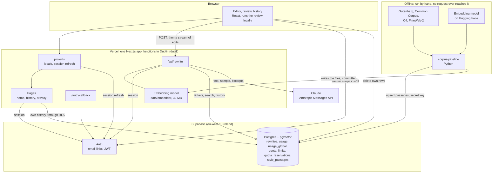
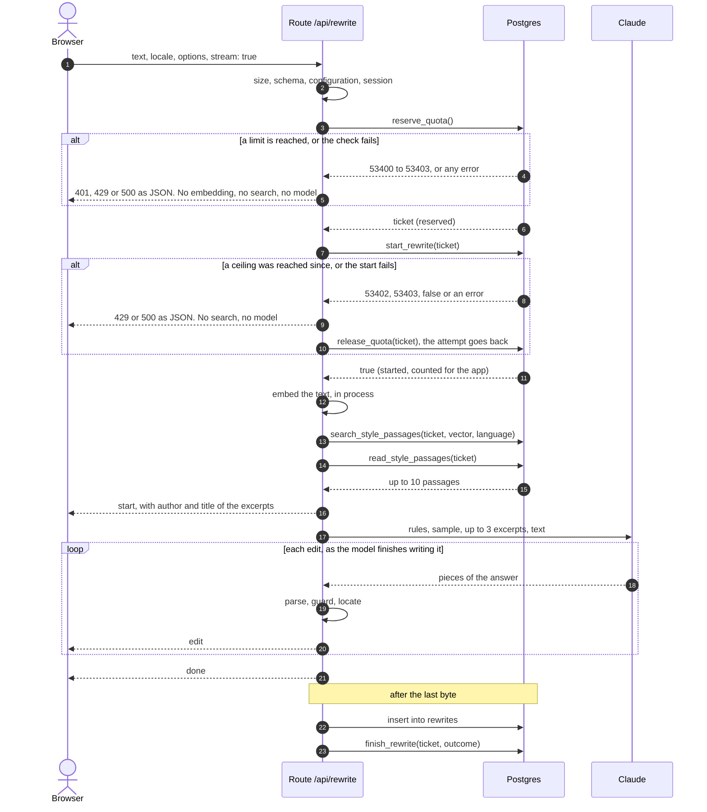
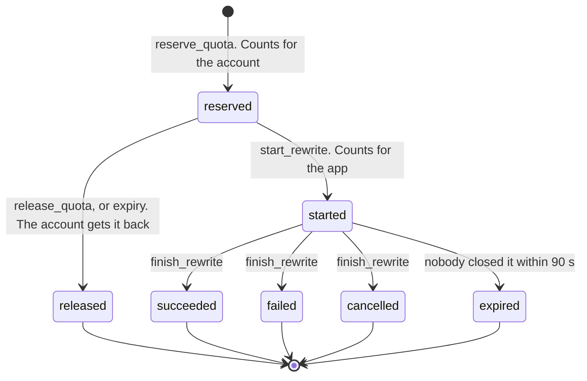

# Architecture

How Rewrity works today, written so you can follow a request without reading every source file.
Figures say how they were obtained. Limits are named where they apply and listed at the end.

## Components

The function region (`frontend/vercel.json`) and the database region were checked on 2 November 2026:
a request to production answered with `x-vercel-id: cdg1::dub1::…` and the Supabase project is in
`eu-west-1`. The route makes several database calls per request, so the two should stay close.

## One rewrite, step by step

The order follows one rule: nothing that costs anything runs before the quota has answered. Starting
the ticket comes before the search because the database only lets a started ticket read the corpus, and
the search takes two calls ([why](#the-quota-policy)). This costs more database round trips than running
quota and search side by side, as the earlier design did, but that also embedded the text and searched
for requests the quota then refused. In the audit, on a local stack with the model answering at once,
the route's own time was a median of 41 ms, of which 37 ms before the model: body, session,
reserve, start and search (`npm run audit`, 3 November 2026). This is not a production figure. The
history and ticket writes at the end still run in parallel.

## The browser

**Pages.** Next.js App Router under `app/[locale]`, in English and French. `proxy.ts` picks the locale
(URL, `NEXT_LOCALE` cookie, then `Accept-Language`) and refreshes the session cookies. All user-facing
text lives in `messages/en.json` and `messages/fr.json`; message keys are type-checked against English
and a test requires the same keys and placeholders in both.

**Sign-in.** An email link only, with no password. `components/auth-panel.tsx` calls
`signInWithOtp` from the browser, which also creates the account on first use. The link lands on
`app/auth/callback/route.ts`, which exchanges the code for a session cookie and only redirects to
same-site paths. The exchange needs a proof kept in a cookie of the browser that asked (PKCE, which
`@supabase/ssr` turns on), so a link opened anywhere else fails, and that attempt uses the link up. The
page says so when it sends the link and when a link fails. Signing out reloads the page, so nothing of
the session stays on the screen or in memory.

**Streaming.** `lib/rewrite/client.ts` posts with `stream: true` and reads one JSON event per line
(`lib/rewrite/protocol.ts`): `start`, `edit`, `done` or `error`. A refusal before the stream starts
comes back as plain JSON with an HTTP error; once the stream has started, the status is already 200
and failures travel as an `error` event. A `done` with `partial` says the model stopped early. A stream
that ends without `done` is reported as a network error.

**Review.** `components/use-rewrite.ts` holds the request state and keeps the edits in reading order as
they arrive, since the model can write a later edit first. Decisions stay in the browser and never go
back to the server: `lib/rewrite/apply.ts` rebuilds the result from the accepted edits, so rejecting or
undoing costs nothing. `components/result-panel.tsx` copies the result with the clipboard API or
downloads it as a text file, in the browser only. Stop appears once the first edit is on screen; it
aborts the request and keeps what has arrived. When the answer stops short, the page says so above the
edits it has. A refusal that follows some edits withdraws them and shows the message, because the
server keeps nothing of that answer. A rewrite reopened from the history travels through
`sessionStorage`, and its offsets are checked against the text before being trusted
(`lib/rewrite/reopen.ts`). It is read during the render and removed only once React has kept that
render, because React can throw a render away and start again. What the reader has typed stays in
memory while they move between pages and languages (`lib/rewrite/draft.ts`), and a reopened rewrite does
not replace it; a reload loses it. Boxes work before the scripts arrive, and what was typed by then is
taken in when they do, as is the text a browser puts back on Back (`components/use-typed-early.ts`).

## The route

`app/api/rewrite/route.ts` is the only entry point that can spend money. In order:

1. **Size and shape.** More than 40,000 characters gets a 413; a body that fails the zod schema
   (`lib/rewrite/schema.ts`) gets a 400. The text is limited to 5,000 characters and the sample to
   1,500.
2. **Configuration.** Without `ANTHROPIC_API_KEY` or the Supabase variables, a 503.
3. **Session.** `supabase.auth.getClaims()`, then a 401 without a user. If the auth server cannot be
   reached the answer is a 500 instead, since that does not mean the reader signed out.
4. **Reservation, start, search, model.** As in the diagram above.
5. **Bookkeeping,** with `after()`, so the reader does not wait for it and the platform keeps the
   function alive until it is done.

`maxDuration` is 60 s. The model call must end within 50 s of the request's arrival, whatever the
session, quota and search took, which leaves time to save what arrived and close the ticket. The SDK's
own `timeout` is not enough for that: it stops once the response headers arrive, so it cannot end a
stream that stalls or runs long.

| Error code              | HTTP     | When                                               | Counted                  |
| ----------------------- | -------- | -------------------------------------------------- | ------------------------ |
| `invalid_request`       | 400, 413 | Bad body                                           | No                       |
| `not_configured`        | 503      | Missing key or Supabase settings                   | No                       |
| `unauthorized`          | 401      | No session, a rejected token, an account deleted   | No                       |
| `too_many_requests`     | 429      | Two attempts already open (53400)                  | No                       |
| `quota_exceeded`        | 429      | The account's daily limit (53401)                  | No                       |
| `global_quota_exceeded` | 429      | The app's daily or monthly ceiling (53402, 53403)  | No                       |
| `server_error`          | 500      | Auth or the quota check is down, the start failed  | No, the model not called |
| `busy`                  | 503      | Rate limit or overload, as a status or in a stream | Yes                      |
| `upstream_error`        | 502      | Any other failure of the call (below)              | Yes                      |
| `refused`               | 422      | The model declined                                 | Yes                      |

`upstream_error` covers a rejected key, another API error, a lost connection, the 50 s deadline, an
answer that is cut off or does not follow the schema, and an answer whose every edit fails a check.
Anything unforeseen after the start answers `server_error` and stays counted.

**The server's access to Supabase.** `lib/supabase/server.ts` builds a client from the publishable key
and the visitor's session cookie, so the route acts as that user: Postgres sees the role
`authenticated` and `auth.uid()` returns their id. There is no secret database key at runtime. The
trade-off is that anything the route can call, the user can call too with their own session, which is
why the quota functions are written to be safe when called directly (see below).

`getClaims()` verifies the token locally only when the project signs its tokens with asymmetric keys;
with the legacy shared secret it calls Supabase Auth on each request. That is a console setting, not
visible from this repository.

## The database

| Table                | Holds                                                                                | Who can reach it                                               |
| -------------------- | ------------------------------------------------------------------------------------ | -------------------------------------------------------------- |
| `rewrites`           | History: user, original text, edits, edit count, language, date                      | Its owner reads, adds and deletes, through RLS. Nobody updates |
| `usage`              | Attempts per account per UTC day. Never purged; goes with the account                | Its owner reads. Only the functions write                      |
| `usage_global`       | Started attempts per UTC day, all accounts. Stays when an account is deleted         | Owner and secret key                                           |
| `quota_limits`       | One row: the limits                                                                  | Owner and secret key                                           |
| `quota_reservations` | One ticket per attempt: user, day, state, timestamps, what its search found          | Owner and secret key; users act on it through the functions    |
| `style_passages`     | The corpus: passage, vector, author, title, language, kind, source, collection, year | Owner and secret key; users read it through a ticket's search  |

"Owner" is the database owner, in the SQL editor. The secret key (`service_role`) reaches the same
tables over HTTP; it stays on the operator's machine and is never in Vercel.

Row-level security is on for every table. Hosted Supabase may grant new tables to `anon` and
`authenticated` by default, so migrations revoke them explicitly. `npm run test:db` asks the catalog what
each browser role can do, a grant to `PUBLIC` or on a single column included, and fails on any privilege
beyond the list it expects: `SELECT`, `INSERT` and `DELETE` on `rewrites`, `SELECT` on `usage`, and
`EXECUTE` on six functions. It also checks that those functions run as their owner with an empty search
path, and that the limits are the ones shipped. The `SELECT` on `usage` dates from the first migration:
nothing on the site reads it, and it only shows a user their own daily count.

### The quota policy

The limits live in one row of `public.quota_limits`:

| Limit                | Value | Why it exists                                                          |
| -------------------- | ----: | ---------------------------------------------------------------------- |
| `user_daily`         |     5 | One account cannot use the whole demo                                  |
| `global_daily`       |    15 | Creating accounts does not create budget                               |
| `global_monthly`     |   300 | Bounds a month of a public demo, and binds before 15 per day does      |
| `max_in_flight`      |     2 | Each attempt holds a function for up to a minute and a paid call       |
| `ticket_ttl_seconds` |    90 | Above the route's 60 s limit, so a live request never loses its ticket |

These are cautious starting values, changed with one `update` in the SQL editor and no deploy. They
count calls, not money: one attempt sends at most the 5,000-character text, the 1,500-character
sample, three excerpts of up to 150 words and a system prompt of about 4,600 characters, and receives
at most 8,000 tokens. The real spending cap is the one set in the Anthropic console. Days and months
are UTC.

**A ticket for each attempt.** Every change of state is a guarded update (`where state = ...`) under
one transaction-level advisory lock, so a ticket moves forward once, however many calls race.

A request refused by `reserve_quota` never gets a ticket: the function raises an error, the
transaction rolls back and nothing changes.

| What happened                                  | Browser receives        | History              | Ticket      | Counted |
| ---------------------------------------------- | ----------------------- | -------------------- | ----------- | ------- |
| Complete answer, with or without edits         | edits, `done`           | Saved                | `succeeded` | Yes     |
| Complete answer, every edit failed a check     | `error`                 | No                   | `failed`    | Yes     |
| Cut off, error or 50 s deadline, after an edit | edits, `done` (partial) | Delivered edits only | `failed`    | Yes     |
| Cut off, error or 50 s deadline, before any    | `error`                 | No                   | `failed`    | Yes     |
| Refusal, even after some edits                 | `error`                 | No                   | `failed`    | Yes     |
| Reader left or pressed Stop, some edits sent   | -                       | Delivered edits only | `cancelled` | Yes     |
| Reader left before any edit, after the start   | -                       | No                   | `cancelled` | Yes     |
| Reader left before the start                   | -                       | No                   | `released`  | No      |
| Function killed before closing the ticket      | -                       | No                   | `expired`   | Yes     |
| Start failed; the model was not called         | JSON error              | No                   | `released`  | No      |
| Function killed before the start               | -                       | No                   | `released`  | No      |

Nothing is refunded once a ticket has started, because the code cannot establish that a call was free.
Some of those attempts probably were: an overload answer, or a reader who left during the search, in
which case the aborted call never reaches the service. Nothing here relies on how Anthropic bills them.
A misconfigured key therefore uses up attempts, which is why the deployment guide runs one real rewrite
first. `refused`, `busy` and `upstream_error` tell the reader that the attempt counted, and
`server_error` before the start means it did not. Two cases cannot say so: the browser's network
message, which does not know, and a failure after some edits, which shows the edits and says the answer
was cut short.

**The reader leaving.** On a streamed answer, the only kind the page asks for, it aborts the model call,
so nobody pays for more of an answer nobody reads. A direct caller of `stream: false` is only heard
leaving before the start: after that the call runs to its end, and the attempt counts either way. The
server hears of it through the request's signal or through the response stream being cancelled, and
listens to both (`lib/rewrite/stream-response.ts`). Vercel only fires the signal for routes that opt in,
so `frontend/vercel.json` sets `supportsCancellation`. Vercel then ends the function, except for work
handed to `after()`, so the route holds the function open with `after()` as soon as a ticket exists,
until the ticket's own bookkeeping is handed over. This was tested on `next start` and with
the real SDK over a local socket, and a local `vercel build` shows the setting in the function's
configuration, but it has not run on a Vercel deployment, so
[the deployment guide](DEPLOY.md#after-a-deployment) includes the check.

**The functions.** All are `security definer` with an empty `search_path`, and read the user from
`auth.uid()`, never from an argument. Each is granted to `authenticated` and revoked from `anon`.

| Function                                              | What it does                                                                                          |
| ----------------------------------------------------- | ----------------------------------------------------------------------------------------------------- |
| `reserve_quota()`                                     | Closes expired tickets, checks the four limits, counts the attempt for the account, returns a ticket  |
| `start_rewrite(reservation)`                          | Moves a live reserved ticket to started and counts it for the app. Re-checks the ceilings, atomically |
| `finish_rewrite(reservation, outcome)`                | Closes a started ticket, once, and frees its slot                                                     |
| `release_quota(reservation)`                          | Gives back a ticket that never started, once                                                          |
| `search_style_passages(reservation, vector, lang, n)` | Records up to 10 passages on the ticket and returns nothing, once per started ticket                  |
| `read_style_passages(reservation)`                    | Returns what the ticket's search recorded, while the ticket is open                                   |

**Why calling them directly gains nothing.** The session cookie is readable by the page, so any user
can call these functions without going through the route. The limits are read in the database. A
ticket answers only to its owner, and ids are random. A direct `reserve_quota` spends the caller's
own attempt; a `release_quota` only ever returns what the same user reserved without using. Reading
the corpus needs a started ticket, which counts everywhere and is never refunded, so it costs one
attempt per ten passages.

**Why the search takes two calls.** The API runs a function and its outer query in one transaction, and
a caller can make that outer query fail: `select=body::int` raises an error that quotes the value, and
the error undoes whatever the function recorded. With one call that both used up the ticket's search and
returned the rows, one attempt could have read the whole corpus through the error messages. So the search
only records which passages it found and returns nothing, and a later call reads those. Abusing either one
gives at most the ticket's ten passages. A search that fails gives nothing and can be repeated, which only
costs the database some time.

Holding reservations does not block others: the app-wide ceilings count started tickets only. Starting
them does take places under the shared ceilings, with or without a model call (see
[known limits](#known-limits)).

**Failure.** If the database cannot be reached, or the limits row is missing, `reserve_quota` gives no
ticket and the model is not called. If closing a ticket fails, the next accepted reservation closes it
once it is over 90 seconds old; the attempt stays counted. A refused call rolls that closing back, so on
a quiet app, or once a ceiling refuses everyone, a stale ticket stays until the next accepted attempt.
The counts stay right, because each call does that work again first. An accepted reservation also
deletes the 200 oldest tickets past two days, after its checks: more than it adds, so the table cannot
grow for long, and never so many that a backlog holds up everyone waiting on the lock. No scheduled job
does it, which would be new infrastructure for a small table.

**The choice of one lock.** A single advisory lock serialises reservations for the whole app, which is
the simplest way to make "check, then count" atomic across three counters. The calls take milliseconds
and this app allows 15 started attempts a day. At a much larger volume, conditional updates on counter
rows would avoid the queue. This relies on one function per request, which is what the REST API does.
The `pg_graphql` extension runs a whole document in one transaction, so one long document could hold the
lock for seconds. It is off on the hosted project (read-only check, 3 November 2026), and it has to stay off.

**No limit per IP address.** Nothing here reads a client address. An account is needed before anything
is spent, and the ceilings hold however many addresses there are. Supabase Auth limits sign-ups per
address, and Vercel offers firewall rules; both are console settings.

## Vector search

Each passage has a 256-dimension vector in `style_passages.embedding`, compared by cosine distance
through an HNSW index (`extensions.vector_cosine_ops`). pgvector was preferred to a separate vector
service because the data, the access rules and the search then live in one database, with nothing else
to run or pay for. HNSW is approximate: it can miss the exact nearest passage, which matters little
here. Because the language filter applies after the index, the function sets
`hnsw.iterative_scan = strict_order` so a search keeps walking the index until it has enough rows
(available from pgvector 0.8; the hosted project ran 0.8.2 on 2 November 2026).

`lib/style/retrieve.ts` chooses what reaches the prompt:

1. Embeds the text, and takes its language from a word count (`lib/style/language.ts`), falling back
   on the interface language.
2. Asks for 10 candidates in that language.
3. Drops those under a similarity of 0.2, keeps one per author, and stops at 3.

A search that fails, or takes more than 5 seconds, is logged and the rewrite goes on without excerpts,
so a stalled search cannot eat the model's time. Setting `STYLE_REFERENCES=off` switches them off.

The search matches meaning, not style, and it always returns something. Top and tenth similarity on
the hosted corpus, measured on 2 November 2026 with one input of each kind:

| Input                      |  Best | Tenth |
| -------------------------- | ----: | ----: |
| Plain English prose        | 0.512 | 0.457 |
| Plain French prose         | 0.474 | 0.406 |
| Generated-sounding English | 0.414 | 0.316 |
| Corporate jargon           | 0.399 | 0.359 |
| Code                       | 0.316 | 0.221 |
| Random letters             | 0.331 | 0.254 |

All of them clear the 0.2 floor, so the floor does not separate related from unrelated text, and
meaningless input still gets excerpts. Whether the excerpts improve the edits has not been measured.

## The embedding model

`sentence-transformers/static-similarity-mrl-multilingual-v1` (Apache-2.0) is a static model: a table
with one vector per token, with no neural network to run. To embed a text, `lib/style/embedder.ts`
tokenises it, averages the rows of its tokens and normalises the result.

| File (`frontend/data/embedder/`) | Content                                                       | Size    |
| -------------------------------- | ------------------------------------------------------------- | ------- |
| `weights.i8`                     | 105,879 tokens x 256 dimensions, as int8                      | 27.1 MB |
| `scales.f32`                     | One scale per token, to undo the quantisation                 | 0.4 MB  |
| `tokenizer.json`                 | The tokenizer, read by `@huggingface/tokenizers`              | 2.6 MB  |
| `meta.json`                      | Dimension, vocabulary size and the SHA-256 of the three files | 390 B   |

`corpus-pipeline/scripts/export_embedder.py` keeps the first 256 of the model's 1,024 dimensions and
writes these files. They are committed, read at the first rewrite of each server instance and verified
against their checksums, because a wrong table would return plausible but meaningless matches. Only the
route's function carries them: the file tracer finds them, and `next.config.ts` lists them in
`outputFileTracingIncludes` as well, because without them rewrites would go on with no excerpts and only
a log line would say so. `frontend/tests/embedder.test.ts` compares the TypeScript vectors with a committed
fixture of what the Python code produces, which holds them in one space for as long as the fixture is
current: after any change to the maths in `embed.py`, regenerate it by hand
(`corpus-pipeline/scripts/export_parity_fixture.py`). No check does that for you.

The trade-off: no request to an embedding service, so no bill, no network hop and one less point of
failure. In exchange, about 30 MB of assets in the repository and in the route's bundle, a model to
maintain by hand, and a pause in the first rewrite of each instance. On a laptop, loading took about
200 ms and embedding a 5,000-character text about 1 ms (one informal measurement, November 2026). It
matches loosely, as the table above shows, which is acceptable for excerpts meant to guide rhythm rather
than subject.

## Claude

`lib/rewrite/claude.ts` is the only file that talks to the model. The default model is
`claude-sonnet-5-5` (override with `ANTHROPIC_MODEL`), with `max_tokens` 8,000, effort `medium`, a 50 s
deadline over the whole call and no retries: a retry could not finish within the route's limit and would
be another paid call. The SDK's own logger is off, because it prints the raw chunk of a corrupt event,
which can quote the user's text.

**The prompt** (`lib/rewrite/prompt.ts`). The system prompt holds the editing method and the tells to
look for. The user message holds, in order: the intensity if not standard, the author's sample, the
excerpts, and the text. The last three sit in tags that the system prompt declares to be data, never
instructions, and a closing tag inside the data is neutralised; the intensity comes from a fixed list.
That lowers the risk of prompt injection without removing it, which is why every edit is then checked
and reviewed.

**Structured output.** The request carries a JSON schema (`{ edits: [{ original, replacement, reason }] }`,
`lib/rewrite/schema.ts`). Only the schema is passed, not the SDK helper's parse step: with it, the SDK
itself throws at the end of a refusal or a cut-off answer, before the code can read why the model
stopped.

**Reading the stream.** `lib/rewrite/edit-stream.ts` tracks braces and strings as characters arrive, and
hands over each edit at its closing brace, so the first edit can be on screen while the fifth is being
written. A piece that does not parse is skipped. When the answer ends, the whole of it must follow the
schema and must not have hit the token limit; otherwise the call fails, and the edits already handed
over are kept as an answer cut short. So `{"edits":[]}` means "nothing to change" while `{}` is an
error. An answer whose every edit fails the checks below is an error too, unless each one merely
changed nothing.

The non-streaming path (`stream: false`) is the same call read at once. The page never uses it; the
audit does.

## Checks on the model's output

Every edit goes through `lib/rewrite/guard.ts` and `lib/rewrite/locate.ts` (with `lib/rewrite/numbers.ts`, which reads the figures for both) before reaching the reader,
one at a time when streaming (`lib/rewrite/collect.ts`).

| Check             | An edit is dropped when                                                                                        |
| ----------------- | -------------------------------------------------------------------------------------------------------------- |
| `unchanged`       | Replacement equals the quote, ignoring case, spacing and typography                                            |
| `span_too_long`   | The quote exceeds 600 characters                                                                               |
| `too_long`        | The replacement exceeds both 200 characters and three times the quote                                          |
| `markup`          | The replacement holds an HTML tag, a Markdown link, or starts with a heading                                   |
| `numbers_changed` | The written numbers differ (below)                                                                             |
| `too_many`        | 40 edits were already kept                                                                                     |
| `not_found`       | The quote is absent, cuts a word or a figure, would change a figure next to it, or another edit took its place |

**Numbers.** The guard compares each number as written, in any order: 3.5 and 35, -5 and 5, 12/03 and
03/12, 12% and 12, .5 and 5 all differ. Thousands separators are ignored when they are unambiguous (1 200
with any kind of space, 1,234,567). A last comma or period that differs from the marks before it is the
decimal mark, so 1,234.567 is not 1,234,567. A lone comma or period before three digits only equals
itself, since "1,200" reads 1200 in English and 1.2 in French. A hyphen or dash after a digit, a letter,
a closing bracket or a unit that follows a digit separates, so a range can be reworded ("2019-2021" to
"2019 to 2021", "5%-10%" to "5% to 10%"); anywhere else it is a minus sign, also ahead of a currency
symbol (-$5, -₹5).

Since each number is compared as written, an edit that re-punctuates a figure is dropped even when a
person reads the same figure: "5-10%" to "5% and 10%", "2019/2020" to "2019-2020", "10h30" to "10:30",
"12 percent" to "12%". That fails safe, at the cost of a suggestion, or of an attempt when it was the
only edit. So does reading "May 15 300 people" as one number.

That comparison only sees the quote. So locating refuses a quote that stops inside a figure and leaves its
digits out ("fell by -" before "5%", "cost 1," before "200", "%" after "12"), and then compares the figures
of the whole text with and without the edit. That covers what the first rule leaves: "of -" before "$5",
"% en" after "12 ", a minus brought by the replacement, a deleted word that joins "5 or 300" into one number.

**What this cannot see.** The checks are deterministic and look at figures, not meaning. A dropped
"not", "rose" becoming "fell", "some" becoming "all", "million" becoming "billion", a changed unit or
currency, a number written in words, figures that are not plain digits (½, 10², XIXe, fullwidth digits),
a sign written in words or brackets, a minus ahead of a currency in letters (-CHF 5), a minus set apart
by a space (- 5 %), a sign that is not a minus (±5, <5%, T-5), figures that trade places, a range reversed
without a percent sign, a reordered ISO date and two edits that change a figure only together all pass.
`frontend/tests/guard.test.ts` lists most of them on purpose. Equal numbers do not mean equal meaning,
and the prompt's instruction to keep facts is a request, not a check. This is why each edit is shown
with its reason and takes effect only when accepted.

**Locating.** The model never gives offsets; the server finds each quote. Exact match first, then a
match that ignores curly quotes, no-break spaces, no-break hyphens and runs of whitespace, mapping the
position back to the real text. Other differences (an ellipsis typed as three dots, a dash typed as a
hyphen) drop the edit rather than guess. A match must be whole words, so "key" never lands inside
"monkey"; a quote found only inside a longer word is dropped, and an accent stored as a separate
character counts as part of its letter. The page also sends the text in one Unicode form (NFC), so the
model's quote and the offsets refer to the same characters. Overlapping edits are dropped. A quote that
occurs several times takes the first free occurrence, so an edit meant for the second one can land on
the first. Two rules protect the spacing of the accepted text. A deleted quote comes down to the whitespace
of one side, the one with more line breaks, so paragraphs stay apart and no double space stays behind. A
line it had to itself goes with it, and the next line keeps its indent. Next to a closing mark after it or
an opening mark before it, a dash or a bold marker included, the space goes; a hyphen or a slash does not
count. Before a French mark, the space in front of the mark is the one that stays, so a no-break space
survives. Spaces written in place of a quote count as a deletion, unless nothing else keeps two words
apart ("—" to " " in "works—and", or in "12%—a"). An outer space or line break that a quote has and its
replacement lost stays in the text, so what it separated does not join, unless the replacement decides
the spacing itself ("de " to "d'") or no space belongs there ("yes ,"). When another edit holds the space
to take, the other side's goes instead, and accepting several neighbouring deletions can still leave a
stray space, or join two words when one of them is a tight dash with nothing in its place.

**Identifiers.** When streaming, ids follow arrival order and never change, so a decision made while
the model writes stays attached to the right edit. The list is kept in position order for display.

## History and bookkeeping

Once the answer is out, the route writes the history row and closes the ticket, side by side, under
the user's session (`settle` in `route.ts`). The writing sample is never part of that row: it goes to
Anthropic in the prompt and nowhere else. A failed history write is logged and does not affect the
answer or the ticket.

The history page reads through RLS on the server, lists the 50 newest rows and shows the total. A read
that fails says so, rather than looking like an empty history. Its search covers the listed rows only,
and it says so when older ones exist. Deleting goes straight from the browser to Supabase, also through
RLS. "Delete all" removes every row of the account, listed or not, and its question says so on a line of
its own, where a double click cannot reach the answer. Each delete asks the server for the list again, so
older rows move up and the browser's copy of the page cannot bring a deleted row back. Dates are printed
in one fixed zone (Paris), which is shown, so the server and the browser agree on them.

On the request path, logs hold error codes, HTTP statuses, class names and counts of dropped edits. They
never print an error's message, because a message can quote the text it failed on (a JSON parse error
does). One place does print a message: the page's error boundary, which writes to the reader's own
console.

## The corpus pipeline

`corpus-pipeline/` is a Python project run by hand, once in a while. It samples passages from four
sources, cleans them, embeds them with the same files the app uses and upserts them into Postgres with
a secret key that stays on the operator's machine. Sources, periods, cleaning, stored metadata and
limits are in [STYLE_CORPUS.md](STYLE_CORPUS.md). The Python package keeps its historical name, `aiwd`.

## Tests and CI

| Layer              | Where                             | Real                                                                               | Replaced                                                 |
| ------------------ | --------------------------------- | ---------------------------------------------------------------------------------- | -------------------------------------------------------- |
| Unit and component | `frontend/tests`, Vitest          | Guard, locate, parser, prompt, components, the Anthropic SDK over a local socket   | Supabase, Anthropic's service                            |
| Browser            | `frontend/e2e`, Playwright        | Production build, pages, client code. Fails on a console error or a broken request | `/api/rewrite`, mocked in the browser                    |
| Database           | `supabase/tests`, `node:test`     | Migrations, functions, RLS, grants, Auth, the HTTP API, real races                 | Nothing, but the stack is local and no route is involved |
| Site audit         | `frontend/audit`, `npm run audit` | Production build, route, database, Auth, mailbox. Fails on a browser error too     | The model, by `audit/mock-anthropic.mjs`                 |
| Corpus             | `corpus-pipeline/tests`, pytest   | Cleaning, filters, embedder, ingest rows                                           | Network and datasets                                     |

**The stand-in model.** `audit/mock-anthropic.mjs` answers on the Messages API's own paths, in JSON and
as a server-sent event stream, and the audit points the SDK at it with `ANTHROPIC_BASE_URL`. Words in
the text steer it: `SLOW`, `FAILAPI`, `REFUSE`, `TRUNCATE`, `TOOLONG`, `CUTOFF`, `MISSING`, `ALLBAD`,
`REVERSE` and `12%`.
The audit then checks each ticket's final state, the counters and the history against the database.

The audit found what stand-in clients could not. The SDK's parse step made every streamed refusal
surface as a server error; the unit tests had passed, because their fake client never parsed anything.
`tests/claude.test.ts` now also runs the real SDK over canned HTTP answers, and
`tests/stream-flow.test.ts` runs the real stream handler and SDK against a local server, which is how a
stream's deadline, a dying connection and a reader leaving get tested.

GitHub Actions has one workflow per area (`frontend.yml`, `database.yml`, `corpus-pipeline.yml`),
triggered by the paths they cover. No workflow calls the real model and none needs a secret. The site
audit is not in CI: it is slow and its timing checks depend on the machine. Nothing tests the quality
of the edits, which would need real model calls, a protocol and a budget of its own.

## Tools and why they are here

| Tool                               | What it does here                             | Why                                                                    | Simplest alternative left aside                             | Trade-off accepted                                                  |
| ---------------------------------- | --------------------------------------------- | ---------------------------------------------------------------------- | ----------------------------------------------------------- | ------------------------------------------------------------------- |
| Next.js on Vercel                  | Pages and the API route in one deployable app | No server to run; streaming route handlers; pages and route share code | A separate API server                                       | Function time limits, cold starts, tied to one platform's model     |
| next-intl                          | Locale routes and messages                    | Two languages from the start, with typed keys                          | One language, or hand-written lookups                       | Every text goes through a message file                              |
| Tailwind CSS                       | Styling, with colours as CSS variables        | Utility classes, no style sheet to name and keep in step               | Plain CSS                                                   | Long class lists in the markup                                      |
| Supabase Auth                      | Email-link sign-in, sessions                  | Comes with the database, and RLS reads its users                       | Writing auth by hand                                        | Sign-up is open, with email limits set in a console                 |
| `@supabase/ssr`                    | Keeps the session in cookies                  | Pages, proxy and route read the same session on the server             | Sending the token by hand with each request                 | The cookie is readable by the page's scripts                        |
| Postgres with RLS                  | History, counters, tickets, access rules      | Rules sit next to the data and also hold for direct API calls          | Checks in the route only                                    | Logic spread over SQL migrations, tested separately                 |
| Tickets and an advisory lock       | Limits, ceilings, unstarted attempts returned | Atomic, holds across instances, needs no other service                 | A counter in memory (does not work on serverless), or Redis | One lock, enough at this volume                                     |
| pgvector (HNSW)                    | Nearest passages                              | No second service; rules and data in one place                         | A hosted vector database                                    | Approximate results, and the corpus counts against database storage |
| Static embedding model, in process | Text to vector, per request                   | No per-request API call, bill or network hop                           | A hosted embedding API                                      | 30 MB of assets, manual upkeep, cold-start cost, loose matching     |
| `@huggingface/tokenizers`          | Cuts the text into the model's tokens         | The same tokens as the Python side, with no native module              | Writing a tokenizer by hand                                 | A dependency, and a 2.6 MB tokenizer file                           |
| Claude (Anthropic SDK)             | Writes the edits                              | Hosted, structured output, streaming                                   | Self-hosting a model                                        | A paid external dependency that sees the text                       |
| zod                                | Validates requests, and edits from the stream | One schema for the type, the check and the JSON sent to the model      | Hand-written checks                                         | A dependency                                                        |
| Vitest, Testing Library            | Unit and component tests                      | Fast, and works with the TypeScript setup                              | `node:test`                                                 | jsdom is not a real browser, which is why Playwright runs too       |
| Playwright, axe                    | Browser tests and accessibility in the audit  | A real browser; the same tool for e2e and audit                        | Unit tests only                                             | Slower, needs Chromium                                              |
| `node:test`                        | Database tests over HTTP                      | No dependency, and it uses the same API an attacker would              | pgTAP, which cannot race two connections                    | Needs a running local stack                                         |
| Python, uv, Ruff, pytest           | The offline corpus pipeline                   | Data tooling (pandas, pyarrow, Hugging Face), locked and reproducible  | Writing it in TypeScript                                    | A second language to maintain                                       |
| GitHub Actions                     | CI                                            | Lives with the repository                                              | Running checks by hand                                      | Only the checks listed above                                        |

## Known limits

- **Edit quality is not measured**, nor the effect of the style excerpts.
- **The output checks do not see meaning** (see above).
- **The ceilings protect the budget, not availability.** With 5 attempts per account and 15 per day,
  three accounts can use up a day for everyone, through the app or by calling the functions directly,
  which needs no model call. Done every day, that also uses up the month's ceiling in about 20 days.
  The code creates an account on first use; whether sign-ups are open is a console setting, like raising
  the numbers. A captcha would also need a change here: the form sends no captcha token, so turning it on
  in the console stops every sign-in.
- **Attempts count even when the failure is on the provider's side**, and a wrong key or model name
  uses up the day's allowance quickly.
- **Cancelling is not verified on Vercel.** Stop and closing a tab were tested locally; on a deployment,
  they rely on the `supportsCancellation` setting doing what Vercel documents.
- **Stop comes with the first edit.** Before that, only leaving the page ends the wait, and the attempt
  stays counted.
- **A signed-in user can add rows directly**, without spending an attempt: any number of rows in their
  own history, and a small ticket row for each reserve and release pair, kept about two days. It cannot
  affect anyone else's data or spend money, but it could fill the database. The fix for the history
  would be to write it inside `finish_rewrite` and revoke `INSERT`.
- **Corpus excerpts leave the database** for Anthropic, and any user can read ten of them per attempt.
- **A sign-in link works once, in the browser that asked for it.** Asking on a laptop and opening the
  link on a phone fails, and the page can only say so afterwards. A link based on `token_hash` would
  lift this; it needs a change to the email template in the console and to the callback.
- **Leaving the review is final for its decisions.** "Edit the text" goes back to the original text. The
  edits come back through History > Reopen, every decision pending again. A reload loses unsent text. A
  reopened rewrite does not replace the typed draft: coming back to the editor after leaving it shows that
  draft. So does switching language while it is on screen, or the editor is empty if no draft waits: the
  rewrite stays in the history. A Reopen abandoned on the way can still open that rewrite for 60 seconds,
  unasked.
- **The browser's copy of a page can be stale.** Coming back to the history with Back can leave out a
  rewrite saved since, or show a failed read after the service has recovered, until a reload.
- **During an Auth outage, pages wait and then ask to sign in.** With a token due for refresh, the proxy
  and the page each wait out the client's retries (about 25 s each here), and the page then looks signed
  out. The route answers `server_error` instead, and the session is fine once Auth returns. Sign out waits
  for Auth with no time limit, so while Auth stalls the button seems to do nothing.
- **A session can be refreshed after the answer has gone.** When a token enters its last 90 seconds during
  a rewrite, the route's bookkeeping refreshes it, and the new cookies cannot reach the browser. The
  browser's next page presents the used refresh token, and Auth hands over the one that replaced it, so
  the reader stays signed in. The audit checks this on the local stack (Auth v2.195.0); it relies on Auth
  keeping that behaviour.
- **An account deleted by the owner looks signed in until its token expires** (an hour at most), when the
  project signs tokens with asymmetric keys: the chip stays above "Sign in to rewrite your text".
- **A full load with a Reopen on its way logs a hydration error.** Reloading in the instant after Reopen,
  or a navigation that falls back to a full load, logs React's error #418 once and rebuilds the page on the
  client. The review shows and works.
- **The sign-in button does nothing useful before the scripts arrive.** The browser submits the form
  itself, the page reloads and the address is gone. On a fast line there is no time to do this.
- **The language guess can be wrong on one short sentence.** It counts function words, so names and titles
  can tip a sentence of about ten words: "Le Monde, Le Figaro and Les Echos all ran it on Monday." reads
  as French, and a short French sentence can read as undecided, which falls back on the interface
  language. It only chooses which excerpts are searched, and a longer text settles it.
- **Accessibility has gaps axe cannot see.** Focus falls to the page after "Edit the text", after a
  delete and after Cancel in the Delete all question, Escape in the appearance panel does not return focus, the radio groups ignore arrow keys, and
  forced-colours mode hides the selected mode, language and accent.
- **Sessions and accounts.** There is no self-service account deletion, and the history page only lists
  and searches the newest 50 rows.
- **The sign-in email has one language.** It comes from one project-wide Supabase template, set in the
  console, so a French reader gets whatever language that template is written in.
