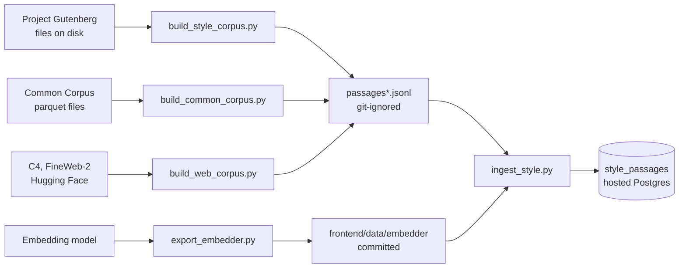

# Style corpus and vector search

The app shows Claude up to three excerpts of published prose as a guide to rhythm and concreteness.
Claude does not learn from them: they are looked up per request and placed in the prompt. The prompt
tells it not to copy them. How they are searched is in [ARCHITECTURE.md](ARCHITECTURE.md#vector-search).



## What is in it

Figures read from the hosted database on 2 November 2026. Total 45,527 passages of 45 to 150 words
(median 118), 150 MB for the table in a 161 MB database.

| Source                 | Language, kind | Passages | Period in the data       | Sites or authors |
| ---------------------- | -------------- | -------: | ------------------------ | ---------------- |
| Project Gutenberg      | en, fiction    |    1,160 | No year stored           | 46 authors (en)  |
|                        | en, essay      |    1,360 | No year stored           |                  |
|                        | fr, fiction    |    1,680 | No year stored           | 37 authors (fr)  |
|                        | fr, essay      |      720 | No year stored           |                  |
| Common Corpus (Pleias) | en, book       |    9,000 | 1531 to 1943             |                  |
|                        | en, news       |    7,000 | 1796 to 1950             |                  |
|                        | fr, book       |    5,301 | 1574 to 1950             |                  |
|                        | fr, news       |    3,306 | 1738 to 1950             |                  |
| C4 `realnewslike`      | en, news       |    9,000 | Crawled in 2019          | 40 sites         |
| FineWeb-2              | fr, news       |    7,000 | Crawls from 2013 to 2022 | 50 sites         |

To check them again, in the SQL editor:

```sql
select source, lang, kind, count(*), min(year), max(year)
from public.style_passages group by 1, 2, 3 order by 1, 2, 3;
```

**Each row stores** the passage (`body`), its vector (`embedding`, 256 dimensions), `author`, `title`,
`lang`, `kind`, `n_words`, `source`, and where they apply `gutenberg_id`, `collection` (a Common Corpus
collection or a web domain) and `year`. For web rows, `author` and `title` hold the domain. The app
sends the browser author and title only, and the page shows authors. Browsers cannot read the table or
call the search: the server reads ten candidates for one started attempt and places at most three in the
prompt.

## How passages are chosen

**Gutenberg.** 123 hand-picked books (`aiwd/style/books.py`). The official catalog supplies metadata,
and the build stops if an author died after 1955. The script reads files already on disk, because
Gutenberg forbids automated downloads from its website; `aiwd/style/gutenberg.py` says how to get them.
It removes the Project Gutenberg header and footer, cuts paragraphs at sentence boundaries, keeps prose
of 45 to 150 words, takes up to 40 seeded passages per book, and drops exact duplicates. These passages
do **not** go through the noise filter below: the books are clean enough, and they are what the filter's
vocabulary is built from.

**Common Corpus.** Documents marked Open Culture and Public Domain, in English or French, dated 1950 or
earlier, from listed collections, of at least 500 words (`aiwd/style/commoncorpus.py`). This text is OCR
output, so it goes through the filter below. Caps per language and kind are in the script.

**C4 and FineWeb-2.** Only pages from the reviewed list of press, magazine and public-broadcaster sites
in `aiwd/style/web.py`. No site may exceed 12 % of its language. Menus and "read also" lines are
removed. Crawls stop at 2022 for FineWeb-2, using the year in the crawl's name; for C4 the code relies on
its being a 2019 crawl. The reasoning: from late 2022 a growing share of web text is written by language
models. A crawl date is only an upper bound on when a page was written.

**The noise filter** (Common Corpus and web): repairs mojibake, rejoins hyphenated line breaks, rejects
OCR noise, lists and tables, and passages with too many words outside a vocabulary built from the
Gutenberg books (`aiwd/style/quality.py`). Duplicates are removed by comparing the start of each
normalised passage, so syndicated copies that differ later can remain.

## Rebuild from scratch

From `corpus-pipeline/`. Generated files stay in `data/style/`, which git ignores.

```bash
uv sync --group dev --locked

# 1. Gutenberg: the catalog, and the 123 books fetched through a route Gutenberg allows
#    (robot access or a mirror), saved as data/style/raw/<id>.txt
mkdir -p data/style/raw
curl -o data/style/pg_catalog.csv https://www.gutenberg.org/cache/epub/feeds/pg_catalog.csv
uv run python scripts/build_style_corpus.py    # -> data/style/passages.jsonl
uv run python scripts/build_vocab.py           # -> data/style/vocab_en.txt, vocab_fr.txt

# 2. Common Corpus: download parquet files first (about 430 MB each), see the script's docstring
uv run python scripts/build_common_corpus.py   # -> data/style/passages_cc.jsonl

# 3. Recent journalism, read from Hugging Face
uv run python scripts/build_web_corpus.py      # -> data/style/passages_web.jsonl

# 4. The embedding model: only to change it (the files are committed, about 30 MB)
uv run python scripts/export_embedder.py       # -> frontend/data/embedder
uv run python scripts/export_parity_fixture.py # -> frontend/tests/fixtures/embedder-parity.json

# 5. Embed and load
export SUPABASE_URL=https://<project-ref>.supabase.co
export SUPABASE_SECRET_KEY=...                 # Settings > API Keys. Never commit it.
uv run python scripts/ingest_style.py --dry-run
uv run python scripts/ingest_style.py
```

If a script stops with `No module named 'aiwd'` on macOS: a synced folder (a Desktop kept in iCloud Drive,
for example) can mark the files in `.venv` as hidden, and Python then skips the file that points at
`src`. Prefix the command with `PYTHONPATH=src`, or keep the repository outside the synced folder. The
tests are not affected, because the pytest configuration adds `src` itself.

## Provenance

What can be identified today, and what cannot. The revisions were read from the Hugging Face API on
4 November 2026.

| Source            | Repository or site                                            | Revision                                                  | What the code reads                                                                                   |
| ----------------- | ------------------------------------------------------------- | --------------------------------------------------------- | ----------------------------------------------------------------------------------------------------- |
| Project Gutenberg | gutenberg.org or a mirror                                     | None: the files are not versioned here                    | The 123 ids in `aiwd/style/books.py`, already on disk, and the catalog CSV                            |
| Common Corpus     | `PleIAs/common_corpus`                                        | Head `307910e4c5d0`, last changed on 6 May 2026           | Whichever parquet files are in the local cache                                                        |
| C4                | `allenai/c4`                                                  | Head `1588ec454efa`, last changed on 9 January 2024       | `realnewslike/c4-train.00000` to `00002` of 512, the first 200,000 rows by default                    |
| FineWeb-2         | `HuggingFaceFW/fineweb-2`                                     | Head `af9c13333eb9`, last changed on 27 October 2025      | By default 36 files spread over a live listing of `data/fra_Latn/train`, 12 row groups each           |
| Embedding model   | `sentence-transformers/static-similarity-mrl-multilingual-v1` | **Pinned:** `b68f4122911b`, last changed on 1 August 2026 | `0_StaticEmbedding`, checked against the committed files as `frontend/data/embedder/NOTICE` describes |

**Those dataset heads are likely, not recorded.** The pipeline's first commit is dated 29 October 2026, and
all three heads are older, so a build from that code would have read them. Nothing records that the hosted
rows came from such a build, with the default arguments, or which Common Corpus files were in the cache,
and no Gutenberg download date or mirror is kept.

Sampling is seeded, but a rebuild may therefore not give the same rows: only the model's revision is pinned
in the code, and the FineWeb-2 file list comes from a live listing. The hosted corpus cannot be regenerated
exactly from this repository. Each row keeps its `source`, `collection` (a Common Corpus collection or a
web domain) and, where known, its `gutenberg_id` and `year`, which is what a review of the rights can go by.

## Changing the corpus

Loading only adds or updates rows by id. To remove a site or a source, delete its rows yourself:

```sql
delete from public.style_passages where source = 'web' and collection = 'example.com';
```

If you change the model, the dimension or the maths in `embed.py`, re-embed every passage and regenerate the parity fixture, and
change the vector size in a migration.

**To switch the excerpts off without touching the data,** set `STYLE_REFERENCES=off` and deploy
([DEPLOY.md](DEPLOY.md#what-is-set-where)): no search, no excerpt in the prompt, no sources note on the home
page, and the privacy page says so. **The public deployment should run this way until the sources have
been reviewed.** The hosted rows are then neither read nor sent anywhere, and they stay in place: removing
them is an intervention of its own.

To show the vector index without any corpus, `supabase/examples/vector_search_explain.sql` works on
synthetic vectors in a transaction that it rolls back
([output and how to run it](ARCHITECTURE.md#the-index-at-work)).

## Limits

- **Nobody has measured whether the excerpts make edits better.** A blind comparison with and without
  them is [written down](research/style-references-comparison.md) and has not been run, because it costs
  real model calls.
- **Not proven human.** The date cut-off and the site list lower the risk of machine-written excerpts in
  the web sources; they do not remove it. English news comes from a single crawl.
- **The search is loose.** It returns the nearest passages however far they are, even for random letters
  ([measurements](ARCHITECTURE.md#vector-search)). Similar topic, not similar style.
- **Old and odd text remains.** OCR errors survive in older sources, and the system prompt asks the model
  to ignore them.
- **Measurements from earlier versions are gone.** Earlier documents quoted filter retention rates and
  neighbour statistics that no script here reproduces, and those statistics described a smaller corpus.

## Licences and credits

Licence fields were read from the Hugging Face and GitHub APIs on 2 November 2026, and those of the datasets
again on 4 November. None of this is legal advice, and the owner should review it before relying on it for
a public service. [THIRD_PARTY_NOTICES.md](../THIRD_PARTY_NOTICES.md) collects the notices the repository
itself has to carry.

| Item                                                                                                                        | Terms                                                       | What to keep in mind                                                                                                                                                     |
| --------------------------------------------------------------------------------------------------------------------------- | ----------------------------------------------------------- | ------------------------------------------------------------------------------------------------------------------------------------------------------------------------ |
| [Project Gutenberg](https://www.gutenberg.org)                                                                              | Public-domain texts; authors checked to have died by 1955   | Depends on the reader's country. Gutenberg's own trademark terms apply to its name and boilerplate, which is stripped                                                    |
| [Common Corpus](https://huggingface.co/datasets/PleIAs/common_corpus)                                                       | Per-document field; only "Public Domain" documents are kept | The dataset declares no overall licence in its metadata. The field is the dataset's own statement                                                                        |
| [C4](https://huggingface.co/datasets/allenai/c4) and [FineWeb-2](https://huggingface.co/datasets/HuggingFaceFW/fineweb-2)   | Datasets under ODC-By                                       | **That licence covers the datasets, not the articles.** Those remain copyrighted by their publishers, are stored in the database, and are sent to Anthropic in prompts   |
| [static-similarity-mrl-multilingual-v1](https://huggingface.co/sentence-transformers/static-similarity-mrl-multilingual-v1) | Apache-2.0                                                  | `frontend/data/embedder` is a modified copy, with the licence text in `LICENSE` and the changes (256 dimensions, quantised to int8) and revision in `NOTICE`, next to it |

16,000 passages come from the web sources. For a public service, the owner should decide whether to keep
them, with the excerpts off in the meantime. Removing them from the hosted database is one
`delete ... where source = 'web'`, and a decision of its own.
